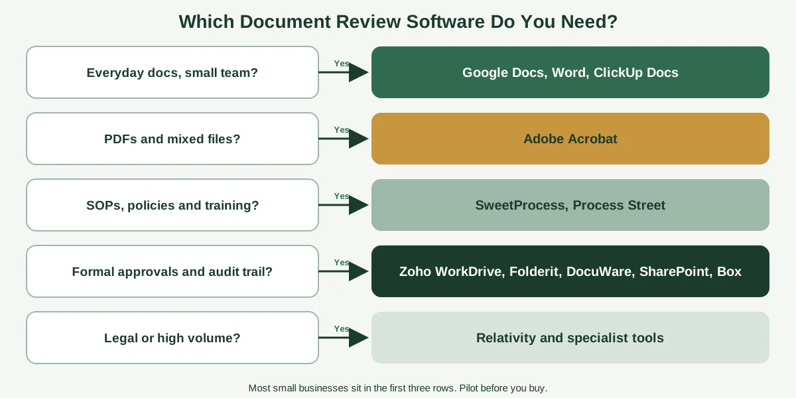
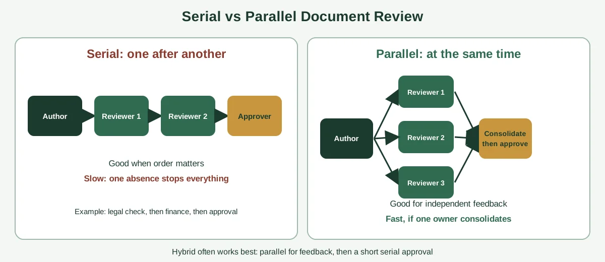

By day nine, nobody remembers who has the document. It started as a clean draft. Then it went to three reviewers by email, two of them replied with edits in different files, one replied "looks fine" without opening it and the manager who has to approve it is waiting for a version that doesn't exist yet.

That's what a document review process looks like when it runs on inboxes and good intentions. It's slow, it's confusing and the final version often isn't the one anyone intended.

The right software can fix a lot of that. But "best" depends entirely on what you're reviewing, who's reviewing it and how formal the sign-off needs to be. A team reviewing SOPs needs something very different from a legal team reviewing thousands of contracts.

This guide walks through the best software for streamlining document review processes by use case, with honest notes on strengths and limits, a feature checklist, a comparison of serial and parallel review and a two-week pilot plan. We'll also cover why you should fix the process before buying anything. If your review process isn't written down yet, start with our guide to [process documentation](https://insyncea.com/blog/process-documentation/).

## What Is a Document Review Process?

**A document review process is the set of steps a document goes through so that the right people can check it, give feedback, agree on changes and formally approve it before it's used or sent.** It covers everything from a quick peer check of a proposal to a formal sign-off on a policy or contract.

Most review processes follow the same basic stages.

1. **Draft:** The author creates the first version.
2. **Assign:** Reviewers are chosen, with clear roles and deadlines.
3. **Review:** Reviewers read, comment and suggest changes.
4. **Consolidate:** The author resolves comments and merges changes.
5. **Approve:** An authorized person signs off.
6. **Publish and record:** The final version is shared, and the approval is recorded.

"Streamlining" simply means getting through those stages faster, with fewer mistakes and less chasing. The goal isn't to remove people from the process. It's to remove the confusion around it.

### Types of document review

Different documents call for different levels of review.

| Type                            | Example                                          | What matters most                                 |
| ------------------------------- | ------------------------------------------------ | ------------------------------------------------- |
| **Informal peer review**        | A proposal, blog post or report                  | Speed and easy commenting                         |
| **Procedure and policy review** | SOPs, handbooks, internal policies               | Owners, versions and review dates                 |
| **PDF and multi-file review**   | Design files, client packs, board papers         | Markup tools and reviewing several files together |
| **Formal approval**             | Budgets, purchase requests, controlled documents | Audit trail and clear sign-off                    |
| **Contract and legal review**   | Agreements, due diligence                        | Accuracy, comparison tools and strict permissions |
| **High-volume review**          | Large sets of legal or compliance documents      | Categorizing, flagging and reporting at scale     |

Knowing which row you sit in is the single most useful step in choosing software.

## Where Document Reviews Go Wrong

Before comparing tools, it helps to know what usually breaks. Most slow reviews share a handful of causes.

| Symptom                      | Likely cause                                      | What helps                                          |
| ---------------------------- | ------------------------------------------------- | --------------------------------------------------- |
| The document gets stuck      | No clear deadline or owner for each stage         | Assign named reviewers with due dates and reminders |
| Conflicting edits            | Several copies in circulation                     | One live copy with tracked changes or suggestions   |
| Comments get lost            | Feedback arrives by email, chat and phone         | One place for all comments                          |
| Nobody knows what's final    | No version control or approval record             | Version history and a formal approval step          |
| Reviewers wait on each other | Everything is sequential, even when it needn't be | Parallel review for independent feedback            |
| Endless rounds               | Unclear scope for each reviewer                   | Tell reviewers what to check, and what to ignore    |
| Last-minute surprises        | Approver sees it only at the end                  | Involve the approver early                          |
| Security gaps                | Sensitive files emailed around                    | Permissions and shared links                        |

Notice that most of these are process problems, not software problems. A tool can enforce deadlines and keep one live copy, but it can't decide who should review what. That's why we suggest writing the process down first. Our [process template](https://insyncea.com/blog/process-template/) guide includes ready-made formats, and our guide to the [document control process](https://insyncea.com/blog/document-control-process/) covers approvals, versions and ownership in detail.

## How to Choose Software by Review Type

Instead of starting with a "top 10" list, start with your review type. Here's a quick way to narrow your options.

| If your reviews are mostly...                | You need...                                        | Examples to look at                                                      |
| -------------------------------------------- | -------------------------------------------------- | ------------------------------------------------------------------------ |
| Everyday documents shared among a small team | Comments, suggestions and simple assignments       | Google Docs, Microsoft Word, ClickUp Docs                                |
| PDFs and mixed files                         | Markup, shared review spaces and comparison        | Adobe Acrobat                                                            |
| SOPs, policies and training                  | Owners, review reminders and read tracking         | SweetProcess, Process Street                                             |
| Formal approvals and controlled documents    | Workflows, audit trails and permissions            | Zoho WorkDrive, Folderit, DocuWare, Laserfiche, SharePoint, M-Files, Box |
| Contracts and legal review                   | Comparison, risk flagging and strict access        | Specialist legal and contract tools                                      |
| High volume                                  | Categorization, AI-assisted flagging and reporting | Relativity, enterprise platforms                                         |

Most small businesses will land in the first three rows, and many can do very well with tools they already own.

## The Best Software for Streamlining Document Review Processes, by Use Case

A note before we start: the tools below are examples from the categories that come up most often, not a ranking. Features and plans change, so check each vendor's current details and test with your own documents. And treat performance claims, such as "cuts review time by half," as vendor-reported unless you can verify them.

### Everyday collaboration: Google Docs, Microsoft Word and ClickUp

For most internal documents, the simplest option is often the best one.

**Google Docs** lets reviewers comment and suggest edits without changing the original text. Google explains how it works in its guide to [suggesting edits in Google Docs](https://support.google.com/docs/answer/6033474): the owner can then accept or reject each suggestion. You can also assign action items from comments, so it's clear who needs to do what.

**Microsoft Word** offers tracked changes and comments, and works well when your team already lives in Microsoft 365.

**ClickUp** combines documents with tasks, so you can link a doc to a review task and track custom statuses such as "Pending review," "In progress" and "Completed."

**Best for:** small teams reviewing proposals, reports, policies and content, with no need for a formal audit trail.

**Watch out for:** weak approval records, and the temptation to let comments pile up with no deadlines.

### PDFs and multi-file review: Adobe Acrobat

When reviews involve PDFs, design files or a mix of formats, a dedicated PDF platform can save time. Adobe's current Acrobat offering lets teams bring several files into a shared space, collaborate on them and use AI features to summarize content and compare versions. Check the current plan details with Adobe before relying on specific limits.

**Best for:** client packs, board papers, design reviews and anything where people mark up PDFs.

**Watch out for:** AI summaries still need a human to check them, and costs add up if every reviewer needs a paid seat.

### SOPs, policies and training: SweetProcess and Process Street

If you're reviewing procedures and policies, you need more than comments. You need owners, review dates and a record that people have seen the update.

**SweetProcess** is a documentation-first tool for procedures, policies and processes, with task assignment and sign-offs.

**Process Street** turns procedures into checklists with approvals and conditional logic, so a policy can move through review stages in a controlled way.

Our guide to [process documentation software](https://insyncea.com/blog/process-documentation-software/) compares these and other options in more depth.

**Best for:** teams that review SOPs, handbooks and policies on a regular schedule.

**Watch out for:** more setup than a simple document tool, and pricing that can be high for very small teams.

### Formal approvals and document control: Zoho WorkDrive, Folderit, DocuWare, Laserfiche, SharePoint, M-Files and Box

When you need clear approval routes, audit trails and tight permissions, document management systems come into their own.

**Zoho WorkDrive** works with Zoho Writer to assign multiple reviewers, set stage deadlines and track review rounds, including collecting feedback from external reviewers.

**Folderit** offers cloud document management with workflows, metadata, audit trails and approvals.

**DocuWare** and **Laserfiche** are established platforms for capturing, routing and storing documents with workflow automation.

**SharePoint and M-Files** suit organizations on Microsoft 365 that want approvals, versioning and governance tied to their existing environment.

**Box** is another option, and it describes common approval and routing flows in its guide to [document workflow automation](https://www.box.com/resources/document-workflow-automation).

**Best for:** controlled documents, budgets, compliance and any review where you need to prove who approved what.

**Watch out for:** setup effort and cost. A ten-person business rarely needs enterprise-scale software.

### Contract, legal and high-volume review: Relativity and specialist tools

Legal review, due diligence and eDiscovery involve huge volumes and strict accuracy needs. Platforms such as Relativity and legal document intelligence tools use AI to categorize documents and flag risks across large sets.

**Best for:** law firms, in-house legal teams and organizations handling thousands of documents.

**Watch out for:** cost and complexity. These tools are built for specialists, and AI flags still need qualified human review. For legal matters, take advice from a qualified professional.

### Project-based review: Wrike and Lark

Some teams review documents as part of broader project work. Project and work management tools such as Wrike, and collaboration suites such as Lark, include approval features alongside tasks and communication.

**Best for:** teams who want reviews and approvals inside their project tool, instead of in a separate system.

**Watch out for:** approval features vary, so check that the tool gives you the audit trail and version control you need.

## Side-by-Side Comparison

Here's a quick view of the main options. Pricing is left out because it changes often and varies by plan, so check current rates on each vendor's website.

| Tool                     | Category                         | Strengths                                                 | Watch out for                                                                     |
| ------------------------ | -------------------------------- | --------------------------------------------------------- | --------------------------------------------------------------------------------- |
| **Google Docs**          | Everyday collaboration           | Suggestions, comments and action items; familiar and easy | Limited formal approval and audit features                                        |
| **Microsoft Word**       | Everyday collaboration           | Tracked changes and comments in Microsoft 365             | Version sprawl if files are emailed                                               |
| **ClickUp**              | Docs plus tasks                  | Custom review statuses and task linking                   | Needs setup to enforce a consistent process                                       |
| **Adobe Acrobat**        | PDF and multi-file review        | Shared review spaces, markup and AI summaries             | Seat costs, and AI output needs checking                                          |
| **SweetProcess**         | SOP and policy review            | Procedures, assignments and sign-offs                     | No automatic screen capture, and it's built for procedures, not general documents |
| **Process Street**       | Checklist and approval workflows | Conditional logic and approvals                           | Pricing and complexity for small teams                                            |
| **Zoho WorkDrive**       | Approval workflows               | Multiple reviewers, stage deadlines and external feedback | Works best within the Zoho ecosystem                                              |
| **Folderit**             | Document management              | Workflows, metadata and audit trails                      | Another system to adopt                                                           |
| **DocuWare, Laserfiche** | Enterprise document management   | Capture, routing and automation at scale                  | Cost and implementation effort                                                    |
| **SharePoint, M-Files**  | Governance and workflows         | Versioning and approvals tied to Microsoft 365            | Setup complexity                                                                  |
| **Relativity**           | Legal and high-volume review     | Large-scale categorizing and flagging                     | Specialist, enterprise-level tool                                                 |

## Features That Matter in Document Review Software

Whichever category you choose, these features separate tools that speed up reviews from tools that just add another login.

| Feature                                   | Why it matters                                        |
| ----------------------------------------- | ----------------------------------------------------- |
| **Reviewer assignment with deadlines**    | Gives each person a clear task and date               |
| **Automatic reminders**                   | Stops reviews stalling without you chasing            |
| **Comments and suggestions in one place** | Prevents feedback scattered across email and chat     |
| **Version history**                       | Lets you see and restore earlier versions             |
| **Serial and parallel review**            | Lets you choose the right route for each document     |
| **Approval step with a record**           | Proves who signed off, and when                       |
| **Audit trail**                           | Shows who did what, which matters for compliance      |
| **Permissions**                           | Controls who can view, comment, edit and approve      |
| **External reviewer access**              | Lets clients or partners review without full accounts |
| **Comparison tools**                      | Highlights what changed between versions              |
| **Integrations**                          | Works with your storage, email and task tools         |
| **AI summaries and flagging**             | Can save time, if outputs are checked                 |
| **Export options**                        | Lets you take your documents and history with you     |
| **Mobile access**                         | Helps reviewers who aren't at a desk                  |

You won't need all of them. Choose the five that would make the biggest difference to your reviews, and treat the rest as extras.

## Serial vs Parallel Review: Choosing the Right Route

One of the biggest speed gains has nothing to do with software. It's deciding how reviewers get the document.

**Serial review** passes the document from one reviewer to the next. Each person sees the previous person's changes.

* **Good for:** documents where order matters, such as a legal check that must happen before finance sees it, or a layered approval chain.
* **Drawback:** slow. If one person is away, everything stops.

**Parallel review** sends the document to all reviewers at once. Everyone comments on the same live copy, and the author consolidates the feedback.

* **Good for:** independent feedback from different experts, where one person's comments don't depend on another's.
* **Drawback:** needs a clear deadline and a single owner to consolidate, or the comments can clash.

**A hybrid approach** often works best. Run a parallel review for feedback, consolidate the comments, then send the result through a short serial approval chain.

Whichever route you choose, name one person who owns the document through the whole process. Software can send the reminders, but someone has to own the outcome.

## What About AI in Document Review?

AI features are showing up in nearly every document tool. They can help, within limits.

**Where AI helps:**

* Summarizing long documents, so reviewers know what to look for
* Comparing versions, and highlighting changes
* Suggesting wording or flagging inconsistencies
* Categorizing and routing documents in large sets
* Pulling out key terms and dates

**Where to be careful:**

* **Accuracy.** AI can miss things, or state errors confidently. Always have a person check important output.
* **Confidentiality.** Check where your documents go when you use AI features, and whether they're used to train models. Read the vendor's privacy and security terms.
* **Accountability.** AI shouldn't replace the human sign-off, especially for legal, financial or compliance documents.
* **Over-trust.** A neat summary can tempt reviewers to skip reading the document.

A sensible rule is to use AI to prepare reviewers and speed up routine checks, and keep human judgment for the decisions.

## Security, Privacy and Compliance

Reviews often involve sensitive material, like contracts, financials, HR files and client data. A few habits protect you.

* **Use permissions, not trust.** Give reviewers "comment" access unless they need to edit.
* **Share links, not attachments.** One live copy beats files floating around in email.
* **Check external access.** If clients or partners review, make sure they see only what they should.
* **Keep an audit trail.** You should be able to see who changed, commented on and approved each version.
* **Turn on two-step verification.** Do it for every tool that stores your documents.
* **Know where data is stored.** Read the vendor's security and data location information.
* **Set retention rules.** Decide how long review records are kept, and how they're disposed of. Some records have legal minimums, so check what applies to your business.

Our guide on the [document control process](https://insyncea.com/blog/document-control-process/) explains simple ways to manage access, versions and archiving.

## How to Choose Document Review Software in 6 Steps

A short, structured approach beats a long search.

### Step 1: Map your current review process

Write down the stages for one real document type, who's involved, how long each stage takes and where it gets stuck. Our guides on [how to create workflows](https://insyncea.com/blog/how-to-create-workflows/) and [workflow steps](https://insyncea.com/blog/workflow-steps/) can help.

### Step 2: Pick one document type to improve first

Choose something frequent and painful, such as policy updates, client proposals or purchase approvals.

### Step 3: Decide the review style

Serial, parallel or hybrid? How many reviewers? Does it need a formal approval and an audit trail?

### Step 4: Shortlist two or three tools

Match them to your review type and existing software. Don't compare ten.

### Step 5: Run a two-week pilot

Use real documents and real reviewers. Measure what changes, using the table below.

| Measure               | How to track it                                 |
| --------------------- | ----------------------------------------------- |
| **Cycle time**        | Days from sending to final approval             |
| **Review rounds**     | How many times the document goes back and forth |
| **Chasing**           | How many reminders you had to send by hand      |
| **Errors**            | Wrong versions used, or missed approvals        |
| **Reviewer feedback** | A quick 1 to 5 rating on ease of use            |

### Step 6: Decide, then document the new process

Choose the tool that clearly improves the numbers. Then write the new process down, including who reviews what, deadlines and where final versions live, so it survives busy periods.

## Common Mistakes When Choosing Document Review Software

**1. Buying before fixing the process.** Software will speed up a clear process, and amplify a confusing one.

**2. Choosing enterprise tools for small needs.** Complexity kills adoption.

**3. Ignoring the reviewers' experience.** If reviewers dislike the tool, they'll go back to email.

**4. Skipping the pilot.** Demos are polished. Real documents reveal the friction.

**5. No deadlines or owners.** Even the best tool can't make an undefined process move.

**6. Trusting vendor "best of" lists.** Many are written to favor the publisher. Run your own test.

**7. Over-relying on AI.** Always keep a human check on important decisions.

**8. Forgetting export.** Make sure you can take your documents and review history with you.

If you're also thinking about automating parts of the flow, our guide to [document process automation](https://insyncea.com/blog/document-process-automation/) explains how to do it without automating a mess.

## Need Help Streamlining Your Review Process?

The hardest part of fixing document review isn't picking the software. It's mapping the real process, agreeing on roles and deadlines, and setting up a routine that people follow.

Our [business operations support](https://insyncea.com/services/business-operations-support/) helps small businesses document their review processes, choose tools that fit and build simple routines that stick. You can also [book a discovery call](https://insyncea.com/contact/#book) and tell us where your reviews are getting stuck.

## FAQ

### What is the best software for streamlining document review processes?

It depends on your review type. Google Docs, Word or ClickUp suit everyday collaboration. Adobe Acrobat suits PDFs and multi-file review. SweetProcess and Process Street suit SOP and policy review. Zoho WorkDrive, Folderit, DocuWare, Laserfiche, SharePoint and M-Files suit formal approvals. Relativity and specialist tools suit legal and high-volume review.

### Is there free software for document review?

Yes. Google Docs and Microsoft Word, with the right plan, offer comments and suggestions or tracked changes at no extra cost. Several document management and workflow tools also have free tiers or trials with limits. Check current plans, since they change.

### What is the best software for reviewing PDFs?

Adobe Acrobat is widely used for PDF markup and multi-file review. Many other PDF tools offer commenting too, so try a couple with your own files before deciding.

### What is the best document management software?

There's no single best option. Choose based on your size, review type, existing software and budget, and test two or three with real documents. Enterprise rankings such as Gartner's Magic Quadrant focus on large organizations, and may not suit a small business.

### What is the difference between document management and document review software?

Document management software stores, organizes and controls documents. Document review software focuses on the feedback and approval stage. Many document management systems include review and approval workflows, and many review tools include basic storage.

### What is the difference between serial and parallel review?

In serial review, reviewers go one after another. In parallel review, they all review at the same time and the author consolidates the feedback. Many teams combine them: parallel for feedback, then serial for approval.

### How do I speed up a document review?

Set clear deadlines and named reviewers, keep one live copy, use parallel review where possible, tell reviewers what to check, send automatic reminders and involve the approver early.

### Can AI review documents for me?

AI can summarize, compare versions and flag issues, which helps prepare reviewers. It can make mistakes, so keep a human check, especially for legal, financial and compliance documents, and check privacy terms before uploading confidential files.

### How do I keep an audit trail of document approvals?

Use a tool that records who reviewed, commented on and approved each version, with dates. Document management and workflow platforms typically include this. For simpler setups, keep a register that records approver, date and version.

### How many reviewers should a document have?

As few as needed. Each extra reviewer adds time and conflicting comments. Choose people who can add something distinct, and give each one a clear focus.

### Do small businesses need dedicated document review software?

Often not at first. Many small teams do well with shared documents, suggestions, comments and a simple checklist. Dedicated software helps when you need audit trails, formal approvals or a high volume of reviews.

## Conclusion

The best software for streamlining document review processes isn't the one with the longest feature list. It's the one that matches your review type, fits how your team already works and makes it obvious who needs to do what, by when.

To recap, map your current process, and decide whether your reviews are everyday, PDF-based, procedure-based, formal or legal. Choose serial, parallel or hybrid review, and shortlist two or three tools. Pilot with real documents, measure cycle time and rounds, and keep a human check on anything important, including AI output.

Make it your own. A small agency reviewing proposals and a company managing controlled policies will end up with very different setups, so start with the simplest tool that solves your biggest bottleneck.

And protect what you review. Documents often contain confidential information, so use permissions, share links instead of attachments, keep an audit trail and turn on two-step verification.

If you'd like help streamlining your own reviews, [book a discovery call](https://insyncea.com/contact/#book) and we'll look at where to start. And if you've found a review habit that cut days off your approvals, we'd love to hear it.