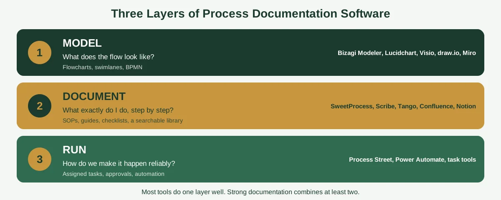
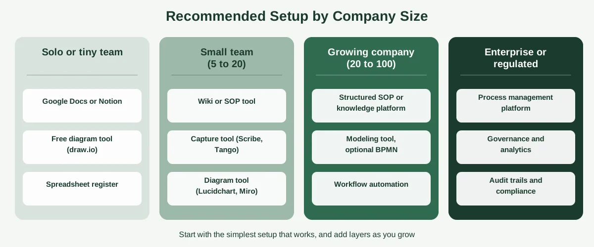

Ask three people what "business process documentation" means, and you'll get three different answers. The operations manager will describe a flowchart. The team lead will talk about a folder of SOPs. The IT person will mention a wiki, or maybe a BPMN diagram nobody else can read.

All three are right, which is exactly why shopping for business process documentation software is so confusing. The category covers tools that draw processes, tools that write them up, tools that store them and tools that run them. Pick the wrong type, and you end up with beautiful diagrams nobody follows, or a pile of instructions with no visual map.

This guide sorts the options into three jobs (model, document and run), compares the main tools in each, explains BPMN in plain English and covers free and open-source choices. You'll also get a simple way to pick the right setup for your size of business. If you'd like the fundamentals before the tools, start with our guide to [process documentation](https://insyncea.com/blog/process-documentation/).

## What Is Business Process Documentation Software?

**Business process documentation software is any tool that helps you map, write down, store, share and maintain how your business processes work.** It can be as simple as a shared document, or as sophisticated as a platform that models processes in a formal notation, tracks changes and measures performance.

A business process is a repeatable sequence of work that produces a result, such as onboarding a client, fulfilling an order or approving an invoice. Documenting it means capturing the steps, the people, the tools, the decisions and the exceptions, so anyone can understand and follow it.

The software side adds some practical benefits.

* **Visibility:** everyone can see how work flows, not just the person doing it.
* **Consistency:** the documented way becomes the shared way.
* **Findability:** procedures live in one searchable place, not in inboxes.
* **Maintenance:** version history, owners and review dates keep documents current.
* **Improvement:** once a process is visible, it's much easier to spot waste.

One note on terms. You'll see this category called process documentation software, SOP software, process mapping software, BPM (business process management) software and knowledge base software. They overlap heavily. Our separate guide to [process documentation software](https://insyncea.com/blog/process-documentation-software/) focuses on the SOP and capture tools. This guide takes the wider view, including the modeling and automation side.

## The Three Jobs: Model, Document and Run

The clearest way to cut through the noise is to recognize that "process documentation" involves three different jobs. Most tools do one of them well, and a few do two.

| Job          | What it answers                       | What you produce                               | Typical tools                                                   |
| ------------ | ------------------------------------- | ---------------------------------------------- | --------------------------------------------------------------- |
| **Model**    | "What does the flow look like?"       | Flowcharts, swimlanes, BPMN diagrams           | Bizagi Modeler, Lucidchart, Visio, draw.io, Miro                |
| **Document** | "What exactly do I do, step by step?" | SOPs, guides, checklists, a searchable library | SweetProcess, Process Street, Scribe, Tango, Confluence, Notion |
| **Run**      | "How do we make it happen reliably?"  | Assigned tasks, approvals, automated steps     | Process Street, Power Automate, project and task tools          |

A diagram shows the shape of a process, but it rarely explains the details. A written SOP explains the details, but it's hard to see the overall flow. And neither makes anything happen on its own.

Strong documentation usually combines at least two layers: a simple visual of the flow, plus written steps for each stage. If you'd like to see what that looks like in practice, our guide to [process documentation examples](https://insyncea.com/blog/process-documentation-examples/) includes flowcharts, swimlanes and checklists side by side.

You don't need all three on day one. Start with the layer that addresses your biggest problem, then add others.

## BPMN in Plain English

If you spend any time looking at process modeling tools, you'll run into BPMN. It can sound intimidating, so here's what it really is.

**BPMN stands for Business Process Model and Notation. It's a standard set of symbols for drawing business processes, so that everyone who reads a diagram interprets it the same way.** It's maintained by the Object Management Group (OMG), the same standards body behind UML. Wikipedia has a good overview of [BPMN](https://en.wikipedia.org/wiki/Business_Process_Model_and_Notation).

The core idea is simple. Different shapes mean different things.

| BPMN element                 | What it means                                           | Example                    |
| ---------------------------- | ------------------------------------------------------- | -------------------------- |
| **Event (circle)**           | Something that starts, happens during or ends a process | "Order received"           |
| **Task (rounded rectangle)** | A piece of work                                         | "Check stock"              |
| **Gateway (diamond)**        | A decision or a split in the flow                       | "In stock?"                |
| **Sequence flow (arrow)**    | The order of steps                                      | Task to task               |
| **Pool and lane**            | Who does what                                           | Customer, sales, warehouse |

### How BPMN differs from a regular flowchart

A basic flowchart uses a handful of shapes and a lot of flexibility. BPMN has a stricter vocabulary, with more specific symbols for things like messages, timers and errors. That precision is a strength when processes are complex, or when business and technical teams need to share the same diagram. It can feel like overkill for simple ones.

### Do small businesses need BPMN?

Usually not. Most small businesses get plenty of value from simple flowcharts and swimlanes, plus written steps. BPMN starts to pay off when:

* Processes are complex, with many roles, handoffs and exceptions
* You plan to automate processes using workflow or BPM platforms that read BPMN
* You work with technical teams or consultants who use it
* You operate in a regulated environment that demands formal process models

If none of those apply, don't let the jargon push you into a heavier tool than you need. A simple diagram everyone understands beats a perfect one nobody can read.

## Business Process Documentation Software Compared

Here's a side-by-side look at the tools that come up most often, grouped by the job they do best. Prices are left out because they change often and vary by plan, so check each vendor's site for current details, and be cautious with comparison pages written by vendors, which tend to favor their own products.

| Tool                         | Main job         | Best for                                                | Free option?           | Watch out for                                                    |
| ---------------------------- | ---------------- | ------------------------------------------------------- | ---------------------- | ---------------------------------------------------------------- |
| **Bizagi Modeler**           | Model            | BPMN modeling and exporting diagrams                    | Yes, free desktop app  | Windows desktop tool, and more formal than many small teams need |
| **Lucidchart**               | Model            | General flowcharts and team diagramming                 | Yes, limited           | Diagrams can drift from the written steps                        |
| **Microsoft Visio**          | Model            | Diagrams in Microsoft 365 environments                  | Limited or paid        | Cost, and a steeper learning curve                               |
| **draw.io (diagrams.net)**   | Model            | Free, flexible diagramming                              | Yes                    | Basic collaboration features                                     |
| **Miro**                     | Model            | Collaborative mapping and workshops                     | Yes, limited           | Better for workshops than for long-term libraries                |
| **IBM Blueworks Live**       | Model            | Cloud-based collaborative process discovery             | Trial                  | Aimed at larger organizations                                    |
| **ARIS**                     | Model and govern | Enterprise process management, compliance and analytics | No                     | Enterprise scale, cost and complexity                            |
| **SweetProcess**             | Document         | Step-by-step SOPs, task assignment and version history  | Trial                  | No automatic screen capture                                      |
| **Process Street**           | Document and run | Recurring checklists and approvals                      | Limited or trial       | Pricing and setup for small teams                                |
| **Scribe, Tango**            | Document         | Fast screenshot-based guides                            | Yes, limited           | Capture software tasks only                                      |
| **Document360**              | Document         | Structured version control and a knowledge base         | Trial                  | Built more for knowledge bases than process maps                 |
| **Confluence, Notion**       | Document         | Flexible wikis and company knowledge                    | Yes                    | Need structure, owners and review habits                         |
| **Zoho Learn**               | Document         | Process documentation within the Zoho ecosystem         | Limited                | Best if you already use Zoho                                     |
| **Microsoft Power Automate** | Run              | Workflow automation and process monitoring              | Included in some plans | Needs documented processes first                                 |

The most useful column is "Main job." If you pick one tool from each layer you need, you'll often do better than with a single all-in-one platform.

## Process Modeling Tools: Mapping the Flow

Modeling tools help you see how a process fits together. They're ideal for processes with decisions, handoffs between people or several systems involved.

**Bizagi Modeler** is a popular choice for BPMN. It's a freeware desktop application for diagramming, documenting and simulating processes in BPMN, available free from Bizagi, as its [documentation](https://help.bizagi.com/platform/en/intro_welcome.htm) explains. You can also publish diagrams to formats such as Word, PDF and web pages. It's Windows-based, so check that it fits your setup.

**Lucidchart, Visio, draw.io and Miro** are general diagramming tools that support flowcharts and swimlanes, and in several cases BPMN shapes. They're more flexible and easier to learn, which makes them a good fit for most small businesses.

**IBM Blueworks Live and ARIS** sit at the enterprise end. They're built for collaborative process discovery, governance, risk tracking and analysis across large organizations.

**Best for:** processes with decisions and several roles, where a picture explains more than a paragraph.

**Where they fall short:** diagrams show flow, but not detail. They also go stale quickly if they live apart from the written steps.

A good habit is to embed the diagram inside your written procedure, so both are updated together. Our guides on [how to create workflows](https://insyncea.com/blog/how-to-create-workflows/) and [workflow steps](https://insyncea.com/blog/workflow-steps/) walk through mapping steps before you draw them.

## Documentation and SOP Tools: Capturing the Details

This layer turns a process into instructions someone can follow.

**SweetProcess** focuses on step-by-step SOPs with embedded screenshots and videos, task assignment and built-in version history. **Process Street** turns procedures into recurring checklists with approvals. **Scribe and Tango** record your clicks and write the guide for you. **Zoho Learn** offers process documentation for teams already in the Zoho world.

**Best for:** anyone who needs a new hire to do a task correctly without asking.

**Where they fall short:** they can hide the big picture. A library of SOPs doesn't show how processes connect.

We compare these tools in more detail in our guide to [process documentation software](https://insyncea.com/blog/process-documentation-software/), including how to run a two-week pilot. And our [process template](https://insyncea.com/blog/process-template/) article gives you copy-and-paste formats if you'd like to start without any software.

## Knowledge Bases and Wikis: Storing Everything in One Place

Once you have diagrams and SOPs, you need a home for them. Knowledge base tools provide search, structure and version control.

**Document360** is built for structured knowledge bases, with version control and collaborative editing. **Confluence** and **Notion** are flexible wikis that many teams use as a company handbook. For developers and technical teams, tools like **GitBook** and open-source options such as **BookStack** and **Wiki.js** are common choices.

**Best for:** one searchable library for procedures, policies, roles and how-tos.

**Where they fall short:** wikis become messy without rules. Give every page an owner and a review date, and consider adding a simple register, like the one in our [document control process](https://insyncea.com/blog/document-control-process/) guide.

## Automation and Execution Tools: Making It Happen

Once a process is documented, some steps can run themselves. Workflow tools such as **Microsoft Power Automate** can trigger tasks, route approvals, move data between apps and monitor how processes perform.

**Best for:** repetitive, rule-based steps in well-understood processes.

**Where it falls short:** automation can't fix a process that isn't clear. If you automate a mess, you get a faster mess. That's why the order matters: document, simplify, then automate. Our guide to [document process automation](https://insyncea.com/blog/document-process-automation/) explains how.

## Free and Open-Source Options

You can document business processes without spending anything. Here are the main free routes, and what to watch for.

| Tool                                   | Type             | What you get                         | Watch out for                                                |
| -------------------------------------- | ---------------- | ------------------------------------ | ------------------------------------------------------------ |
| **Bizagi Modeler**                     | Modeling         | Free BPMN diagramming on Windows     | Desktop only, and more formal than many teams need           |
| **draw.io (diagrams.net)**             | Modeling         | Free flowcharts and swimlanes        | Basic collaboration                                          |
| **Notion and Confluence (free tiers)** | Wiki             | Flexible documentation               | Limits on features and users                                 |
| **BookStack**                          | Open-source wiki | Self-hosted structured documentation | You manage hosting, updates and security                     |
| **Wiki.js**                            | Open-source wiki | Self-hosted wiki with search         | Same: technical setup and upkeep                             |
| **Google Docs, Word**                  | Documents        | Simple SOPs and checklists           | No owners, review reminders or approvals unless you add them |
| **Scribe and Tango (free plans)**      | Capture          | Screenshot guides                    | Plan limits on capture types, exports and libraries          |

The honest trade-off is that free tools often lack the features that keep documentation alive, such as owners, review reminders and version control. You can add those yourself with a simple process register, which our [process template](https://insyncea.com/blog/process-template/) guide includes.

If you choose open source, remember that "free" doesn't mean "no cost." Someone has to host it, secure it, back it up and keep it updated.

## Features to Look For

Across all three layers, a few features separate tools that last from tools that get abandoned.

| Feature                         | Why it matters                                                       |
| ------------------------------- | -------------------------------------------------------------------- |
| **Visual mapping**              | Drag-and-drop flowcharts, swimlanes and, if needed, BPMN support     |
| **A central, searchable hub**   | One place for all procedures, policies and roles                     |
| **Version control**             | History, rollback and clear approvals                                |
| **Owners and review reminders** | Stop documents going stale                                           |
| **Permissions**                 | Control who can view, edit and approve                               |
| **Export and publishing**       | Share diagrams and documents as PDF, Word or web pages               |
| **Templates**                   | Keep documents consistent                                            |
| **Integrations**                | Work with the tools you already use                                  |
| **AI assistance**               | Draft steps from recordings or transcripts, and suggest improvements |
| **Automation hooks**            | Connect documented steps to workflow tools                           |
| **Audit trail**                 | Show who changed what, and when                                      |

A quick word on AI. Some tools can now generate a process draft from a recording or transcript, identifying the trigger, the title and the key steps. That can save time, but treat the result as a first draft. AI doesn't know your exceptions, so have the person who does the work check it.

## How to Choose: Match the Setup to Your Size

The best setup depends far more on your size and complexity than on any feature list. Here are sensible starting points.

| Stage                           | Likely setup                                                                 | Why                                       |
| ------------------------------- | ---------------------------------------------------------------------------- | ----------------------------------------- |
| **Solo or tiny team**           | Google Docs or Notion, a free diagramming tool, a spreadsheet register       | Cheap and flexible, and enough to start   |
| **Small team (5 to 20)**        | A wiki or SOP tool, a capture tool for software tasks, a diagram tool        | Adds structure and easy capture           |
| **Growing company (20 to 100)** | A structured SOP or knowledge platform, a modeling tool, workflow automation | Needs ownership, training and consistency |
| **Enterprise or regulated**     | Process management platforms with governance, analytics and audit trails     | Formal compliance and scale               |

### A simple five-step process

1. **Name your biggest problem.** Is it unclear flow, missing instructions, scattered documents or manual work?
2. **Choose the layer.** Model, document, run, or a combination.
3. **Shortlist two or three tools.** Fit them to your size, existing software and budget.
4. **Pilot with a real process.** Document one process in each tool, and have a newcomer follow it.
5. **Set the habits.** Decide where documents live, who owns them and when they're reviewed.

For a detailed pilot plan and scoring sheet, see our guide to [process documentation software](https://insyncea.com/blog/process-documentation-software/).

## Common Mistakes When Choosing Business Process Documentation Software

**1. Buying a modeling suite when you need SOPs.** Many small businesses need clear instructions more than formal diagrams.

**2. Choosing BPMN because it sounds professional.** Use it only when complexity or technical needs call for it.

**3. Documenting in the tool before you understand the process.** Software holds your process. It doesn't design it.

**4. Letting diagrams and written steps drift apart.** Keep them together, with one owner.

**5. Ignoring ownership and review dates.** Even the best tool can't keep documents current on its own.

**6. Trusting vendor comparison pages.** Run your own pilot.

**7. Automating too early.** Document and simplify first.

**8. Forgetting security.** Process documents can include customer data and access details. Limit permissions, turn on two-step verification and keep passwords out of the text.

Many of these gaps also show up as wider operational problems. Our guide to [building business systems for growth](https://insyncea.com/blog/business-systems-for-growth/) shows how documented, maintained processes fit together.

## Need Help Documenting Your Business Processes?

The hardest parts of this aren't the software. They're deciding what to document, mapping what really happens and building habits that keep everything current.

Our [business operations support](https://insyncea.com/services/business-operations-support/) helps small businesses map and document their processes, choose simple tools that fit and set up routines that last. You can also [book a discovery call](https://insyncea.com/contact/#book) and tell us which process is causing you the most trouble.

## FAQ

### What is business process documentation software?

It's software that helps you map, write down, store, share and maintain how your business processes work. Tools range from diagramming and BPMN modeling apps to SOP platforms, wikis and workflow automation tools.

### What is the best business process documentation software?

There's no single best option. Modeling tools such as Bizagi Modeler, Lucidchart and draw.io suit flowcharts and BPMN. SOP tools such as SweetProcess, Process Street and Scribe suit step-by-step instructions. Wikis such as Confluence and Notion suit knowledge libraries. Power Automate suits automation. Match the type to your problem.

### What is BPMN?

BPMN, or Business Process Model and Notation, is a standard set of symbols for drawing business processes. It's maintained by the Object Management Group and helps different people read the same diagram the same way.

### Do I need BPMN software?

Usually not for a small business. Simple flowcharts and swimlanes, plus written steps, are enough. BPMN helps when processes are complex, when you plan to automate with BPM platforms or when technical teams and regulators expect it.

### Is there free business process documentation software?

Yes. Bizagi Modeler is a free Windows desktop tool for BPMN. draw.io is a free diagramming tool. Notion and Confluence have free tiers, Scribe and Tango have free plans, and open-source wikis such as BookStack and Wiki.js are free to use, though you host them yourself.

### What is business process documentation software for Microsoft 365?

Microsoft users often combine Visio for diagrams, SharePoint or OneNote for storage, Word for documents and Power Automate for automating documented steps. Check what's included in your plan before buying anything new.

### What are free documentation tools for developers?

Common choices include open-source tools such as BookStack and Wiki.js, hosted tools with free tiers such as GitBook and Notion, and diagramming with draw.io. Developer documentation (such as API docs) is a different kind of documentation from business process documentation, so choose accordingly.

### What is the difference between process mapping and process documentation?

Process mapping draws the flow of a process visually. Process documentation records it fully, including steps, owners, tools, exceptions and quality checks. Good documentation usually includes a map.

### What is the difference between process documentation software and BPM software?

Process documentation software captures and shares how processes work. BPM (business process management) software goes further, with modeling standards, execution, monitoring and analytics, and it's typically aimed at larger organizations.

### How much does business process documentation software cost?

It ranges from free to many hundreds of dollars a month, depending on type and scale. Prices change often, so check current plans on each vendor's site and run a pilot first.

### Can AI document business processes?

AI can draft processes from recordings and transcripts, suggest steps and tidy wording. It can't know your real exceptions, so have the person who does the work verify the result.

### How do I get started with process documentation?

Choose one important process, write down the real steps, test them with someone new and give the document an owner and a review date. Then pick tools to match. Our guide to process documentation walks through it.

## Conclusion

Business process documentation software isn't one category. It's three jobs: showing how a process flows, explaining exactly how to do it and making it happen reliably. The tool that's right for you depends on which job is your biggest gap.

To recap, start by naming your problem, and choose the layer that fixes it: model, document, run or a combination. Use BPMN only if your complexity demands it. Match your setup to your size, pilot with a real process and set simple habits for owners, reviews and where documents live.

Make it your own. A small agency and a regulated manufacturer will choose very different tools, so begin with the simplest setup that works, and add more as you grow.

And handle what you document with care. Process documents can contain customer details and access information, so limit permissions, use two-step verification and keep passwords out of the text.

If you'd like help getting started, [book a discovery call](https://insyncea.com/contact/#book) and we'll look at where to begin. And if you've found a tool combination that works well for your team, we'd love to hear about it.