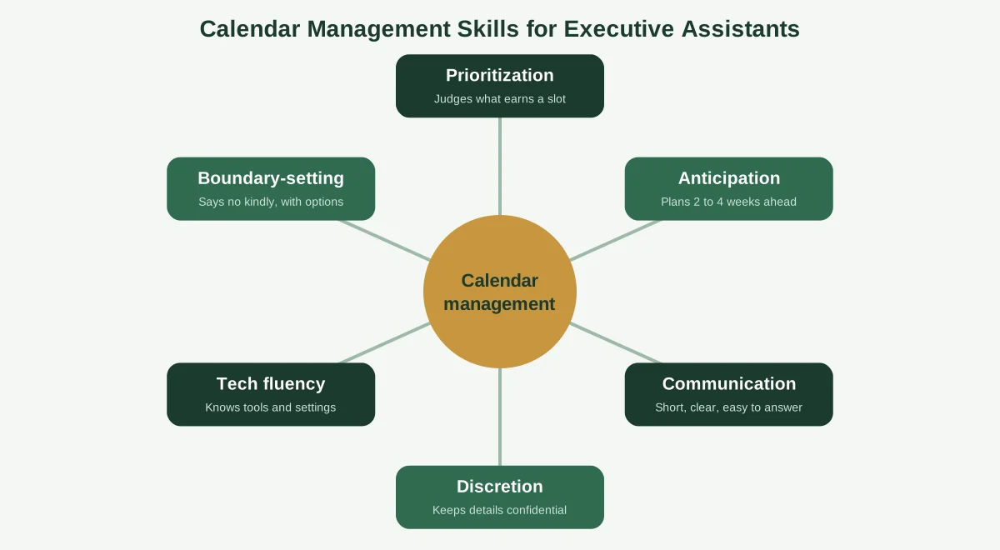
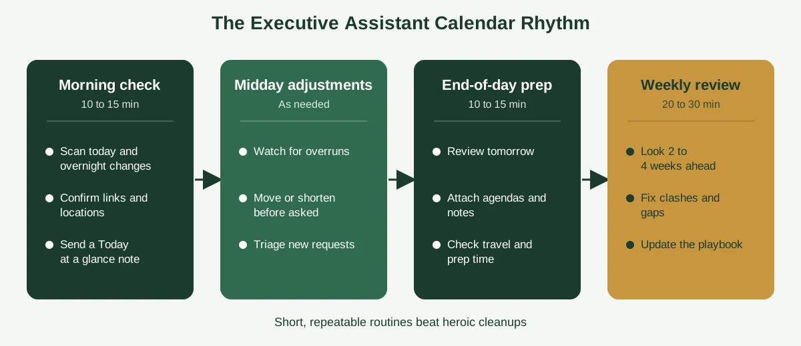

Here's a myth worth retiring: that calendar management is the easy part of an executive assistant's job. It looks easy from the outside, because the output is just a tidy grid of colored boxes. But behind every clean calendar is a stack of quiet decisions about priorities, people and timing.

Get those decisions right, and your executive feels calm, prepared and in control. Get them wrong, and a double-booking, a missed time zone or a forgotten prep block can undo a week of good work.

This guide covers calendar management for executive assistants from the ground up. You'll get the core skills, a daily and weekly rhythm, ways to organize a calendar so it's readable at a glance, a playbook template, the best tools, and SMART goals you can use in your next review. If you're brand new to the topic, our guide on [what calendar management is](https://insyncea.com/blog/what-is-calendar-management/) is a good warm-up.

## What Calendar Management Means for an Executive Assistant

**For an executive assistant, calendar management is the ongoing work of planning, protecting and adjusting an executive's schedule so their time follows their priorities.** It goes well beyond booking meetings. It includes screening requests, preparing for each commitment, coordinating travel and following up afterwards.

Think of yourself as an air traffic controller for someone else's day. Planes (meetings) arrive from every direction, runways (time slots) are limited, and your job is to keep everything moving safely without anyone having to look at the radar except you.

That's why the work sits at the center of the role. Almost everything else you do, from email triage to travel to meeting prep, touches the calendar in some way.

Here's what the job typically includes:

* **Scheduling and rescheduling** meetings, calls and events across time zones
* **Gatekeeping** by deciding which requests get through and which get redirected
* **Protecting focus time** so the executive has room to think
* **Preparing** agendas, briefs and materials before each meeting
* **Coordinating travel** with real blocks for transit, check-in and arrival buffers
* **Following up** on action items so meetings lead to results
* **Reporting** short summaries of what's ahead and what needs a decision

And there's one part that's easy to miss: judgment. Two assistants with the same software can produce very different calendars, because one understands the executive's goals and the other just fills gaps.

So the real question isn't "how do I use the calendar tool?" It's "how do I make good scheduling decisions on someone else's behalf, quickly and consistently?" The rest of this guide is built around that question.

## The Core Calendar Management Skills Every Executive Assistant Needs

People often ask for the top three skills of an executive assistant. Different employers rank them differently, but for calendar work, three skills do most of the heavy lifting: **prioritization and judgment, clear communication, and discretion.** Tech fluency, anticipation and boundary-setting round out the set.

### Prioritization and judgment

You'll constantly decide what gets a slot and what doesn't. That means knowing the executive's top goals well enough to see when a request supports them, and when it's just noise.

A useful habit is to ask "what happens if this meeting doesn't happen?" If the honest answer is "not much," it probably shouldn't take a prime slot.

### Clear communication

Most of your messages should be short, specific and easy to answer. Instead of "Do you want to take this call?" try "Vendor intro, 20 minutes, Thursday 2:00 p.m. Eastern. Yes, no or suggest another time?"

Good communication also means giving the executive a heads-up before a problem lands. Nobody likes learning about a conflict five minutes before it starts.

### Discretion

A calendar shows who your executive is meeting and what's coming. Treat every detail as confidential, share only what's needed, and never describe sensitive meetings in event titles that others can see.

### Anticipation

Strong assistants think two to four weeks ahead. They notice the quarterly board meeting before it's urgent, build travel buffers before the trip is booked and pencil in prep time before the invitation arrives.

### Tech fluency

You'll live in a calendar app, an email inbox, a video meeting tool and probably a task manager. Knowing the shortcuts, sharing settings and time zone features saves hours every month.

### Boundary-setting

Sometimes you have to say no on the executive's behalf. Doing it kindly and firmly, with a clear reason or alternative, protects the executive's time without damaging relationships.

Which of these is hardest to learn? For most people it's judgment, because it only grows with experience. The fastest way to build it is to ask the executive for feedback every week, and write down the patterns you notice.

## How to Manage a Calendar as an Executive Assistant: A Daily and Weekly Rhythm

If you're wondering how to manage a calendar as an executive assistant without feeling like you're always catching up, the answer is rhythm. Short, repeatable routines beat heroic cleanups.

### Morning check (10 to 15 minutes)

Scan today's schedule and any overnight changes. Confirm links, locations and dial-in details, then send the executive a short "Today at a glance" note with what's on, what needs a decision and what's coming up.

### Midday adjustments

Meetings run over and priorities shift. Keep an eye on the afternoon, and move or shorten things before the executive has to ask. This is also a good time to answer new requests, since you'll have a clearer sense of how the rest of the day is going.

### End-of-day prep (10 to 15 minutes)

Look at tomorrow. Attach agendas and notes, make sure prep and travel time are in place, and flag any conflicts so they can be solved tonight, not at 8:00 a.m.

### Weekly review (20 to 30 minutes)

Look at the next two to four weeks. Check for clashes, missing prep time, travel gaps and meetings that no longer have a purpose. Update your notes on the executive's preferences, and plan next week's focus blocks.

The weekly review is where the quality happens. If you only have time for one routine, make it that one.

For a deeper walkthrough of the steps, see our guide on [how to effectively manage an executive calendar](https://insyncea.com/blog/how-to-manage-an-executive-calendar/), which includes a copyable preferences brief and a weekly template.

## How to Organize an Executive's Calendar So It's Readable at a Glance

The best way to organize a calendar is to make it easy to read in three seconds. If the executive has to study it, it's too messy.

Three habits get you most of the way there.

### Use a simple color system

Pick four to six colors and stick with them. For example:

| Color        | Use for                       |
| ------------ | ----------------------------- |
| Dark green   | Focus time and planning       |
| Medium green | Internal meetings             |
| Gold         | External meetings and clients |
| Light grey   | Travel and buffers            |
| Blue         | Personal and family           |
| Red          | Hard deadlines                |

Whatever scheme you choose, write it down and use it every time. Consistency is what makes colors useful.

### Name events so they explain themselves

A good event title answers "who, what and why" in a few words. Compare "Meeting" with "Q3 budget review: Finance, decision needed."

Add the agenda, links and key notes to the event itself, so everything lives in one place. Keep sensitive details out of the title if others can see the calendar.

### Layer calendars carefully

Many executives have a work calendar, a personal calendar and sometimes a travel calendar. Layer them so free and busy times show correctly, and double-check that a personal commitment doesn't hide behind a "free" label on the work view.

Then add a few other touches that help: recurring blocks for focus time and weekly reviews, working hours set correctly, and reminders for prep tasks. Little things like these make the calendar feel like it's working with the executive, not against them.

If you're ever unsure whether a calendar is well organized, try this test. Hand it to someone unfamiliar and ask them to describe the executive's week in thirty seconds. If they can, you've done it right.

## The Executive Calendar Playbook: A Simple Template

Search for calendar management for executive assistants and you'll see people asking for a template, an Excel sheet or a PDF. The most useful one is a short playbook that captures how your executive wants their time handled.

You can copy the table below into a Google Sheet, an Excel file or a document. It takes about 30 minutes to fill in with your executive, and it'll answer most of the questions you'd otherwise have to ask again and again.

| Playbook item               | What to record                   | Example                                   |
| --------------------------- | -------------------------------- | ----------------------------------------- |
| Working hours and time zone | Hours, days off, home zone       | Mon to Fri, 9:00 to 17:00 Eastern         |
| Focus time                  | When and how long                | Mornings, 9:00 to 11:30                   |
| Meeting defaults            | Length and buffer                | 25 or 50 minutes, 10-minute buffer        |
| Always book                 | Names or roles that get priority | Board, investors, direct reports          |
| Check first                 | Requests needing approval        | New vendors, press, speaking              |
| Decline politely            | Requests to turn down            | Cold pitches, unsolicited demos           |
| Travel rules                | Preferences and limits           | No flights before 8:00, buffer on arrival |
| Communication style         | How updates should arrive        | Short daily note, urgent items by text    |
| Escalation                  | What to interrupt for            | Board, major clients, emergencies         |
| Review date                 | When to update the playbook      | First Friday of each quarter              |

Once it's filled in, share it with the executive for a quick sign-off. Then you can follow it with confidence, and anyone covering for you can too.

You can go one step further and turn the playbook into a proper standard operating procedure. Our guide to [building business systems for growth](https://insyncea.com/blog/business-systems-for-growth/) explains how to document routines so they work even when the person who created them is away.

Keep a second, simpler sheet as a tracker for the weeks ahead. Columns for date, event, status, prep needed, travel needed and follow-up make it easy to see at a glance what's confirmed, what's pending and what needs attention.

## Calendar Management Tools and Apps for Executive Assistants

You don't need a big stack of software. A handful of dependable tools cover almost everything.

**Calendar apps.** Google Calendar and Microsoft Outlook are the two most common. Both support shared access, working hours, time zones, reminders and color-coding. In Outlook, delegate access and color categories are especially handy for managing a boss's calendar, and the Scheduling Assistant view helps you see when several people are free.

**Scheduling links.** Tools such as Calendly let people book time from set availability, which reduces email back-and-forth. Create separate links for different meeting types, and set buffers and daily limits inside the tool.

**Task and project tools.** Asana, Trello and Notion are popular for tracking prep work and follow-ups. The calendar says when something happens, and the task tool says what has to be done around it.

**Video meeting tools.** Zoom, Google Meet and Microsoft Teams all integrate with major calendars, so links appear in invitations automatically.

**A spreadsheet tracker.** A simple Google Sheet or Excel file can track travel plans, recurring commitments and upcoming deadlines, especially when you're juggling more than one executive.

**A password manager.** Calendars, inboxes and travel accounts all need access. A password manager lets you share credentials securely, without pasting them into chats or emails.

A few rules help whichever tools you pick:

* Use the tools your executive and team already use
* Limit access to what the job needs, and review it every few months
* Turn on two-step verification wherever you can
* Add a new app only when it solves a real problem

It's tempting to chase the newest tool. In practice, a well-used basic setup beats a fancy one that nobody fully understands.

## Handling Tricky Scheduling Situations

Even with great routines, tricky moments will come up. Here are the most common ones and how to handle them calmly.

### Two important meetings land at once

Check the playbook first. If it doesn't say which one wins, send the executive a short message with both options and your recommendation, so the decision takes seconds.

### A VIP asks for time on a focus block

Offer the nearest alternative that protects the focus time, such as "Thursday morning or Friday after lunch." Most people accept a good alternative, and you've kept the boundary.

### A last-minute change arrives

Move fast and keep it simple. Confirm what's changing, check what it affects (prep, travel, other attendees), and send a one-line update to everyone involved.

### You need to decline on the executive's behalf

Be kind and brief. For example: "Thank you for the invitation. Unfortunately \[Name] can't take this on right now, but they appreciate you thinking of them." It's polite, it's final and it doesn't invite negotiation.

### Time zones get confusing

Always write the zone next to the time, and offer a window both sides can meet in. When in doubt, check with a time zone converter before you send anything.

### The executive double-books themselves

It happens. Don't make it awkward. Fix it quietly, tell them what you moved and why, and suggest a small tweak so it's less likely to repeat.

Notice the pattern. Each situation is easier when you've agreed on the rules in advance, which is why the playbook is so valuable.

## SMART Goals for Executive Assistants Focused on Calendar Management

SMART goals are specific, measurable, achievable, relevant and time-bound. They're useful in performance reviews, and they give you something concrete to work toward.

There's no official list of five, so here are five practical goals you can adapt.

| Goal                      | Measure                                                                  | Timeframe                 |
| ------------------------- | ------------------------------------------------------------------------ | ------------------------- |
| Eliminate double-bookings | Zero unresolved double-bookings per month                                | Within 60 days            |
| Protect focus time        | At least 10 hours of focus blocks kept each week                         | By the end of the quarter |
| Improve preparation       | Agendas and notes attached to 100 percent of key meetings the day before | Within 30 days            |
| Speed up responses        | Scheduling requests answered or triaged within one business day          | Within 45 days            |
| Document the process      | A complete executive playbook, reviewed and signed off                   | Within 30 days            |

Pick two or three to start with, rather than all five. A few goals you actually track are worth more than a long list you forget.

Review progress with your executive monthly. A quick conversation about what's working keeps the goals alive, and it makes it easy to ask for feedback.

## Common Calendar Management Mistakes Executive Assistants Make

Everyone slips up now and then. These are the patterns to watch for.

**1. Saying yes first and checking later.** Fill a slot before checking priorities and you'll be unpicking it by lunchtime.

**2. Forgetting prep and travel time.** The meeting is on the calendar, but the preparation isn't. Add both.

**3. Overpacking the day.** A full calendar looks productive, but it leaves no room for surprises. Build in buffers.

**4. Not telling the executive about changes.** If something moves, they should hear it from you first.

**5. Keeping the rules in your head.** If only you know how the calendar works, it falls apart when you're away. Write the playbook.

**6. Using vague event titles.** "Call" or "Meeting" tells nobody anything. Use clear, short titles.

**7. Skipping the weekly review.** Small cracks become big problems fast.

**8. Ignoring the executive's energy.** A free slot isn't always a good slot. Notice when they do their best thinking, and guard it.

If you recognize a few of these, you're in good company. Choose one to fix this week, and keep going.

## Growing From Calendar Manager to Strategic Partner

Calendar management is often where an executive assistant's career begins. It's also where trust is built, and trust is what opens the door to bigger work.

As you prove you can keep the schedule running smoothly, you'll often be asked to take on more: managing projects, coordinating with clients and vendors, preparing reports and improving how the team works. That's the move from task-taker to strategic partner.

It helps to understand how the business itself runs. Our guide on [what business operations are](https://insyncea.com/blog/what-are-business-operations/) gives you a plain-language map of the work behind the scenes, which makes you better at spotting what needs attention.

If you're a founder or executive reading this, notice how much of the work above takes real time and attention. A dedicated assistant, whether in-house or virtual, can own all of it, and the best handoffs start with the playbook you've just seen.

Our [executive assistant support](https://insyncea.com/services/executive-support/) covers calendar and inbox management, meeting coordination, travel and follow-ups. If you'd like to talk it through, you can [book a discovery call](https://insyncea.com/contact/#book).

## FAQ

### How do you manage a calendar as an executive assistant?

Learn the executive's priorities and preferences, then protect focus time first. Triage every request, add prep and buffer time, check the schedule each morning and evening, and review the next two to four weeks every week. Write the rules in a playbook so decisions stay consistent.

### How do you organize an executive's calendar?

Use a simple color system, give every event a clear title, and keep agendas and links inside the invitation. Layer work, personal and travel calendars so free and busy time is accurate, and use recurring blocks for focus time and weekly reviews.

### What are the top 3 skills of an executive assistant?

Employers rank them differently, but for calendar work the key three are prioritization and judgment, clear communication, and discretion. Tech fluency, anticipation and boundary-setting also matter a great deal.

### What are examples of calendar management?

Common examples include time blocking, batching similar meetings, adding buffer time, color-coding events, handling time zones, using scheduling links and preparing agendas the day before. For more, see our guide on what calendar management is.

### What are the four types of calendars?

There's no official list of four. In history, calendars are usually grouped as solar, lunar and lunisolar. At work, people often mean personal, shared team, project or master, and booking calendars. Executive assistants mainly manage the work types.

### What are some good calendar management tools and apps for executive assistants?

Google Calendar and Microsoft Outlook cover most needs. Add a scheduling link such as Calendly, a task tool like Asana, Trello or Notion, a video meeting app and a password manager. A simple spreadsheet works well as a tracker.

### What are SMART goals for an executive assistant?

They're specific, measurable, time-bound goals such as eliminating double-bookings within 60 days, keeping 10 hours of weekly focus time protected, or attaching agendas to key meetings the day before. Choose two or three and review them monthly.

### Is there a free calendar management template for executive assistants?

Yes. Use the playbook table in this guide and copy it into a Google Sheet or Excel file. Add a second sheet to track upcoming events, prep, travel and follow-ups.

## Conclusion

Calendar management for executive assistants is a craft that blends judgment, communication and consistency. It looks simple on the surface, but it shapes how an executive spends every day.

To recap, build your core skills, keep a daily and weekly rhythm, organize the calendar so it's readable at a glance, and write a playbook that captures the rules. Choose a few reliable tools, prepare for tricky moments, and set SMART goals to keep improving.

Make it your own. Every executive works differently, so adapt the playbook, the colors and the routines until they fit the person you support.

Remember that a calendar is confidential. Share access only with those who need it, keep credentials in a password manager, and keep sensitive details out of visible event titles.

If you'd like help taking calendar work off your plate, [book a discovery call](https://insyncea.com/contact/#book) and tell us what's taking up your time. And if you've got a scheduling habit that saved your week, we'd love to hear it.