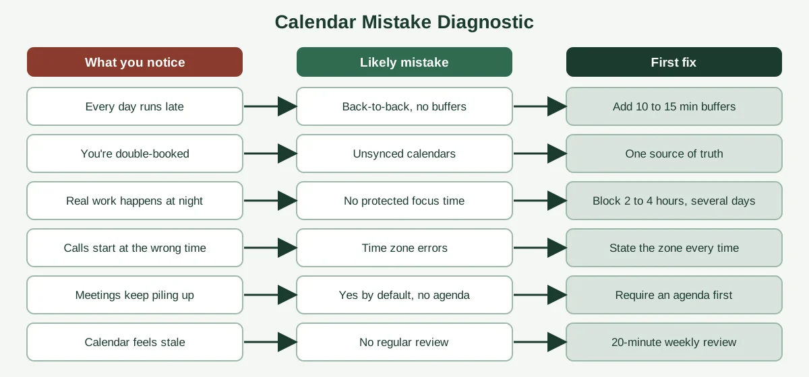
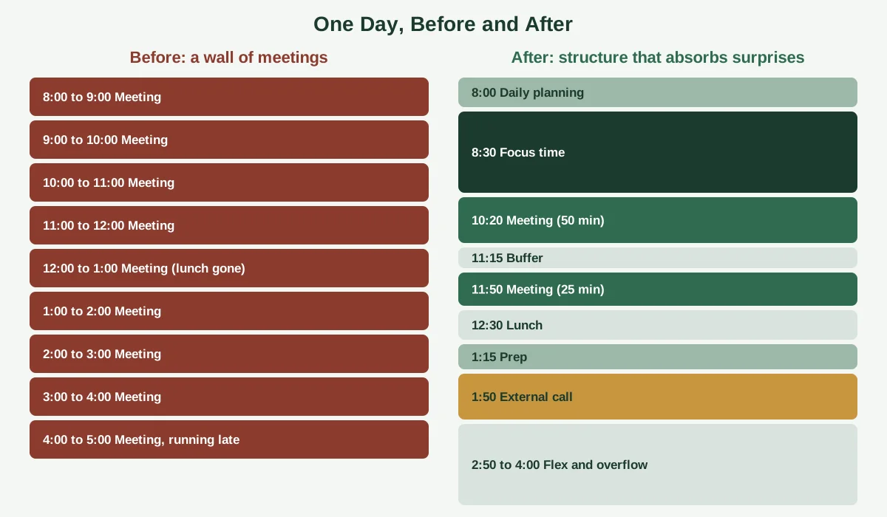

"Sorry, I thought that call was at 3." Seven words, and they've cost more deals, friendships and good moods than most people realize. The frustrating part is that nearly every calendar disaster has a boring cause, and a boring fix to go with it.

That's good news. You don't need a new personality or a fancier app to stop losing time to your schedule. You need to spot the handful of habits that quietly break calendars, and replace them with a few small rules.

This guide walks through the most common calendar management mistakes, why each one happens and how to avoid it. It's written for founders, executives and the assistants who run their schedules, so you'll see examples from all three. If you want the fundamentals first, start with our guide on [what calendar management is](https://insyncea.com/blog/what-is-calendar-management/).

## Planning Mistakes: When the Calendar Isn't Built Around What Matters

Most calendar problems start before anyone sends an invitation. They begin with how the week is planned, or whether it's planned at all.

### Mistake 1: Letting requests, not priorities, fill the calendar

Treating every meeting as equally important is the root of most overloaded schedules. When you say yes by default, your calendar becomes a record of other people's priorities.

**How to avoid it:** Write down your top three to five priorities for the quarter, and put time for them on the calendar first. Anything that doesn't connect to one of them has to earn its slot.

A simple question helps: "What happens if this meeting doesn't happen?" If the honest answer is "not much," it probably doesn't need a prime slot.

### Mistake 2: Overscheduling and stacking meetings back to back

Filling every hour feels productive. In reality, it leaves no room for overruns, thinking or a mental reset, and one late call slides through the whole day.

Even leaders at the top feel this. The Harvard Business School study of 27 CEOs, published in [Harvard Business Review](https://hbr.org/2018/07/the-leaders-calendar), found that meetings took up a huge share of their working time, and the CEOs themselves admitted many could be shorter.

**How to avoid it:** Shorten default meetings to 25 or 50 minutes, so every call ends with a built-in breather. Leave one open hour a day, and treat it as protected.

### Mistake 3: Forgetting prep time, travel time and breaks

A meeting on the calendar isn't the whole story. There's also the preparation before it, the notes after it, the commute or the flight, and the human need for lunch.

**How to avoid it:** Add a short prep block before important meetings, 10 to 15 minutes of buffer after them and real blocks for travel. Schedule lunch like any other commitment, because it'll disappear otherwise.

### Mistake 4: Having no protected focus time

If your best thinking hours are open to anyone with an invitation, the deep work gets pushed into evenings and weekends. That's a fast route to burnout.

**How to avoid it:** Block two to four hours of focus time several times a week, in the hours when you think best. Mark them as busy, and defend them politely. If someone asks for the slot, offer the nearest alternative instead of simply saying no.

Here's the thing about these four mistakes. They all come from the same place: planning the calendar around what's asked of you, not around what you're trying to achieve. Flip that order, and the rest gets easier.

## Coordination Mistakes: When Calendars, People and Time Zones Collide

The next group of mistakes shows up when more than one person, calendar or location is involved. They're the ones that produce the "sorry, I thought that was at 3" moments.

### Mistake 5: Double-booking and juggling unsynced calendars

Double-booking usually happens for a boring reason. Work, personal and team calendars don't talk to each other, so a free slot on one is busy on another.

**How to avoid it:** Keep one source of truth. Sync or overlay your calendars so that a personal appointment blocks the work calendar too. Use temporary holds for maybe-meetings, and give each calendar its own color so a glance tells you what's what.

If a double-booking does happen, fix it quietly, tell the executive what you moved and why, and move on.

### Mistake 6: Getting time zones wrong

A missed time zone is one of the quickest ways to look unprepared. It happens most when you're sending times without stating the zone, or when daylight saving changes happen on different dates in different countries.

**How to avoid it:** Set the calendar to your home time zone, and write the zone next to every time you send, such as "3:00 p.m. Eastern." Offer a window that works for both sides. In the weeks around clock changes, double-check anything with international attendees.

### Mistake 7: Accepting meetings without an agenda

Open-ended syncs with no clear purpose are the calendar's biggest time thieves. They tend to run long, wander off topic and end without decisions.

**How to avoid it:** Ask for an agenda before you accept. If there isn't one, ask whether an email or a short document would do the job. For your own meetings, put the purpose and the desired outcome in the invitation itself.

### Mistake 8: Too many people editing the calendar with no rules

When several people book, move and cancel events with no shared rules, the calendar turns into a patchwork. Nobody knows who approved what, and conflicts multiply.

**How to avoid it:** Decide who owns the calendar. One person, whether that's the executive or an assistant, should act as the gatekeeper, with a written set of rules for who gets in. Others send requests instead of booking directly.

A tiered system makes this easy. Book now for people who always get in, check first for new contacts and vendors, and decline or delegate the rest. For more detail, see our guide on [how to effectively manage an executive calendar](https://insyncea.com/blog/how-to-manage-an-executive-calendar/).

## System Mistakes: When Good Habits Never Get Built

The last group isn't about any single meeting. It's about the absence of a routine, and it's where small cracks quietly turn into big ones.

### Mistake 9: Never reviewing or updating the calendar

A calendar built once and left alone drifts away from real workloads and changing priorities. By week three, it's out of date.

**How to avoid it:** Spend 15 to 30 minutes each week looking at the next two to four weeks. Check for clashes, missing prep time, travel gaps and meetings with no purpose. Friday afternoon or Monday morning both work well.

### Mistake 10: Ignoring recurring meetings

Recurring meetings tend to outlive their purpose. Nobody remembers starting them, and nobody wants to be the one to cancel them.

**How to avoid it:** Review every recurring event each quarter. Ask: "If this weren't on my calendar, would I add it today?" If the answer is no, cancel it, shorten it or reduce how often it happens.

### Mistake 11: Writing vague event titles and leaving out details

"Call" and "Meeting" tell nobody anything. When the link, location and agenda are scattered across emails, you waste minutes before every event hunting for them.

**How to avoid it:** Use clear titles that say who, what and why, like "Q3 budget review: Finance, decision needed." Put the link, agenda and background notes inside the event. If others can see the calendar, keep sensitive details out of the title.

### Mistake 12: Keeping the rules in your head

If only one person knows how the calendar works, it breaks the moment they're away. It also makes it impossible for anyone else to help.

**How to avoid it:** Write a one-page playbook covering working hours, focus time, meeting lengths, buffers, who always gets in and who needs approval. Keep it shared, and review it every quarter. Our guide on [calendar management for executive assistants](https://insyncea.com/blog/calendar-management-for-executive-assistants/) includes a playbook template you can copy.

### Mistake 13: Handing over the calendar without clear instructions

Delegating is one of the best things you can do for your schedule. But handing someone access with no rules, no priorities and no feedback sets them up to guess.

**How to avoid it:** Start with a narrow scope, write down your preferences and agree on what needs approval. Check in weekly for the first month. More on this in our guide to [virtual assistant calendar management](https://insyncea.com/blog/virtual-assistant-calendar-management/).

Many operational headaches in a growing business start as small process gaps like these. If that sounds familiar, our guide to [business operations challenges](https://insyncea.com/blog/business-operations-challenges/) is a useful next read.

## A Quick Diagnostic: What's Going Wrong With Your Calendar?

Not sure which mistake is hurting you most? Match what you're noticing to the likely cause.

Here's the same information in a table you can keep handy.

| What you're noticing          | Likely mistake                    | First fix                                                      |
| ----------------------------- | --------------------------------- | -------------------------------------------------------------- |
| Every day runs late           | Back-to-back meetings, no buffers | Shorten default meetings and add 10 to 15 minutes between them |
| You're double-booked          | Unsynced calendars                | Sync or overlay all calendars into one view                    |
| Real work happens at night    | No protected focus time           | Block two to four hours several times a week                   |
| Calls start at the wrong time | Time zone errors                  | State the zone on every time you send                          |
| Meetings pile up              | Yes by default, no agenda         | Require an agenda before accepting                             |
| The calendar feels stale      | No regular review                 | Do a 20-minute weekly review                                   |
| Only you understand it        | Rules in your head                | Write a one-page playbook                                      |
| Delegation isn't working      | No instructions or feedback       | Narrow the scope and give feedback early                       |

Pick the row that sounds most like your week, and fix that one first. You'll feel the difference quickly.

## See the Difference: A Day Gone Wrong vs a Day Fixed

Sometimes it's easier to see it than read about it. Here's the same day, before and after applying a few of these fixes.

On the left, the day is a wall of back-to-back meetings. There's no focus block, no lunch, no prep and no room for an overrun. One late call and everything after it slips.

On the right, the same meetings are grouped, shortened and spaced out. Focus time sits in the morning, buffers cover the overruns, and an open hour at the end of the day absorbs surprises.

Nothing about the work changed. Only the structure did.

## Time Management Rules People Ask About

Several of the questions people search for sit right next to calendar mistakes. Here's what each of them means, so you can decide whether it's useful to you.

### What is the 3-3-3 rule?

It's a daily planning method from author Oliver Burkeman, who wrote *Four Thousand Weeks*. Each day, you spend three hours on your most important project, complete three shorter tasks and dedicate time to three maintenance activities. Inc.com has a good [overview of the 3-3-3 method](https://www.inc.com/jessica-stillman/productivity-time-management-oliver-burkeman-333-method.html) if you'd like to read more.

It works well on a calendar. Block the three hours first, then fit the shorter tasks and admin around it.

### What is the 7-8-9 rule?

It splits a 24-hour day into 7 hours of work or study, 8 hours of sleep and 9 hours for everything else. Some versions swap the numbers around, so treat it as a balance reminder, not a strict schedule.

### What are the 4 P's of time management?

There's no single official list, and different sources use different words. For calendars, a simple version is to prioritize, plan, protect and prune. Decide what matters, put it on the calendar, guard it and remove what no longer earns its place.

### What is a simple trick to solve calendar problems?

If you only do two things, add buffers between meetings and do a weekly review. Those two habits prevent most of the problems in this guide.

None of these rules is magic. They work because they limit how much you plan and force you to decide what matters. Pick one that fits your style, and drop the rest.

## A 10-Minute Calendar Rescue Plan

If your calendar feels out of control right now, don't try to fix everything. Run this short plan today.

1. **Look at tomorrow.** Open the calendar and scan for clashes, missing links and missing prep time.
2. **Add one buffer.** Put 15 minutes after your busiest meeting.
3. **Protect one block.** Mark a stretch of focus time for this week, and set it to busy.
4. **Cancel or shorten one meeting.** Pick a recurring one that no longer earns its place.
5. **Check the time zones.** Make sure every external invitation shows the zone.
6. **Schedule your weekly review.** Put 20 minutes on the calendar for next Friday.

That's it. Six small moves, and your week will feel lighter.

Once that's working, build on it. Add a color system, write your playbook and set simple meeting rules, so the improvements stick.

## Tools That Help You Avoid Calendar Mistakes

Tools won't fix a messy habit, but the right setup makes good habits easier. You rarely need more than a few.

**A main calendar.** Google Calendar and Microsoft Outlook both support shared access, working hours, color-coding and multiple time zones. The best one is the one you and your team already use well.

**A scheduling link.** Tools like Calendly let people book from approved slots, with buffers and daily limits built in. It cuts down on email back-and-forth and on double-bookings.

**A task tool.** Asana, Trello or Notion keep prep work and follow-ups in one place, so the calendar says when and the task list says what.

**A password manager and two-step verification.** Calendars hold sensitive information, so keep access secure and limited.

Before adding anything new, ask what problem it solves. An extra app on top of unclear habits usually just adds another place for things to go wrong.

## When It's Time to Get Help

Some calendars are a job in themselves. If your inbox and schedule eat the first half of your day, or the same mistakes keep coming back, it may be time to hand them to someone whose job it is to get them right.

A good executive assistant, whether in-house or virtual, brings structure, consistency and judgment. They learn your priorities, apply your rules, protect your focus time and keep follow-ups moving.

Our [executive assistant support](https://insyncea.com/services/executive-support/) covers calendar and inbox management, meeting coordination, travel and follow-ups. If you'd like to talk through what to hand over first, you can [book a discovery call](https://insyncea.com/contact/#book).

## FAQ

### What are the most common calendar management mistakes?

The most common mistakes are letting requests fill the calendar, overscheduling and stacking meetings back to back, skipping buffer and prep time, having no focus time, double-booking, getting time zones wrong, accepting meetings without agendas and never reviewing the calendar.

### How do you avoid double-booking?

Keep one source of truth by syncing or overlaying all your calendars, use temporary holds for maybe-meetings and give one person ownership of booking. Check that personal appointments show as busy on your work calendar.

### How much buffer time should I leave between meetings?

Ten to fifteen minutes works for most people. Add more before and after calls that tend to overrun, such as board discussions, interviews and client calls.

### How often should I review my calendar?

A short weekly review of 15 to 30 minutes is enough for most people. Look two to four weeks ahead, and take a quick look at tomorrow every evening.

### What is a simple trick to solve calendar problems?

Add buffers between meetings and do a weekly review. Those two habits prevent most scheduling problems.

### What are some best practices for managing my calendar effectively?

Put priorities and focus time on the calendar first, set simple meeting rules, require agendas, state time zones, batch similar meetings and review weekly. Write your rules down so anyone can follow them.

### What is the 3-3-3 rule for time management?

It's a daily method from Oliver Burkeman: three hours on your most important project, three shorter tasks and three maintenance activities.

### What is the 7-8-9 rule for time management?

It divides a day into 7 hours of work, 8 hours of sleep and 9 hours for everything else. It's a balance guide, not a strict schedule.

### What is the best tool for managing calendars?

Google Calendar and Microsoft Outlook cover most needs. Add a scheduling link, a task tool and a password manager if required. The best tool is the one your team already uses well.

### Do I need an assistant to avoid these mistakes?

Not necessarily. Many people fix these problems with a few rules and a weekly review. An assistant helps when the calendar takes more time than you can spare, or when the stakes of a mistake are high.

## Conclusion

Calendar management mistakes are rarely dramatic. They're small, boring habits that add up: a missing buffer, an unstated time zone, a meeting with no agenda, a review that never happens.

The good news is that the fixes are just as small. Plan around your priorities, protect focus time, sync your calendars, state your time zones, require agendas and review every week. Write your rules down so the system survives busy days and holidays.

Make it your own. A founder with clients in several time zones will fix different things first than a leader with a steady local schedule, so start with the row of the diagnostic table that sounds most like your week.

Remember that a calendar also holds sensitive information. Limit access to people who need it, use proper sharing settings and keep private details out of visible event titles.

If you'd like help taking the calendar off your plate, [book a discovery call](https://insyncea.com/contact/#book) and we'll look at what to hand over first. And if you've fixed a calendar mistake that changed your week, we'd love to hear about it.