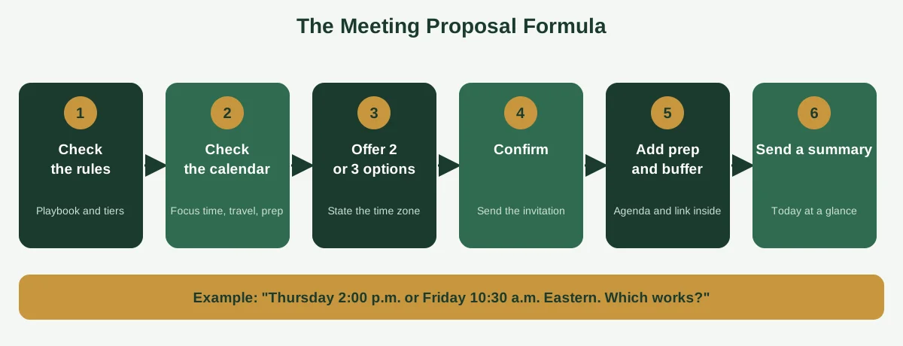
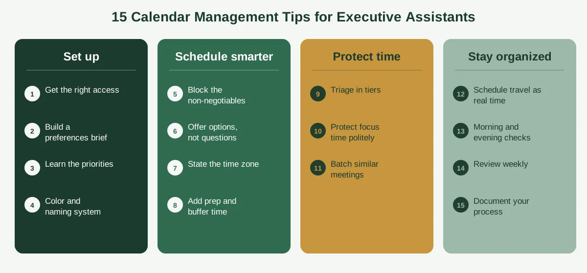

If you only remember one calendar tip from this whole guide, make it this one: never ask a question you can answer with a proposal. Instead of "When are you free?" send "Thursday at 2:00 p.m. or Friday at 10:30 a.m. Eastern. Which works?" It saves a full round of emails, every single time.

That small habit is a good example of what separates a busy executive assistant from an effective one. The effective ones aren't faster typists. They've built a set of habits that remove friction before it starts.

Below are 15 calendar management tips for executive assistants, grouped into four stages: getting set up, scheduling well, protecting your executive's time and staying organized. Whether you're new to the role or ten years in, you'll find a few you can use this week. If you want a broader view of the craft first, see our guide on [calendar management for executive assistants](https://insyncea.com/blog/calendar-management-for-executive-assistants/).

## Set Yourself Up for Success: Tips 1 to 4

Good calendar work starts before the first meeting is booked. These four tips cover the foundation, and skipping them is the most common reason new assistants feel like they're always catching up.

### Tip 1: Get the right access first

You can't manage a calendar you can't see. Ask for the permission level your role needs: usually the ability to view details and make changes to events.

In Outlook, that's typically delegate access. Microsoft explains how it works in its guide to [giving someone delegate access to your mail and calendar](https://support.microsoft.com/en-us/office/give-someone-delegate-access-to-your-mail-and-calendar-901d08a6-e496-4547-b0dd-1520d05b714c). In Google Calendar, it's done through sharing settings with specific people.

Use proper sharing or delegate access instead of your executive's password. It's safer, and it keeps a clear record of who did what.

### Tip 2: Build a preferences brief in the first week

Sit down with your executive for 30 minutes and write down how they like their time handled. Cover working hours, focus time, default meeting length, buffers, travel preferences, who always gets in and who needs approval.

This single page will answer most of your future questions. Our guide on [how to effectively manage an executive calendar](https://insyncea.com/blog/how-to-manage-an-executive-calendar/) includes a preferences brief you can copy.

### Tip 3: Learn the priorities, not just the preferences

Preferences tell you how your executive likes things done. Priorities tell you what matters. Ask for their top three to five goals this quarter, and check in each quarter, since they change.

When you know the priorities, you can make good calls on your own. You'll see that a particular investor call deserves a prime slot, while a vendor demo can wait.

### Tip 4: Create a simple color and naming system

Pick four to six colors and stick with them. For example, one for focus time, one for internal meetings, one for external meetings, one for travel and buffers, and one for personal commitments.

Then name events so they explain themselves. "Q3 budget review: Finance, decision needed" tells the story. "Meeting" tells nothing.

Little things like these make the calendar readable in three seconds, which is exactly what a busy executive needs. Here's the part people forget, though: write the system down. If only you know what the colors mean, it breaks the moment you're out sick.

## Schedule Smarter: Tips 5 to 8

Once the foundation is in place, these tips make everyday scheduling faster and cleaner.

### Tip 5: Block the non-negotiables first

Before any meeting goes in, add the things that must be protected. That includes focus time, planning time, lunch, exercise, family commitments and travel.

If you fill the calendar with meetings first, there's no room left for the work that matters. Blocking the essentials first flips the order, so meetings have to fit around priorities.

### Tip 6: Offer options, not open questions

Remember the tip from the start? Propose two or three specific times, with the time zone, and make it easy to say yes. It's the single biggest time-saver in scheduling.

A good proposal follows the same steps every time. Check your executive's rules, check the calendar, offer two or three options, confirm and then add prep and buffer time. A short summary goes out at the end, so nothing is lost.

### Tip 7: Always state the time zone

Write the zone next to every time you send, such as "3:00 p.m. Eastern." When you're working across regions, offer a window that suits both sides, like "between 10:00 and 14:00 Eastern."

Take extra care in the weeks when daylight saving changes begin in different countries on different dates. Those are the weeks when a double-check pays off the most.

### Tip 8: Add prep and buffer time by default

Every important meeting needs preparation, and every day needs slack. Add a short prep block before key calls, and 10 to 15 minutes between meetings.

Back-to-back calls look efficient until the first one overruns. Buffers turn a small delay into a non-event, and they give your executive a moment to breathe.

A quick check before you send any invitation helps. Run through this list.

| Before you send                              | Check |
| -------------------------------------------- | ----- |
| Does it fit a current priority?              | ✅     |
| Is the time zone stated?                     | ✅     |
| Is there prep time before it?                | ✅     |
| Is there a buffer after it?                  | ✅     |
| Does travel or a time zone change affect it? | ✅     |
| Does it clash with protected focus time?     | ✅     |
| Are the agenda and link in the invitation?   | ✅     |

## Protect Your Executive's Time: Tips 9 to 11

This is where good assistants earn their keep. Anyone can book a meeting. Fewer people can say no kindly and protect the time that matters.

### Tip 9: Triage requests in tiers

Sort every request into one of three groups. **Tier 1** is book now, for people your executive has said always get in. **Tier 2** is check first, for new contacts, vendors and press. **Tier 3** is decline, delegate or hold, for cold pitches and meetings that could be an email.

Tiers stop you from making every decision from scratch. They also make your choices easy to explain, because you're following a rule, not a mood.

### Tip 10: Protect focus time, politely

When someone asks for a slot that sits on a focus block, don't just say no. Offer the nearest good alternative, such as "Thursday morning or Friday after lunch."

Most people accept a good alternative, and the boundary stays intact. If a request really can't wait, check with your executive before moving a protected block.

### Tip 11: Batch similar meetings

Group one-on-ones, external calls and internal reviews into themed blocks. Maybe Tuesday and Thursday afternoons are for external calls, and Monday is for the team.

Fewer context switches means more energy for the work itself. It also makes the week easier to read at a glance, which helps both of you plan.

A short, kind decline helps here as well. Something like "Thank you for the invitation. Unfortunately, \[Name] can't take this on right now, but they appreciate you thinking of them" works in nearly every case. It's polite, it's clear and it doesn't invite negotiation.

## Stay Organized and Communicate Well: Tips 12 to 15

The last four tips are about rhythm and communication. They're the habits that keep everything running smoothly week after week.

### Tip 12: Put travel on the calendar as real time

Don't leave travel as a note in the corner of a day. Add the drive to the airport, the flight, check-in time and the transfer to the hotel as separate blocks.

Add a buffer on arrival too. A flight that lands at 2:00 p.m. doesn't mean your executive is ready for a 2:30 call. And remember to save confirmation details in the event itself, so everything is in one place.

### Tip 13: Do a morning and evening check

Spend 10 minutes each morning scanning today's schedule, confirming links and locations, and flagging overnight changes. Then spend 10 minutes each evening looking at tomorrow, attaching agendas and making sure prep time is in place.

A short "Today at a glance" note, with three lines covering what's on, what needs a decision and what's coming, keeps your executive informed without adding to their inbox.

### Tip 14: Review the next two to four weeks every week

Set aside 20 to 30 minutes each week to look ahead. Check for clashes, missing prep time, travel gaps and meetings that no longer have a purpose.

This is where most of the quality happens. Skip it and small cracks turn into problems that surface at 8:00 a.m. on a Monday.

### Tip 15: Document your process so anyone could cover for you

Write down how you handle requests, where information lives and what the rules are. Include your color system, your tier list and your preferences brief.

It feels like extra work, but it protects your executive when you're away, and it frees you up for bigger projects. It's also a good habit for the business as a whole, as our guide to [building business systems for growth](https://insyncea.com/blog/business-systems-for-growth/) explains.

## The 15 Tips at a Glance

If you'd like a quick reference, here's the whole list in one place.

| Stage            | Tips                                                                                                                 |
| ---------------- | -------------------------------------------------------------------------------------------------------------------- |
| Set up           | 1. Get the right access. 2. Build a preferences brief. 3. Learn the priorities. 4. Create a color and naming system. |
| Schedule smarter | 5. Block the non-negotiables. 6. Offer options, not questions. 7. State the time zone. 8. Add prep and buffer time.  |
| Protect time     | 9. Triage in tiers. 10. Protect focus time politely. 11. Batch similar meetings.                                     |
| Stay organized   | 12. Schedule travel as real time. 13. Do morning and evening checks. 14. Review weekly. 15. Document your process.   |

You don't need to adopt all 15 at once. Pick two or three that would make the biggest difference this week, and add more as they become habits.

## What Are the Best Tips for Executive Assistants to Be Successful?

People often ask for the best overall tips beyond the calendar itself. Beyond the 15 above, a few habits show up in almost every effective assistant.

**Anticipate.** Look ahead and solve problems before they land. The best compliment you can earn is "I didn't even have to ask."

**Communicate briefly and clearly.** Short, specific messages that are easy to answer beat long explanations every time.

**Guard confidentiality.** A calendar shows who your executive is talking to and what's coming. Treat all of it as private.

**Ask when you're unsure.** A quick question costs less than a wrong assumption.

**Keep learning.** Tools change, and so do your executive's priorities. A little curiosity goes a long way.

Which of these matters most? For calendar work, the top three skills are prioritization and judgment, clear communication and discretion. Tech fluency, anticipation and boundary-setting round out the list.

## SMART Goals for Executive Assistants

SMART goals are specific, measurable, achievable, relevant and time-bound. They give you something concrete to work toward and talk about in reviews.

Here are examples focused on calendar work. You can adapt them to your own role.

| Goal                      | Measure                                              | Timeframe                 |
| ------------------------- | ---------------------------------------------------- | ------------------------- |
| Eliminate double-bookings | Zero unresolved double-bookings per month            | Within 60 days            |
| Protect focus time        | At least 10 hours of focus blocks kept per week      | By the end of the quarter |
| Improve preparation       | Agendas attached to every key meeting the day before | Within 30 days            |
| Speed up scheduling       | Requests answered or triaged within one business day | Within 45 days            |
| Document your process     | A complete playbook reviewed and signed off          | Within 30 days            |

Pick two or three, not all five. A few goals you actually track are worth more than a long list you forget.

## Calendar Management Tools Worth Using

You don't need a pile of apps. A small, well-used set does the job.

**A main calendar.** Google Calendar and Microsoft Outlook both support shared access, working hours, color-coding and time zones. Use whichever your executive and team already use.

**A scheduling link.** Tools like Calendly let others book from approved slots. Set buffers and daily limits inside the tool, and make separate links for different meeting types.

**A task tool.** Asana, Trello or Notion keep prep work and follow-ups in one place, so the calendar says when and the task list says what.

**A password manager.** It lets you share credentials securely, without pasting them into chats or emails.

**Two-step verification.** Turn it on for calendar, email and travel accounts.

When you're choosing between tools, ask what problem each one solves. A new app on top of unclear habits just makes a mess faster.

## Is Executive Assistant a Dead-End Job?

It's a fair question, and you'll see it asked often. The honest answer is no, though the path looks different from what it used to.

Executive assistant work is a strong launchpad. The role builds judgment, communication, project coordination and a deep understanding of how a business runs. Many assistants grow into chief of staff roles, operations management, project management and business support leadership.

The job market is worth looking at honestly. The US Bureau of Labor Statistics tracks [executive secretaries and executive administrative assistants](https://www.bls.gov/OES/Current/oes436011.htm) as a distinct occupation, and its data shows pay well above general administrative roles. Overall employment in this field is growing slowly or flat, so competition for the best roles is real. Check the page for the latest figures, since they update each year.

What does that mean for you? It suggests that the assistants who thrive are the ones who go beyond scheduling. They take on projects, improve processes and become strategic partners. Our guide on [what business operations are](https://insyncea.com/blog/what-are-business-operations/) is a good place to start building that wider view.

## The One Mistake an Executive Assistant Must Never Make

There's no official answer, but most experienced assistants point to breaching confidentiality. A calendar and inbox hold sensitive information, and once trust is broken, it's very hard to rebuild.

Other serious slip-ups include double-booking without telling your executive, missing a time zone on a key call and guessing instead of asking. They're fixable, but they chip away at confidence.

To protect yourself, keep information private, limit who sees sensitive events, keep credentials in a password manager and speak up early when something goes wrong. Owning a mistake quickly is almost always better than hoping nobody notices.

## Need Extra Support With Your Executive's Calendar?

Sometimes the calendar is too much for one person, or an executive doesn't have an assistant yet. That's where outside help fits in.

Our [executive assistant support](https://insyncea.com/services/executive-support/) covers calendar and inbox management, meeting coordination, travel and follow-ups. If you'd like to talk through what to hand over first, you can [book a discovery call](https://insyncea.com/contact/#book).

## FAQ

### How do you manage calendars as an executive assistant?

Get the right access, write down your executive's preferences and priorities, and block non-negotiables first. Triage requests in tiers, offer specific time options, add prep and buffer time, check the schedule each morning and evening, and review the next two to four weeks every week.

### What are the best tips for executive assistants to be successful?

Anticipate needs, communicate briefly and clearly, guard confidentiality, ask when you're unsure and keep learning. For calendar work, strong judgment, clear communication and discretion matter most.

### How do you organize an executive calendar?

Use a simple color system, give events clear titles and keep agendas and links inside the invitation. Layer work, personal and travel calendars so free and busy time is accurate, and use recurring blocks for focus time and weekly reviews.

### What is the best way to manage a calendar?

Decide your priorities first, put protected time on the calendar before meetings, set simple rules and review weekly. A calendar works best as a plan you wrote on purpose.

### What are calendar management skills?

Key skills include prioritization, clear communication, discretion, attention to detail, time zone awareness, anticipation and comfort with tools like Google Calendar and Outlook.

### What are the top 3 skills of an executive assistant?

Employers rank them differently, but for calendar work the top three are prioritization and judgment, clear communication and discretion.

### How do you stay organized as an executive assistant?

Use a daily morning and evening check, a weekly review, a consistent color and naming system, and a written playbook. A task list for prep work and follow-ups keeps nothing in your head.

### What is the best tool for managing calendars?

Google Calendar and Microsoft Outlook cover most needs. Add a scheduling link such as Calendly, a task tool and a password manager if required. The best tool is the one your team already uses well.

### What are examples of SMART goals for an executive assistant?

Examples include eliminating double-bookings within 60 days, keeping 10 hours of weekly focus time protected, attaching agendas to key meetings the day before and responding to scheduling requests within one business day.

### Is executive assistant a dead-end job?

No. It builds skills that lead to chief of staff, operations and project roles. The assistants who grow fastest take on projects and process improvement, not just scheduling.

## Conclusion

Strong calendar management isn't about working faster. It's about building habits that remove friction before it starts, so your executive's time goes to the work that matters.

To recap, set yourself up with the right access, a preferences brief and a clear system. Schedule with proposals, time zones and buffers. Protect your executive's time with tiers, polite boundaries and batching, and keep everything steady with daily checks, weekly reviews and a documented process.

Make these tips your own. Every executive works differently, so adjust the rules, the colors and the routines until they fit the person you support.

And always keep confidentiality at the center. Share access only with people who need it, keep sensitive details out of visible event titles and store credentials in a password manager.

If you'd like a hand with the calendar, [book a discovery call](https://insyncea.com/contact/#book) and we'll look at what to take off your plate. And if you've got a scheduling habit that saved your week, we'd love to hear it.