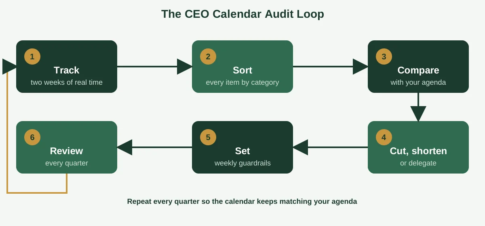
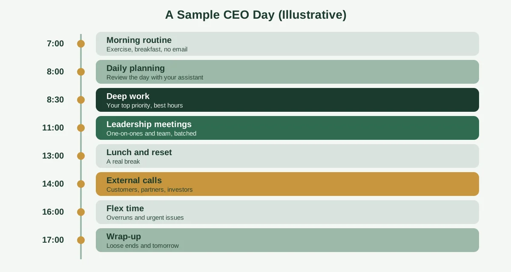

Your calendar is a budget. Every hour you've got is spent on something, and the only real question is whether you chose the spending or inherited it. Most CEOs, if they're honest, are overspending on meetings they never planned and underspending on the work only they can do.

Researchers at Harvard Business School got a rare look at this. In a study published in Harvard Business Review, Michael Porter and Nitin Nohria followed 27 CEOs of large companies for 13 weeks, with each CEO's assistant coding their time in 15-minute blocks. According to coverage of the study, those CEOs averaged roughly 62.5 hours a week, and the researchers concluded that how a CEO allocates time shapes both their own effectiveness and the company's performance. You can read the original in [Harvard Business Review](https://hbr.org/2018/07/the-leaders-calendar).

That's the stake in CEO calendar management. This guide shows you how to turn your schedule into a plan you chose, with an audit, a weekly template, a sample day, rules for cutting meeting overload and a clear list of what to delegate. If you want the fundamentals first, start with our guide on [what calendar management is](https://insyncea.com/blog/what-is-calendar-management/).

## What Is CEO Calendar Management?

**CEO calendar management is the practice of planning and protecting a chief executive's time so that their schedule reflects the company's priorities, not just the loudest requests.** It covers what gets booked, what gets declined, how long each thing takes and what happens around it, like prep, travel and follow-up.

People sometimes ask what executive calendar management means, and the answer for a CEO is the same idea with higher stakes. Their time is spread across more people, more decisions and more consequences than almost anyone else's in the business.

A CEO's calendar also does something an ordinary calendar doesn't. It sends a message. When a CEO spends hours on a topic, the whole organization reads that as a signal of what matters.

That's why it's worth treating the calendar as a leadership tool, not an admin chore. A few things set it apart:

* **It's a strategy in visible form.** If your top priority never appears on your calendar, it isn't really your top priority.
* **It has more stakeholders.** Boards, investors, customers, executives and employees all want time.
* **It carries more risk.** A missed call or a double-booking with a key partner can cost more than a few awkward minutes.
* **It's confidential.** A CEO's schedule can reveal deals, hires and plans before they're public.

You don't need to run a huge company for this to apply. A founder-CEO with a team of ten faces the same pull between urgent requests and important work. The scale is different, but the discipline is the same.

## What the Research Says About How CEOs Spend Their Time

The Harvard study is the best data we have on this, and it's worth knowing what it found. It tracked 27 CEOs across more than a decade of research, and, as [McKinsey noted when the article won a major award](https://www.mckinsey.com/about-us/new-at-mckinsey-blog/how-do-ceos-manage-their-time-the-winners-of-the-60th-annual-hbr-mckinsey-award-explain), the dataset covers about 60,000 hours of CEO time.

A few findings stand out.

**Meetings dominate.** A summary of the study from [MGMA](https://www.mgma.com/articles/test-of-time-harvard-study-reveals-how-ceos-spend-their-days-on-and-off-work) reports that the CEOs averaged 37 meetings in a given week, and spent about 72 percent of their work time in them.

**A lot of time is reactive.** Coverage of the study reported that roughly 36 percent of CEO time was spent reacting to unfolding issues, and that most of the CEOs dealt with some kind of crisis while being tracked.

**Not everything is scheduled.** About a quarter of CEO time went to spontaneous interactions, which helps leaders stay in touch with what's really happening.

**An agenda matters.** The authors argued that without a clear agenda, the demands of the loudest groups take over.

**Shorter meetings are possible.** The CEOs themselves admitted that many one-hour meetings could be cut to 30 or even 15 minutes.

Two honest caveats. First, the study looked at CEOs of large companies, so the exact numbers won't match a founder running a 20-person business. Second, the study is from 2018, so the working world has shifted since then, with more video calls and remote work.

Still, the patterns hold up well. Leaders everywhere report too many meetings, too much reactive work and too little thinking time. The study's real value is the method: measure where your time actually goes, then compare it with where you want it to go.

## How CEOs Organize Their Day: Start With an Agenda

When people ask how CEOs organize their day, the best answer is "around an agenda, not an inbox." The leaders who manage time well decide what they're trying to achieve first, then arrange the calendar to match.

Here's a simple way to do it.

### Write a short personal agenda

List three to five things you want to move forward this quarter. They might be a major hire, a product launch, a fundraising round or a key customer relationship. Keep the list short enough to remember.

### Turn priorities into recurring blocks

For each priority, give it a regular home on the calendar. If hiring is a top priority, block two hours every week for interviews and candidate reviews. If it's strategy, protect a half-day each month.

### Use themes for days or half-days

Some CEOs give each day a theme, such as people on Monday, customers on Tuesday and strategy on Thursday. Themes cut down on context switching, and they make it easy for your assistant to know where a new request belongs.

### Guard some time that's completely yours

The study's authors recommended carving out meaningful stretches of alone time, and avoiding the temptation to fill it with email. Think of it as thinking time, and treat it as a meeting you can't move.

### Leave room for the unplanned

Don't book every minute. Open space catches overruns, urgent issues and the casual conversations that tell you what's really going on.

What about the morning routine? There's no single CEO routine that works for everyone, and a lot of the popular advice is more about personality than evidence. The study did note that the CEOs averaged about 6.9 hours of sleep and spent around 45 minutes a day on exercise, which shows that even very busy leaders carved out time for their health. Build a routine that suits your energy, and put it on the calendar so it doesn't quietly disappear.

## Run a CEO Calendar Audit

If you do one thing from this guide, make it this. An audit shows you where your time goes, and it's the fastest route to a calendar you actually like.

### Step 1: Track two weeks of real time

Export the last two to four weeks from your calendar, or have your assistant do it. Include what happened, not just what was planned.

### Step 2: Sort every item into a category

Use categories that match how you lead. Here's a starting set.

| Category               | Examples                                             |
| ---------------------- | ---------------------------------------------------- |
| Strategy and planning  | Quarterly planning, strategy sessions, deep thinking |
| People and leadership  | One-on-ones, team meetings, hiring, coaching         |
| Customers and partners | Client calls, partner meetings, sales support        |
| Investors and board    | Board prep, investor updates, advisor calls          |
| Operations and reviews | Business reviews, finance, metrics                   |
| Reactive and urgent    | Crises, escalations, unplanned calls                 |
| Personal and health    | Exercise, family, rest                               |

### Step 3: Compare it with your agenda

Look at the totals. If strategy is your top priority and it gets 3 percent of your time, you've found your gap.

### Step 4: Cut, shorten or delegate

For each recurring meeting, ask whether it needs to exist, whether it needs you and whether it needs the full hour. Most calendars have a few easy cuts hiding in plain sight.

### Step 5: Set weekly guardrails

Turn what you learned into simple rules. We'll cover a template for these next.

### Step 6: Review every quarter

Repeat the audit each quarter, since the authors of the HBR study recommended checking that your schedule still matches your goals. It takes an hour, and it keeps the calendar honest.

You can run this with a spreadsheet and your assistant's help. The point isn't perfect data. It's seeing the pattern.

## A CEO Calendar Template: Weekly Guardrails

A template saves you from rebuilding the week every Monday. The one below isn't a fixed schedule. It's a set of guardrails that your assistant can use to say yes, no or "how about Thursday?" without asking you every time.

You can copy it into a document or a spreadsheet and fill in your own answers.

| Guardrail                 | What to decide                   | Example                                                      |
| ------------------------- | -------------------------------- | ------------------------------------------------------------ |
| Thinking time             | Hours per week, protected        | 4 hours, mornings, Tuesday and Thursday                      |
| Meeting-free blocks       | Days or windows with no meetings | Wednesday mornings                                           |
| Default meeting length    | The standard slot                | 25 or 50 minutes                                             |
| Buffers                   | Time between meetings            | 10 to 15 minutes                                             |
| Internal vs external days | Which days for which meetings    | Internal Monday and Wednesday, external Tuesday and Thursday |
| Always book               | People who get priority access   | Board, key customers, direct reports                         |
| Check first               | Requests needing your approval   | New vendors, press, speaking                                 |
| Decline by default        | Requests to turn down            | Cold pitches, unsolicited demos                              |
| Flex time                 | Unscheduled time each day        | One hour in the afternoon                                    |
| Health and family         | Non-negotiable personal time     | Exercise at 7:00, dinner at 18:30                            |
| Quarterly review          | Date and owner                   | First Friday of each quarter, with your assistant            |

Once it's filled in, share it with whoever manages your calendar. It's the playbook behind every scheduling decision, and it makes your preferences clear on days when you're not around to explain them.

If you'd like a deeper walkthrough of how to set this up, see our guide on [how to effectively manage an executive calendar](https://insyncea.com/blog/how-to-manage-an-executive-calendar/), which includes a weekly template and a triage system for meeting requests.

## A Sample CEO Day

People often search for the daily schedule of a CEO, so here's an example. Treat it as an illustration, not a prescription. Your own energy, time zone and business will shape what works.

**7:00 to 8:00: Morning routine.** Exercise, breakfast and a quiet start, with no email yet.

**8:00 to 8:30: Daily planning.** Review the day with your assistant, check the "Today at a glance" note and confirm the key decisions.

**8:30 to 11:00: Deep work.** Your best hours go to your top priority, such as strategy, writing or a major decision.

**11:00 to 13:00: Leadership meetings.** One-on-ones and team meetings are grouped together, so they don't scatter across the day.

**13:00 to 14:00: Lunch and reset.** A real break, with no calls booked on top of it.

**14:00 to 16:00: External calls.** Customers, partners and investors fit here.

**16:00 to 17:00: Flex time.** An unscheduled hour that absorbs overruns, urgent issues and spontaneous conversations.

**17:00 to 17:30: Wrap-up.** Clear loose ends, review tomorrow and hand notes to your assistant.

Notice a few things. Thinking time comes first, when most people have the most energy. Meetings are grouped. And flex time sits near the end of the day, so a delay doesn't wreck the whole schedule.

If you're a night owl, flip it. What matters is putting your hardest thinking in your sharpest hours.

## How to Cut Meeting Overload

Given how much of a CEO's week goes to meetings, this is where the biggest gains sit. You don't have to cancel everything. You just need to be more deliberate.

**Change the default length.** Move from 30 and 60 minutes to 25 and 50. It gives everyone a built-in break and trims hours from the week.

**Require an agenda.** If a meeting can't say what decision it needs or what outcome it wants, it's not ready to be booked.

**Ask "does this need me?"** Many meetings work fine with a delegate attending and sending you a short summary.

**Replace some meetings with writing.** Status updates often work better as a short written note or a shared document. Save live time for decisions and discussion.

**Review recurring meetings quarterly.** Standing meetings tend to outlive their purpose. Cancel, shorten or reduce the frequency of any that no longer earn their place.

**Cap the number of external meetings.** Decide how many customer, partner or investor calls you'll take in a week, and hold the line.

**Batch your meetings.** Cluster similar meetings so you can stay in one mode for a stretch, instead of switching all day.

A good test is to look at each recurring meeting and ask, "If this weren't on my calendar, would I add it today?" If the honest answer is no, you know what to do.

If you'd like to build a repeatable meeting process into your business, our guide to [how to improve business operations](https://insyncea.com/blog/how-to-improve-business-operations/) is a helpful next step.

## What a CEO Should Delegate to an Executive Assistant

Handing off your calendar is one of the highest-leverage moves a CEO can make. It's also the answer to the question of how to manage the calendar for your boss, since the assistant is usually the one doing it.

Here's a sensible split.

**Delegate fully:**

* Scheduling and rescheduling routine meetings
* Time zone coordination
* Meeting reminders and daily summaries
* Travel logistics, including real blocks for transit and buffers
* Cleaning up recurring events and stale invitations

**Delegate with approval:**

* New contacts, vendors, press and speaking requests
* Anything that commits the CEO's name or reputation
* Requests that need to move a protected block

**Keep for yourself:**

* Sensitive conversations and major relationships
* Decisions involving significant money, legal matters or hiring
* Personal commitments you want to manage directly

The assistant needs three things to do this well: access to the calendar, a written playbook of your preferences and a clear sense of your priorities. Without the third one, they can follow rules but not make judgment calls.

Start with a narrow scope, such as scheduling and inbox triage, and expand it as trust grows. A short daily note and a weekly check-in keep everything aligned without taking up much of your time.

For more on how this works with remote support, see our guide to [virtual assistant calendar management](https://insyncea.com/blog/virtual-assistant-calendar-management/).

## Tools for CEO Calendar Management

You rarely need more than a few reliable tools. People often ask about the best calendar system, and the honest answer is that the best one is the one your team already uses well.

**Main calendar.** Google Calendar and Microsoft Outlook both handle shared calendars, working hours, color-coding, reminders and multiple time zones. Pick one as your source of truth.

**Multiple calendars.** If you keep separate work, personal and travel calendars, layer them so free and busy time is accurate everywhere. A personal appointment should block the work calendar too.

**Scheduling links.** Tools like Calendly let people book from approved slots. Use different link types for different meetings, with buffers and daily limits built in.

**Task and notes tools.** Asana, Trello or Notion help track prep work and follow-ups, so the calendar says when and the task list says what.

**A password manager and two-step verification.** Your calendar reveals sensitive information, so keep access secure and limit it to the people who need it.

Before adding anything new, ask what problem it solves. A new app on top of unclear habits usually just creates a more complicated mess.

## Common Mistakes CEOs Make With Their Calendars

Even experienced leaders fall into the same traps. Watch for these.

**1. Letting the calendar fill by default.** If you don't claim your time, other people will.

**2. Having no written agenda.** Without one, the loudest demands set your priorities.

**3. Back-to-back meetings with no buffers.** One overrun then slides through the whole day.

**4. Skipping thinking time.** The most important work gets squeezed into evenings.

**5. Attending meetings out of habit or politeness.** Many calls work fine without you.

**6. Keeping the rules in your head.** Your assistant can't apply preferences they've never heard.

**7. Never reviewing.** A calendar that isn't audited quietly drifts away from your goals.

**8. Confusing busy with important.** A full calendar can feel like progress while the real work waits.

You might hear people refer to Patrick Lencioni's book on the five temptations of a CEO here. It lists five traps: choosing status over results, popularity over accountability, certainty over clarity, harmony over productive conflict and invulnerability over trust. It's a leadership fable, not a scheduling guide, but the idea carries over neatly. A calendar full of prestigious appearances, or one that avoids hard conversations, is often a sign that one of those temptations is steering.

## Getting Help With Your Calendar

At some point, managing a CEO's calendar becomes a job in itself. If your inbox and schedule are eating the first half of your day, or the same conflicts keep coming back, it's time for a dedicated person to own it.

A good executive assistant, whether in-house or virtual, brings structure, judgment and consistency. They learn your priorities, apply your guardrails, protect your thinking time and keep follow-ups moving.

Our [executive assistant support](https://insyncea.com/services/executive-support/) covers calendar and inbox management, meeting coordination, travel and follow-ups. If you'd like to talk through what to hand over first, you can [book a discovery call](https://insyncea.com/contact/#book).

## FAQ

### What is CEO calendar management?

CEO calendar management is the practice of planning and protecting a chief executive's time so that their schedule reflects the company's priorities. It includes scheduling, gatekeeping, preparation, travel, follow-ups and regular reviews.

### How do CEOs organize their day?

Effective CEOs start with a short personal agenda, then build the calendar around it. They protect thinking time, group similar meetings, use themes for days or half-days, add buffers and leave room for unplanned issues.

### How do you manage the calendar for your boss?

Get the right level of access, write down their preferences and priorities, and agree on which requests need approval. Then protect focus time, add prep and buffer time, send a short daily summary and review the next few weeks every week.

### What is the best way to manage multiple calendars?

Keep one source of truth by syncing or overlaying your calendars, give each a color and write clear event titles. Make sure personal commitments show as busy on the work calendar, and review everything weekly.

### What is the best tool for managing calendars?

Google Calendar and Microsoft Outlook cover most needs. Add a scheduling link such as Calendly, a task tool and a password manager if required. The best system is the one your team already uses well.

### What is a CEO morning routine?

There's no single routine. Many CEOs protect a quiet start, some exercise and a short planning session before meetings begin. The Harvard study found that the CEOs it tracked averaged about 6.9 hours of sleep and around 45 minutes of daily exercise. Build one that fits your energy, then put it on the calendar.

### What are the five temptations of a CEO?

They come from Patrick Lencioni's leadership fable: choosing status over results, popularity over accountability, certainty over clarity, harmony over productive conflict and invulnerability over trust.

### What are effective time management strategies for CEOs?

Write a personal agenda, audit your calendar each quarter, protect thinking time, shorten default meeting lengths, batch similar meetings, delegate scheduling and leave flex time each day.

### What is another word for managing a calendar?

Common alternatives include scheduling, diary management, schedule coordination and calendar administration.

### Is there a CEO calendar management template?

Yes. Use the weekly guardrails table in this guide and copy it into a document or spreadsheet. Pair it with the audit categories to check your schedule each quarter.

## Conclusion

CEO calendar management isn't about squeezing in more. It's about making sure the hours you have go to the work only you can do, and that the schedule you inherit doesn't quietly decide your priorities.

To recap, write a short agenda, audit where your time goes, set weekly guardrails and cut meeting overload. Use a sample day as a starting point, delegate the routine and review every quarter.

Adapt it to your own situation. A founder-CEO with a small team will use these ideas differently from a leader of a large company, so take what fits and adjust the rest.

And remember that a CEO's calendar is confidential. Limit access to the people who need it, use proper sharing settings and keep sensitive details out of visible event titles.

If you'd like help taking the calendar off your plate, [book a discovery call](https://insyncea.com/contact/#book) and we'll look at what to hand over first. And if you've found a scheduling habit that changed your week, we'd love to hear it.