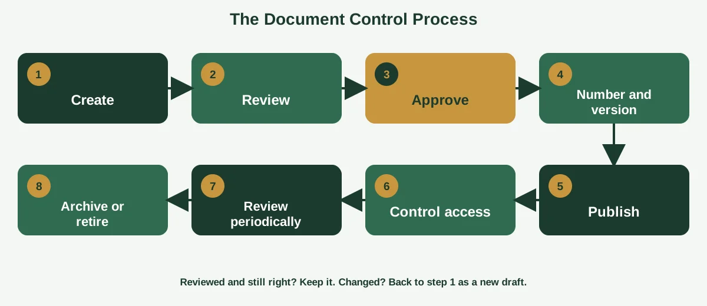
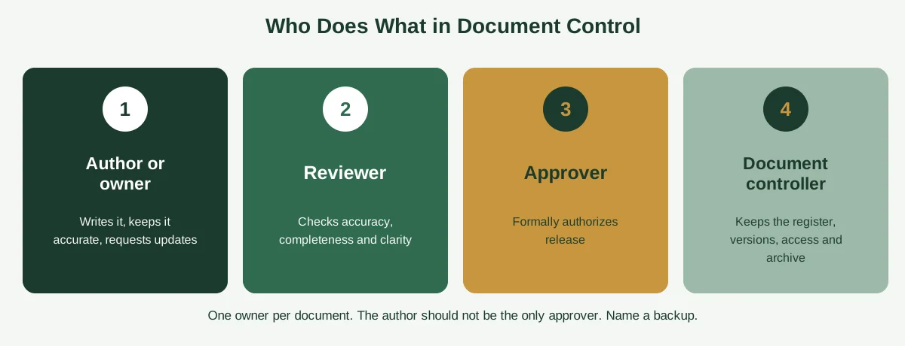

Two team members are about to quote a customer. One opens the pricing sheet saved on the shared drive. The other opens the version attached to an email from March. The numbers don't match, the customer notices and nobody can say which one is right.

That's not a software problem. It's a document control problem. And it's surprisingly common in small businesses, where policies, price lists, SOPs, contracts and templates multiply faster than anyone can keep track of them.

This guide explains the document control process in plain language: what it is, the eight steps it follows, who does what, how ISO 9001 fits in and how to run a simple version without buying anything. You'll also get a master document register template, a version numbering guide, a worked example and a look at what a document controller actually does. If you're new to documenting how your business works, our guide to [process documentation](https://insyncea.com/blog/process-documentation/) is a good place to start.

## What Is the Document Control Process?

**The document control process is a repeatable set of steps for creating, reviewing, approving, distributing, updating, storing and retiring documents, so everyone always uses the current, approved version.** It keeps documents accurate, secure and easy to find, and it creates a clear record of who changed what and when.

Technical Writer HQ describes it as a repeatable workflow that moves a document from draft to approved, distributed, maintained and archived. That's a handy way to picture it: a lifecycle, not a one-off task.

Document control answers five simple questions about every important document.

* **Is this the latest version?**
* **Who approved it, and when?**
* **Who is allowed to see or change it?**
* **Where does it live?**
* **When will it be reviewed or retired?**

If you can't answer all five for your key documents, you have a gap.

### Which documents need controlling?

Not every file needs this level of care. A good rule is to control any document where using the wrong version would cause real problems. That usually includes:

* Policies and procedures (SOPs)
* Price lists, quotes and contract templates
* Employee handbooks and HR forms
* Safety, quality and compliance documents
* Client-facing templates and proposals
* Process documents and checklists
* Anything an auditor, regulator or client might ask to see

Meeting notes, drafts and personal working files usually don't need formal control.

### How it differs from related terms

| Term                    | What it focuses on                                                                     |
| ----------------------- | -------------------------------------------------------------------------------------- |
| **Document control**    | Keeping documents accurate, approved and current through their whole life              |
| **Document management** | Storing, organizing and finding documents                                              |
| **Records management**  | Keeping evidence of what happened (completed forms, signed contracts) for a set period |
| **Document processing** | Capturing and reading incoming documents to extract their data                         |

They work together. Document management is the filing cabinet, document control is the set of rules about what goes in it and who can change it, and records management covers how long to keep things. Our guide to [document processing](https://insyncea.com/blog/document-processing/) covers the capture-and-extract side.

## Why Document Control Matters for Small Businesses

It may sound like something only regulated industries need, but small businesses benefit just as much.

**Fewer costly mistakes.** When everyone uses the current price list, procedure or contract template, errors drop. Nobody quotes from an outdated sheet.

**Consistency.** Clients get the same service and information whoever they deal with.

**Faster onboarding.** New hires know where to find the approved version, and don't pick up outdated habits from old files.

**Audit and compliance readiness.** If a client, insurer or regulator asks for evidence, you can produce the current document and its approval history within minutes.

**Security.** Controlled access means sensitive documents don't end up in the wrong hands.

**Less time wasted.** Fewer "which version is this?" conversations, and no hunting through folders.

**A stronger foundation for growth.** As you add staff and clients, informal habits stop working. A light control process scales with you.

You don't need heavy bureaucracy for this. A small business can run an effective document control process with a shared drive, a spreadsheet and some clear rules.

## The Document Control Process in 8 Steps

Here's the full lifecycle. You can run every step with simple tools.

### Step 1: Create and author

Draft the document using an approved template, a standard naming convention and your branding. Assign a named owner who's responsible for keeping it accurate. Our [process template](https://insyncea.com/blog/process-template/) guide includes ready-made formats you can use.

**Tip:** Put the owner, version, date and review date in a standard header or footer on every page.

### Step 2: Review

Someone with the right knowledge checks the draft for accuracy, completeness and clarity. For a procedure, that might be the person who does the work. For a policy, it might be a manager or specialist. Record who reviewed it and when.

### Step 3: Approve

An authorized person formally signs off before the document goes into use. Define in advance who can approve which types of document. This step is what separates a controlled document from a draft that happened to get shared.

### Step 4: Number and version

Give every document a unique reference and a version number, such as "SOP-014, version 2.1." Record changes in a short change log. We'll cover version rules in more detail below.

### Step 5: Publish and distribute

Release the approved version to one central place that everyone can reach, and tell the people affected. Remove or clearly mark old versions, so nobody finds them by mistake.

### Step 6: Control access

Decide who can view, who can edit and who can approve. Use permissions in your storage system, not trust. Keep an audit trail, where your tools support it, so you can see who changed what.

### Step 7: Review periodically

Set a review date for every document, often every 6 to 12 months, or sooner if the process, the law or the business changes. At review, confirm it's still right, update it or retire it.

### Step 8: Archive or retire

When a document is replaced or no longer needed, mark it obsolete, remove it from active use and archive it according to your retention rules. Some records have legal retention periods, so check what applies to your business and location.

Sprinto describes a similar lifecycle in its guide to the [document control procedure](https://sprinto.com/blog/document-control-procedure), covering how documents are managed, stored, tracked and updated to keep them accurate. The names of the steps vary between sources, but the shape is the same: draft, check, approve, issue, maintain, retire.

## Roles in the Document Control Process

Clear roles keep the process from becoming everyone's job, and therefore nobody's. In a small business, one person might hold several roles.

| Role                    | What they do                                                         | Example in a small business                        |
| ----------------------- | -------------------------------------------------------------------- | -------------------------------------------------- |
| **Author or owner**     | Writes the document, keeps it accurate and requests updates          | The operations manager who owns the onboarding SOP |
| **Reviewer**            | Checks accuracy, completeness and clarity before approval            | A team member who does the task daily              |
| **Approver**            | Formally authorizes release                                          | The business owner or department head              |
| **Document controller** | Maintains the register, tracks versions, manages access and archives | An office manager or operations coordinator        |

A few guidelines help.

**The author shouldn't be the only approver.** A second pair of eyes catches mistakes the author can't see.

**One owner per document.** If two people share ownership, nobody feels responsible.

**Name a backup.** If the document controller is away, someone else should be able to step in.

## The Master Document Register

If you do only one thing from this guide, make it this. A master document register is a single list of every controlled document, with the details needed to manage it. It's the backbone of the whole process.

Our [process template](https://insyncea.com/blog/process-template/) article includes a simple process register, and here's a document-focused version you can copy into a spreadsheet.

| Doc ID  | Title                  | Type     | Owner           | Version | Approved by     | Approval date | Location | Next review     | Status   |
| ------- | ---------------------- | -------- | --------------- | ------- | --------------- | ------------- | -------- | --------------- | -------- |
| SOP-001 | New client onboarding  | SOP      | Account manager | 2.1     | Owner           | 10 Jan        | \[Link]  | 10 July         | Current  |
| POL-003 | Data protection policy | Policy   | Operations lead | 1.4     | Owner           | 5 Feb         | \[Link]  | 5 Feb next year | Current  |
| FRM-007 | Expense claim form     | Form     | Finance lead    | 3.0     | Operations lead | 1 Mar         | \[Link]  | 1 Sept          | Current  |
| TPL-012 | Proposal template      | Template | Sales lead      | 1.2     | Owner           | 14 Mar        | \[Link]  | 14 Sept         | Due soon |
| SOP-009 | Month-end close        | SOP      | Bookkeeper      | 0.3     |                 |               | \[Link]  |                 | Draft    |

### Tips for using the register

* Add a filter on the status column, so you can see what's draft, current or obsolete at a glance.
* Set a monthly reminder to check what's coming up for review.
* Link each entry directly to the live document.
* Keep the register itself under control, with one owner and a single copy.

## Version Control and Naming: Simple Rules That Work

Version confusion is the number one document control problem. A few plain rules prevent most of it.

### A simple numbering system

| Version           | Meaning                                                   |
| ----------------- | --------------------------------------------------------- |
| **0.1, 0.2, 0.3** | Drafts, not yet approved                                  |
| **1.0**           | First approved version                                    |
| **1.1, 1.2**      | Minor changes, such as typos, wording and small updates   |
| **2.0**           | Major changes, such as new steps, new policy or a rewrite |

### A simple naming pattern

Use a consistent format that sorts well, for example:

**Doc ID + Title + Version**
Example: *SOP-001 New Client Onboarding v2.1*

Avoid names like "Final," "Final 2" and "Final (new)." They tell you nothing and spiral out of control.

### Version rules worth writing down

* **One live copy.** Keep a single master in one location, and share links, not attachments.
* **Never edit the approved version directly.** Work on a draft, then approve and replace.
* **Keep a change log.** A short table at the end of each document noting the date, author and what changed.
* **Mark old versions obsolete.** Move them to an archive folder, so they can't be mistaken for current ones.
* **Use built-in version history.** Google Drive, SharePoint and similar tools track versions automatically. Switch it on.

A good test is to ask three different team members where to find the current expense claim form. If you get three different answers, version control needs work.

## What Does ISO 9001 Require for Document Control?

Many small businesses ask about ISO 9001 because a client or tender requires it. You don't need certification to benefit from document control, but it helps to know what the standard asks.

ISO 9001:2015 uses the term "documented information," which merges the older ideas of documents and records. Clause 7.5.3 says documented information must be controlled so that it's available and suitable for use where and when needed, and adequately protected from loss of confidentiality, improper use or loss of integrity.

It also lists the activities to address, as applicable:

* Distribution, access, retrieval and use
* Storage and preservation, including keeping it legible
* Control of changes, such as version control
* Retention and disposition

And it covers documents that come from outside the organization, such as customer specifications and regulatory requirements.

One point surprises people: the 2015 edition dropped several mandatory documented procedures that earlier versions required, including a quality manual. As DeGrandson's [practical guide to ISO 9001 documented information](https://www.degrandson.com/blog/iso-9001-documented-information) explains, it's up to the organization to decide what's needed. In other words, you must control your documented information, but you have flexibility about how.

In practice, the eight-step process above covers the ground the standard asks for. If you're pursuing certification, check the exact wording of the standard and talk to your certification body, because requirements and interpretations can differ by sector.

## A Worked Example: Updating an SOP

Let's walk through a real scenario to show how the process runs.

**Situation:** The refund policy has changed. The old rule allowed refunds within 30 days. The new rule is 14 days. The customer support SOP needs to change.

1. **Request.** The support lead logs a change request: "Update refund window from 30 to 14 days in SOP-004."
2. **Draft.** The document owner copies the current version, marks it as draft 2.1-draft and makes the change. The change log notes the reason.
3. **Review.** A support agent reads the draft and confirms the steps still make sense.
4. **Approve.** The business owner approves it and records the date.
5. **Publish.** The controller replaces the live copy with version 2.1, moves version 2.0 to the archive folder and marks it obsolete.
6. **Notify.** The team gets a short message: "SOP-004 updated to v2.1. Refund window is now 14 days. See change log."
7. **Update the register.** The version, date and next review are updated.
8. **Check.** A week later, the support lead spot-checks that agents are using the new version.

The whole thing takes less than an hour, and now there's a clear record of what changed, who approved it and when. That's document control in action.

## Document Control Systems and Software

You can run document control with simple tools, and you can upgrade when you outgrow them.

| Level            | Tools                                                                                            | Good for                                                  |
| ---------------- | ------------------------------------------------------------------------------------------------ | --------------------------------------------------------- |
| **Basic**        | Shared drive (Google Drive, OneDrive), spreadsheet register, naming rules                        | Small teams with a modest number of documents             |
| **Intermediate** | SharePoint, Confluence, Notion or similar with version history, permissions and review reminders | Growing teams who want searchable libraries and approvals |
| **Dedicated**    | Document control or quality management software                                                  | Regulated industries, certification and large libraries   |

Dedicated systems typically add approval workflows, automatic version numbering, review reminders, electronic signatures, audit trails and reporting. They can be valuable, but they cost money and take effort to set up.

### How to choose

* **Start with the problem.** What goes wrong today? Wrong versions, slow approvals, missing audit trails?
* **Match the size.** A ten-person business rarely needs enterprise software.
* **Check the basics.** Version history, access controls, approval records and easy export.
* **Test with real documents.** Try a few of your own before you commit.
* **Plan for automation later.** Our guide to [document process automation](https://insyncea.com/blog/document-process-automation/) explains how to add automation once the basics are solid.

Because pricing and features change often, check current details on each vendor's website. And rather than chasing a "top 10" list, pick two or three tools that fit your size and trial them.

## Document Control Best Practices

Across all the steps and tools, a few habits make the biggest difference.

* **Start with the documents that matter most.** Don't try to control everything at once.
* **Keep it simple.** If the process is a burden, people will work around it.
* **Name an owner for every document.**
* **Use templates.** Consistent headers, footers and sections make documents easy to read and check.
* **Keep one live copy in one place.** Share links instead of attachments.
* **Record approvals.** A name and date, kept somewhere safe.
* **Set review dates.** Put them in the register and the calendar.
* **Control access.** Grant permissions by role, and review them regularly.
* **Archive, don't delete.** Keep old versions for the retention period, clearly marked obsolete.
* **Train your team.** A 15-minute walkthrough of where things live and how to request changes saves hours.
* **Audit yourself.** Every quarter, check a sample of documents against the register.

If you're building a wider set of routines like this, our guide to [building business systems for growth](https://insyncea.com/blog/business-systems-for-growth/) shows how documented, controlled processes fit together.

## Common Document Control Mistakes

Most problems come from the same few slips.

**1. Controlling everything, or nothing.** Too much control creates paperwork, and too little creates chaos. Focus on documents where mistakes matter.

**2. No single source of truth.** Copies in email, desktops and drives guarantee confusion.

**3. Skipping approval.** If drafts can slip into use, the process isn't working.

**4. No review dates.** Documents quietly go out of date.

**5. Unclear ownership.** If everyone owns it, no one updates it.

**6. Messy naming and versions.** "Final_v3_REAL" is a sign of trouble.

**7. Leaving old versions in circulation.** Move them to an archive folder right away.

**8. Letting access drift.** People change roles and leave, so review permissions regularly.

**9. Making it too complicated.** A 12-step approval chain for a one-page checklist will be ignored.

**10. Not telling people about changes.** An updated document nobody knows about is as bad as an outdated one.

Many of these gaps also show up as wider operational problems. Our guide to [business operations challenges](https://insyncea.com/blog/business-operations-challenges/) covers the bigger picture.

## The Document Controller Role: Duties, Skills and Qualifications

You'll often see people search for document controller jobs. In a small business, this might be part of an operations or office manager's role. In larger or regulated organizations, it's a dedicated position.

### What is the main job of a document controller?

The main job is making sure that everyone uses the current, approved version of each document. Typical duties include:

* Maintaining the master document register
* Assigning document numbers and version codes
* Coordinating review and approval
* Publishing approved versions and removing obsolete ones
* Managing access and permissions
* Archiving and disposing of documents according to retention rules
* Running periodic audits and chasing overdue reviews
* Supporting teams with templates, naming rules and training

### What skills do you need?

Attention to detail, organization, clear communication, good record-keeping, comfort with document management tools and spreadsheets, discretion with sensitive information and the patience to chase people for reviews.

### Do you need qualifications?

Formal qualifications aren't always required. Employers usually value administrative or records experience, and in regulated sectors, familiarity with quality systems such as ISO 9001. Some people add short courses in quality management or records management. Requirements vary by country and industry.

### What about salary?

It varies widely by country, industry and seniority, so check local job listings and salary surveys for current figures rather than relying on a single number.

If you don't have the capacity for this internally, it's a task that fits well with outside administrative support.

## Need Help Setting Up Document Control?

Setting up a document control process is mostly a one-time effort of choosing what to control, writing a few clear rules, building the register and training the team. After that, it takes a small, regular amount of attention.

If you'd like help, our [business operations support](https://insyncea.com/services/business-operations-support/) can map your documents, set up the register, write the procedure and build a simple review routine. You can also [book a discovery call](https://insyncea.com/contact/#book) and tell us where document confusion is costing you the most.

## FAQ

### What is the document control process?

It's a repeatable set of steps for creating, reviewing, approving, distributing, updating, storing and retiring documents, so everyone uses the current, approved version. It keeps documents accurate, secure and traceable.

### What are the steps in the document control process?

The common steps are create, review, approve, number and version, publish and distribute, control access, review periodically and archive or retire. Names vary by source, but the lifecycle is the same.

### What are document control procedures?

They're the written rules for how your organization handles documents: who can create and approve them, how they're numbered and versioned, where they're stored, who has access and how long they're kept.

### Can you give an example of document control?

Yes. When a refund policy changes, the owner drafts a new version, a reviewer checks it, the business owner approves it, the controller replaces the live copy and archives the old one, and the team is told. The register is updated with the new version and review date.

### What does ISO 9001 require for document control?

ISO 9001:2015 requires organizations to control documented information so that it's available where needed, protected from loss and misuse, and managed for distribution, access, storage, change control and retention. It no longer prescribes specific mandatory procedures, so you decide how to meet the requirements.

### What is a master document register?

It's a single list of all controlled documents, with details such as ID, title, owner, version, approval date, location, next review date and status. It's the backbone of document control.

### How should I number document versions?

A simple system uses 0.x for drafts, 1.0 for the first approved version, 1.1 and 1.2 for minor changes and 2.0 for major changes. Whatever you choose, apply it consistently, and keep a change log.

### What systems are used for document control?

Small businesses often use a shared drive with a spreadsheet register. Growing teams use SharePoint, Confluence or Notion with version history and permissions. Regulated organizations often use dedicated document control or quality management software.

### What is the best document control software?

It depends on your size, industry and budget. Start with the problems you want to solve, check for version history, access controls, approval records and audit trails, and trial two or three options with your own documents.

### What is the best way to manage documents?

Decide which documents matter most, keep one live copy in one place, name an owner for each, use consistent naming and versions, record approvals, set review dates and control who can edit.

### What skills do you need to be a document controller?

Attention to detail, organization, clear communication, good record-keeping, comfort with document tools and discretion with sensitive information.

### How often should documents be reviewed?

Many organizations review key documents every 6 to 12 months, and sooner if the process, the law or the business changes. Set the date in the register, so it isn't forgotten.

## Conclusion

A document control process isn't about bureaucracy. It's about making sure that when someone reaches for a policy, a price list or a procedure, they find the right one, and know it's been checked and approved.

To recap, control the documents that matter most. Give each one an owner, an ID and a version number, and run it through the eight steps: create, review, approve, version, publish, control access, review and retire. Keep a master register, use simple naming rules and train your team.

Make it your own. A five-person consultancy and a growing manufacturer will control different documents with different tools, so start light, and add structure only when you feel the need.

And remember that documents often contain sensitive information. Limit access by role, use secure storage, turn on two-step verification and keep sensible retention rules.

If you'd like help setting up your own process, [book a discovery call](https://insyncea.com/contact/#book) and we'll look at where to start. And if you've got a document control habit that saved you from a version mix-up, we'd love to hear it.