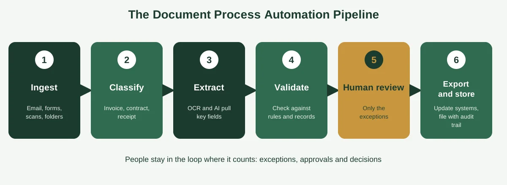
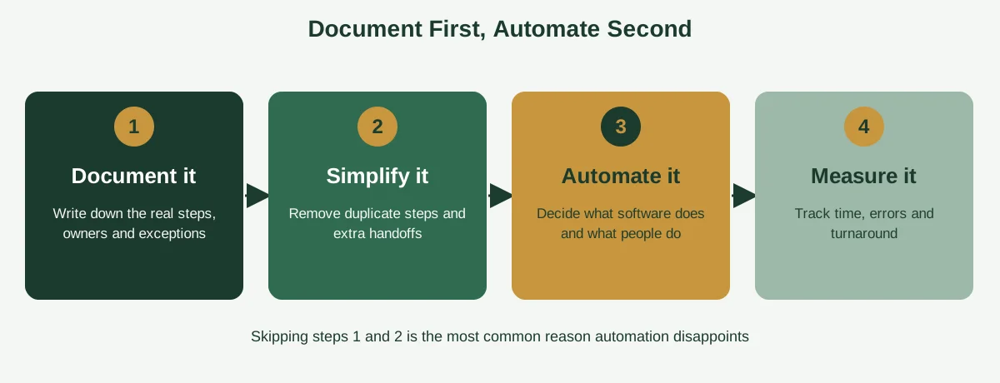

Every month, somebody on your team opens a supplier invoice, reads the total, types it into the accounting system, types the same number into a tracking sheet and then forwards the PDF to a manager for approval. It takes six minutes. Then they do it again, and again, a hundred times a month.

Nothing about that work needs a human brain. It needs accuracy, speed and a clear set of rules, which is exactly what software is good at. That's the idea behind document process automation: letting technology handle the capturing, reading, checking, routing and filing of documents, so people can spend their time on the exceptions and the decisions.

This guide explains what document process automation is (and the three different things people mean by it), how it works step by step, which processes to automate first and how to pick tools without overspending. You'll also get a seven-step plan, a risk checklist and a simple way to estimate your savings. And since automation only works on processes you understand, we'll start where it should: with clear documentation. If you want that background, read our guide to [process documentation](https://insyncea.com/blog/process-documentation/) first.

## What Is Document Process Automation?

**Document process automation is the use of software to handle the steps of a document-based process, such as receiving, reading, extracting data from, checking, routing and storing documents, with little or no manual typing.** A person still reviews exceptions and makes decisions, but the repetitive handling is done for them.

Typical documents include invoices, receipts, purchase orders, contracts, application forms, onboarding paperwork and client intake forms.

The phrase gets used loosely, so it helps to know that it covers three related ideas.

| Term                                 | What it means                                            | Example                                          |
| ------------------------------------ | -------------------------------------------------------- | ------------------------------------------------ |
| **Document automation (generation)** | Creating documents automatically from templates and data | A contract generated from a client record        |
| **Document processing (extraction)** | Reading incoming documents and pulling out data          | Capturing the total and due date from an invoice |
| **Document workflow automation**     | Routing documents through approvals and steps            | Sending an invoice to a manager, then to finance |

Document process automation is the umbrella that joins all three into one end-to-end flow. A good setup receives a document, reads it, checks the data, routes it for approval, files it and updates the right system.

You'll also hear a few related terms:

* **OCR (optical character recognition)** turns images or scans of text into machine-readable characters. It reads the letters, but doesn't understand them.
* **IDP (intelligent document processing)** adds AI that understands the context, such as telling a due date from an invoice date, and works on both structured forms and messy files.
* **RPA (robotic process automation)** uses software "bots" to copy the steps a person would take on screen, like clicking, copying and pasting between systems.

You don't need to master all the jargon. What matters is knowing which problem you're solving: creating documents, reading them or moving them around.

## Signs Your Business Is Ready for Document Automation

Automation isn't always the right answer. It pays off when work is repetitive, rule-based and high-volume. Here are the signs it's worth a look.

* **People retype the same data into several places.** Every retyping is a chance for a typo.
* **Documents wait in inboxes.** Approvals stall because the right person didn't see the email.
* **Errors keep appearing.** Wrong totals, missing fields and duplicate entries cost time to fix.
* **Month-end is a scramble.** Everyone's chasing paperwork at the last minute.
* **Finding a document takes too long.** Files are scattered across email, drives and desktops.
* **Onboarding paperwork drags.** New clients or staff wait days for forms to be completed.
* **Only one person knows how it works.** Everyone else is afraid to touch it.
* **You're growing.** Volume is rising, and the manual approach won't keep up.

If you recognized three or more, you probably have a good candidate. If your documents are few, unpredictable and each one needs real judgment, automation may cost more than it saves, and a clear checklist might be enough.

A quick test: could you explain the process to a new hire in five clear steps? If yes, it's probably ready to automate. If you'd struggle, document it first.

## How Document Process Automation Works: The Six-Stage Pipeline

Most systems follow the same basic pipeline, whether it's a simple no-code setup or an enterprise platform.

### 1. Ingest

The system collects documents from wherever they arrive: email attachments, web forms, scans, shared folders or cloud storage. The goal is to get everything into one stream.

### 2. Classify

It sorts each document by type. Is it an invoice, a contract, a receipt or something else? Classification decides which rules and routes apply.

### 3. Extract

Using OCR and, increasingly, AI, the system pulls the key fields out of the document: names, dates, totals, line items and reference numbers.

### 4. Validate

The extracted data is checked against your rules and records. Does the total match the purchase order? Is the supplier in your system? Is the date in the right format? Anything that fails is flagged.

### 5. Human review

This stage matters more than it sounds. Low-confidence or unusual items go to a person for a quick check and approval. A good system sends only the exceptions, not everything.

### 6. Export and store

Clean, approved data flows into your accounting software, CRM or other systems, and the document is filed in a searchable archive with a record of what happened.

Notice that the human stays in the loop where it counts. Automation isn't about removing people. It's about removing the typing, so people can focus on the cases that need judgment.

## Document First, Automate Second

Here's the advice most vendor guides skip: you can't automate a process you haven't clearly defined. If the steps are fuzzy, the exceptions are unwritten and everyone does it differently, software will just do the confusion faster.

The UC Berkeley Business Process Management Office makes the point directly: when a process is a candidate for automation or AI, documenting it comes first. You can see its reasoning on the [Berkeley BPMO portal](https://bpmoportal.berkeley.edu/node/95).

That's why we recommend a simple order.

**1. Document it.** Write down the real steps, owners, exceptions and tools. Our guide to [process documentation examples](https://insyncea.com/blog/process-documentation-examples/) shows what a good one looks like, and the [process template](https://insyncea.com/blog/process-template/) article gives you copy-and-paste formats.

**2. Simplify it.** Look for steps that exist only because of old habits: duplicate approvals, extra handoffs, forms nobody reads. Remove them before you automate.

**3. Automate it.** Now you can decide, step by step, what software should do and what people should do.

**4. Measure it.** Track time, errors and turnaround before and after, so you know whether it worked.

Skipping steps one and two is the most common reason automation projects disappoint. The software works. The process underneath doesn't.

If you want the bigger picture of how documented, automated processes fit together, our guide to [building business systems for growth](https://insyncea.com/blog/business-systems-for-growth/) is a good companion.

## Practical Use Cases for Small Businesses

Document automation isn't only for large enterprises. Here are six places small businesses commonly start.

### Invoices and accounts payable

Incoming supplier invoices are captured, the key fields are extracted, the totals are matched to purchase orders and approved invoices go straight to your accounting system.

|          | Before             | After                           |
| -------- | ------------------ | ------------------------------- |
| Entry    | Typed by hand      | Extracted automatically         |
| Checking | Eyeballing totals  | Matched against purchase orders |
| Approval | Forwarded by email | Routed to the right approver    |
| Filing   | Saved manually     | Stored with a searchable record |

### Employee and client onboarding

Offer letters, contracts, ID checks and forms are sent, signed and filed automatically, and reminders chase anything missing. New hires and clients start faster, and nothing gets lost.

### Contracts and e-signatures

Contracts are generated from templates, sent for signature, tracked and stored, with reminders ahead of renewals.

### Expense receipts

Employees photograph receipts, the system reads the amount, date and vendor, and entries land in the expense tracker for approval.

### Client intake forms

Forms are captured online, data flows into your CRM or project tool and the right team member is notified. No more copying details from emails.

### Document routing and approvals

Purchase requests, policy documents and proposals move through the right sequence of reviewers, with a clear audit trail. Box lists examples of this kind of automated flow, including onboarding, contract signing, compliance monitoring and routing, in its guide to [document workflow automation](https://www.box.com/resources/document-workflow-automation).

One caution: most published examples come from vendors, and they rarely include hard numbers on time or cost saved. Treat the use cases as inspiration, and measure your own results.

## What to Automate First

You can't, and shouldn't, automate everything at once. Score your candidates on four questions.

| Question                                 | Why it matters                                 |
| ---------------------------------------- | ---------------------------------------------- |
| **Is the volume high?**                  | Repeating tasks give the biggest payoff        |
| **Are the rules clear?**                 | Rule-based decisions are easiest to automate   |
| **Are the documents fairly consistent?** | Standard layouts are easier to read accurately |
| **What happens when it goes wrong?**     | Higher risk means more human review is needed  |

Here's an example scoring sheet. Use your own numbers.

| Process             | Volume (1 to 5) | Clear rules (1 to 5) | Consistent docs (1 to 5) | Total |
| ------------------- | --------------- | -------------------- | ------------------------ | ----- |
| Supplier invoices   | 5               | 4                    | 3                        | 12    |
| Expense receipts    | 4               | 4                    | 3                        | 11    |
| Client intake forms | 3               | 5                    | 5                        | 13    |
| Custom contracts    | 2               | 2                    | 2                        | 6     |

The highest-scoring process is usually your pilot. In this example, client intake forms are an easy win, since they're structured and the rules are clear. Custom contracts would stay manual for now.

Start with one process, prove it works and then expand. A small success builds the confidence and the evidence you'll need for the next one.

## Document Process Automation Tools

The market is crowded, and the names change fast. Instead of ranking products, here are the main categories and what each is good at.

| Category                                  | What it does                                              | Examples                                                     |
| ----------------------------------------- | --------------------------------------------------------- | ------------------------------------------------------------ |
| **OCR and data extraction**               | Reads text and fields from scans and PDFs                 | Cloud AI services, scanning apps, accounting add-ons         |
| **Intelligent document processing (IDP)** | Understands layouts and context, handles varied documents | Dedicated IDP platforms, AI document readers                 |
| **Workflow and no-code automation**       | Connects apps and routes documents between steps          | Microsoft Power Automate, Zapier, Make                       |
| **Document generation and e-signature**   | Builds documents from templates and collects signatures   | Document automation and e-signature tools                    |
| **Content and document management**       | Stores, secures and organizes documents with workflows    | Box, SharePoint, Google Drive                                |
| **RPA**                                   | Bots that mimic on-screen actions across systems          | UiPath, Automation Anywhere, Power Automate, SS&C Blue Prism |

For most small businesses, the sweet spot is a workflow tool you already have access to, such as Microsoft Power Automate if you use Microsoft 365, or a connector tool like Zapier or Make, combined with the extraction features built into your accounting or document software. You may not need a specialist platform at all.

### What about AI?

AI has made extraction much better, especially for messy documents. A few honest notes:

* **There's no single "best" AI for document processing.** Results depend on your documents, so test candidates on your own samples before committing.
* **General-purpose AI assistants can draft and summarize documents.** They can generate a first draft of a contract or a report, but they aren't a complete automation system, and you shouldn't paste confidential files into any tool without checking its privacy terms.
* **AI makes mistakes.** That's why the human-review stage matters, especially for money, legal and personal data.

### A quick note on RPA

If you're curious about RPA, there are generally said to be three types: attended bots that work alongside a person, unattended bots that run on their own, and hybrid setups that combine both. It's a powerful approach for connecting older systems that have no integration options, but it's usually more than a small business needs on day one.

Pricing varies widely and changes often, so check current plans on each vendor's site, and look closely at per-user, per-document and per-run charges before you commit.

## How to Automate a Document Process in 7 Steps

Here's a practical, low-risk way to get started.

### Step 1: Pick one process

Choose a high-volume, rule-based process from your scoring sheet, such as supplier invoices or client intake. Keep the scope small.

### Step 2: Map the current steps

Write down how it works today, including the exceptions and workarounds. Watch the person who does it. Our guides on [how to create workflows](https://insyncea.com/blog/how-to-create-workflows/) and [workflow steps](https://insyncea.com/blog/workflow-steps/) can help you break it into stages.

### Step 3: Clean it up

Remove duplicate steps, unclear approvals and unnecessary handoffs. Agree on naming rules, standard formats and who approves what.

### Step 4: Decide what's automated and what's human

Mark each step as automatic, automatic with review or manual. Anything involving large amounts of money, legal risk or sensitive data should include a human check.

### Step 5: Choose a tool that fits

Match the tool to the job, and to what you already use. Check that it integrates with your accounting, CRM or storage, offers an audit trail and handles your document types. Test it on real samples, not the vendor's demo files.

### Step 6: Run a pilot

Run the automated process alongside the manual one for a few weeks. Compare results, fix issues and gather feedback from the people involved.

### Step 7: Measure and expand

Track time per document, error rates and turnaround. If the numbers improve, document the new process, train the team and move to the next candidate.

## Risks to Plan For (and How to Reduce Them)

Automation brings real benefits, along with a few real risks. Here's what to watch for.

| Risk                            | What can go wrong                           | How to reduce it                                                                                         |
| ------------------------------- | ------------------------------------------- | -------------------------------------------------------------------------------------------------------- |
| **Extraction errors**           | A wrong total or date flows into your books | Keep human review for low-confidence and high-value items, and spot-check regularly                      |
| **Privacy and security**        | Sensitive documents are exposed             | Check where data is stored, limit access, use two-step verification and read the vendor's security terms |
| **Automating a broken process** | You scale the mess                          | Document and simplify first                                                                              |
| **Over-reliance on AI**         | Confident but wrong answers go unnoticed    | Validate against rules and records, and test on your own samples                                         |
| **Vendor lock-in**              | Your data is hard to move                   | Prefer tools with easy export, and keep your own copies                                                  |
| **No audit trail**              | You can't see who approved what             | Choose tools that log every action                                                                       |
| **Silent failures**             | An automation breaks and nobody notices     | Set up alerts and review exceptions weekly                                                               |
| **Compliance gaps**             | Records aren't kept as the rules require    | Check retention and approval requirements for your industry                                              |

Always keep a way for people to see, correct and override what the system does. Trust grows when mistakes are easy to catch.

## How to Estimate Your Savings

Before buying anything, work out what you could save. It takes five minutes.

**Time saved = (minutes per document today − minutes per document after) × documents per month**

Here's an illustrative example. Replace the numbers with your own.

|                           | Today | After automation |
| ------------------------- | ----- | ---------------- |
| Documents per month       | 120   | 120              |
| Minutes per document      | 6     | 2 (review only)  |
| Hours per month           | 12    | 4                |
| **Hours saved per month** |       | **8**            |

Eight hours a month is about 96 hours a year. At $25 an hour, that's roughly $2,400 in staff time, before counting fewer errors, faster approvals and less stress at month-end.

Compare that with the tool cost, setup time and the time needed to maintain it. If the savings clearly beat the costs within a year, you've got a good candidate. If not, wait or choose a simpler tool.

Also count what's harder to measure: fewer late payments, quicker onboarding and a cleaner audit trail. They often matter more than the hours.

## Need Help Getting Started?

The hardest part of document automation usually isn't the software. It's mapping the process, cleaning it up and deciding what to automate. If your team is already stretched, that's where outside help makes the biggest difference.

Our [business operations support](https://insyncea.com/services/business-operations-support/) helps small businesses document processes, simplify workflows and prepare them for automation, and our [administrative support](https://insyncea.com/services/administrative-support/) can handle document-heavy tasks like data entry and filing while you build the system. You can also [book a discovery call](https://insyncea.com/contact/#book) and tell us which process is costing you the most time.

## FAQ

### What is document process automation?

It's the use of software to handle the steps of a document-based process, including receiving, reading, extracting data, checking, routing and storing documents, with little manual typing. People still review exceptions and make decisions.

### How do you automate a documentation process?

Pick one high-volume, rule-based process, map the current steps, simplify them, decide what's automated and what needs human review, choose a tool that fits, run a pilot alongside the manual process and measure the results before expanding.

### What are some examples of document automation?

Common examples include extracting data from supplier invoices, generating contracts from templates, sending and tracking e-signatures, capturing expense receipts, routing approvals and filling in onboarding paperwork automatically.

### What is the difference between document automation and document processing?

Document automation usually means creating documents from templates and data. Document processing means reading incoming documents and extracting data. Document process automation joins both, plus routing and storage, into one end-to-end flow.

### What is the difference between OCR and IDP?

OCR converts images of text into machine-readable characters but doesn't understand context. IDP adds AI to understand the meaning of fields, such as telling a due date from an invoice date, and it handles varied layouts.

### What are the best document automation tools?

It depends on your needs and your existing software. Common categories include extraction tools, workflow tools such as Microsoft Power Automate, Zapier and Make, e-signature and document generation tools, and document management platforms. Test any tool on your own documents first.

### Which AI is best for document processing?

There isn't one best option, because results vary by document type, quality and language. Test a few candidates on real samples, check accuracy and review privacy terms before choosing.

### Can ChatGPT generate documents?

General-purpose AI assistants can draft and summarize documents, such as reports, emails and contract drafts. They aren't a full document automation system, and any draft needs human review. Avoid pasting confidential information into any tool without checking its privacy policy.

### What are the top RPA tools?

Commonly named tools include UiPath, Automation Anywhere, Microsoft Power Automate and SS&C Blue Prism. Rankings change often, so compare current features and pricing for your use case.

### What are the three types of RPA?

They're generally described as attended (works alongside a person), unattended (runs on its own) and hybrid (a mix of both).

### Do small businesses need document automation?

Not always. It pays off when you handle a lot of repetitive, rule-based documents. For low volumes, a clear process document and a simple checklist may be enough.

### How long does it take to set up?

A simple workflow with an existing tool can take days. A more complex setup with extraction, approvals and integrations may take weeks, including testing. Plan for a pilot period either way.

## Conclusion

Document process automation isn't about replacing people. It's about taking the repetitive handling of documents off their plates, so they can spend their time on exceptions, decisions and the work only humans can do.

To recap, understand which kind of automation you need, whether that's generating, processing or routing documents. Document and simplify the process first, then score your candidates and pilot one. Choose tools that fit what you already use, keep humans in the loop for risky items and measure the results.

Make it your own. A small agency with a few dozen invoices a month needs a very different setup from a company processing thousands, so start with the smallest change that makes a real difference.

And treat your documents with care. They hold financial and personal information, so check where your data goes, limit access, turn on two-step verification and keep an audit trail.

If you'd like help preparing your processes for automation, [book a discovery call](https://insyncea.com/contact/#book) and we'll look at where to start. And if you've automated a document process that changed your month-end, we'd love to hear how.