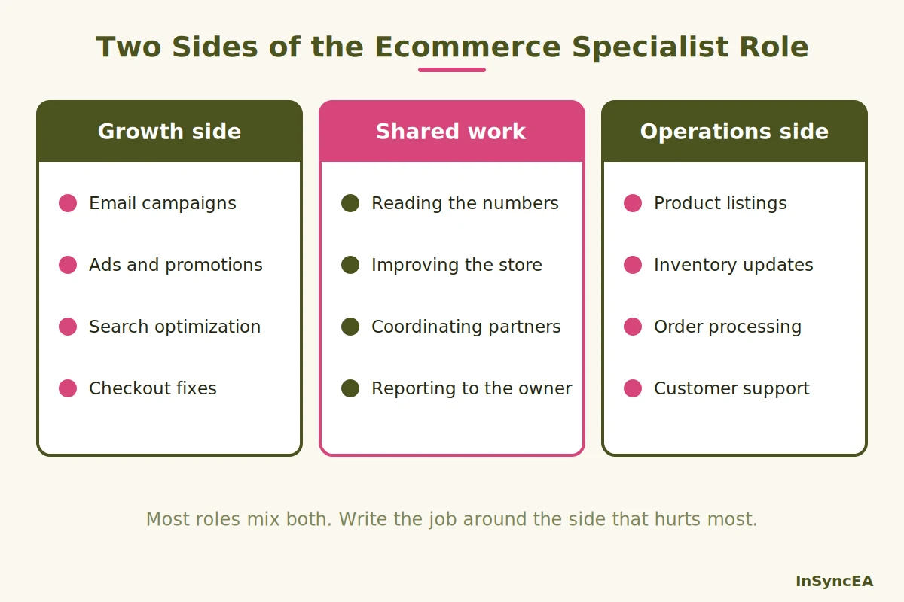
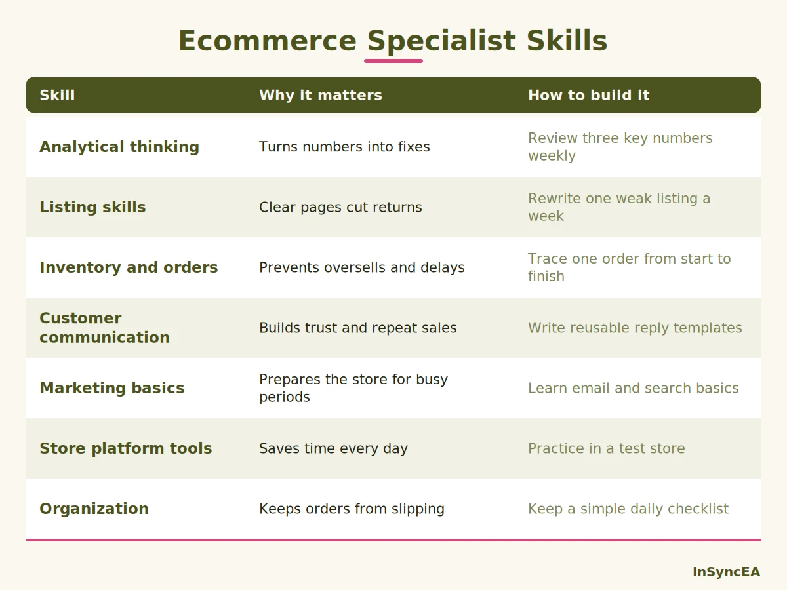
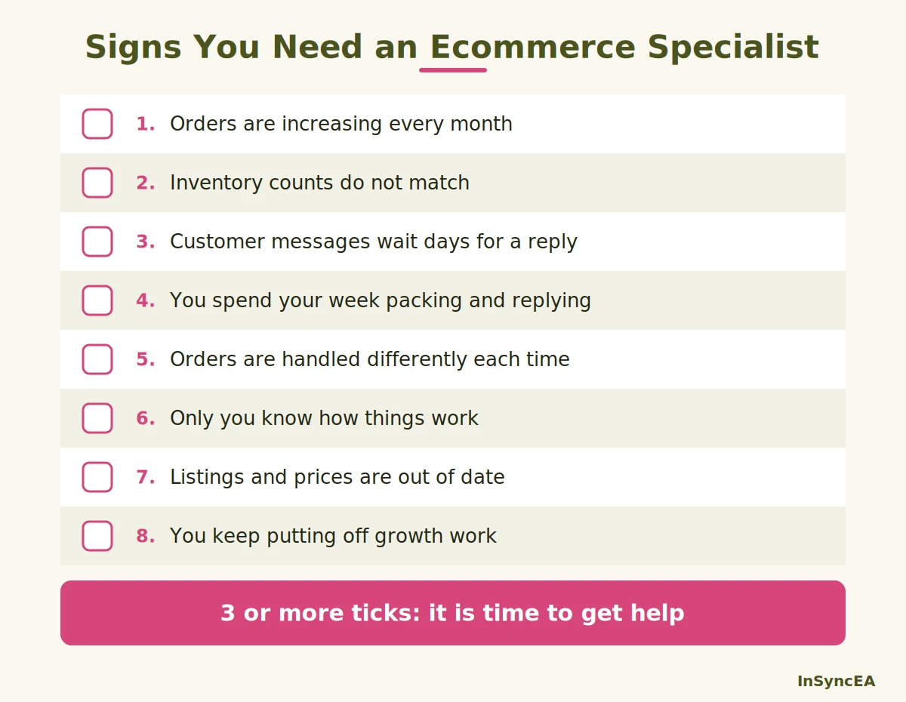

Search for "ecommerce specialist" and you'll find two very different jobs with the same title. One is built around ads, email, and conversion rates, and the other is built around stock, orders, and customer messages.

That split matters if you're an online store owner, because the person you need depends on which problem is costing you the most. An ecommerce specialist is one of the most common hires for a growing store, and one of the most often misunderstood.

In this guide, I'll explain what an ecommerce specialist is, what they actually do day to day, and the skills the role needs. I'll also cover how people get into the job and the signs that your business is ready for one, so you can decide whether to hire, contract, or get operations support.

## What Is an Ecommerce Specialist?

**An ecommerce specialist is a person who helps an online business sell more smoothly by looking after the day-to-day work of the store: product listings, orders, stock, customer messages, and performance numbers.** Depending on the company, the role can lean toward marketing or toward operations.

Job titles in this area overlap, so it helps to see how the main ones differ.

An ecommerce **specialist** usually handles hands-on tasks and reports on results. An ecommerce **manager** owns the whole store's goals and decisions, which we cover in our guide to [ecommerce management](/blog/ecommerce-management/).

An ecommerce **operations** role focuses on getting orders to customers, which we cover in our guide to [ecommerce operations](/blog/ecommerce-operations/).

In a large company, the specialist works inside a team with a manager above and other specialists beside them. In a small business, the specialist is often the first person you hire to take work off your plate, and they tend to cover several areas at once.

You'll also see the term used differently by different employers. Some describe the role as designing and running marketing campaigns for an online store.

Others describe it as managing and improving all the online sales channels. Others stress inventory and order handling.

That's why a clear job description matters more than the title. Before you hire, or before you take a role, check which side of the work it really covers.

The role is also hands-on by design. That makes it a common first hire for founders and a common entry point for people starting an ecommerce career. For an owner, the simplest way to think about it is that the specialist owns the repeat work, so you can own the decisions.

## What Does an Ecommerce Specialist Do?

On a typical day, an ecommerce specialist keeps the store running and a little better than yesterday. They check new orders, update products, answer customer questions, watch the numbers, and fix whatever is slowing sales down.

Picture a typical morning. The specialist checks overnight orders, fixes an address problem, and replies to customers who asked about delivery. Around midday they update a few product listings and stock counts. In the afternoon, they review the week's numbers and choose one small thing to improve, like a confusing product page.

The work usually falls into two sides, and most roles mix both.

**The growth side** is about bringing in shoppers and turning them into buyers. It includes email campaigns, ads, search optimization, promotions, and improving product pages and checkout.

**The operations side** is about making sure what was sold gets delivered well. It includes product listings, inventory updates, order processing, shipping coordination, returns, and customer support.

**The shared work** sits in the middle. Both sides rely on reading the numbers, improving the store, and coordinating with suppliers, carriers, designers, and the owner.

Which side matters most for you depends on your biggest bottleneck. If you don't have enough traffic or sales, you probably need the growth side. If sales are fine but orders, stock, and replies are messy, you need the operations side.

Many small stores need the operations side first. Marketing brings in more orders, but if the back end can't handle them, growth just creates more problems.

## Key Responsibilities of an Ecommerce Specialist

Here are the responsibilities you'll see most often, with what each one involves.

**Product listings.** Creating and updating product pages, including titles, descriptions, photos, prices, and variations. Accurate listings reduce returns and customer questions.

**Inventory coordination.** Keeping stock counts correct across your store and any marketplaces, flagging low stock, and working with suppliers on reorders. A common slip is selling something that's no longer available.

**Order management.** Checking new orders, resolving payment or address problems, and making sure each order moves to fulfillment on time.

**Customer support.** Answering questions about products, orders, delivery, and returns. Fast, clear replies are one of the cheapest ways to build trust.

**Analytics and reporting.** Tracking numbers like conversion rate, average order value, return rate, and order accuracy, then pointing out what's changing and why.

**Store optimization.** Improving how the store looks and works: clearer product pages, simpler checkout, better navigation, and faster pages. Small fixes here often add up to more orders.

**Marketing support.** Running or assisting with email, promotions, and ads. If you advertise online, the U.S. Federal Trade Commission's guidance on [online advertising and marketing](https://consumer.ftc.gov/business-guidance/advertising-marketing/online-advertising-marketing) is a useful reminder that truth-in-advertising rules apply online too.

**Team and partner coordination.** Working with suppliers, couriers, designers, freelancers, and the owner so that everyone knows what's happening.

When I handled administration, order management, customer inquiries, and store updates for an e-commerce business behind its Shopify store, this was the mix of work involved. You can read how it went in my [Shopify operations management case study](/case-studies/shopify-operations-management/).

If you're hiring, don't expect one person to do every item well. Decide which three or four matter most right now, and write the role around them.

It also helps to be clear about what a specialist usually doesn't do. Big decisions, like brand direction, pricing strategy, and budgets, normally stay with the owner or an ecommerce manager. The specialist carries out and improves the work within those decisions.

## Skills Every Ecommerce Specialist Should Have

You don't need a long list of tools to be good in this role. The skills that matter most are practical and easy to spot in the way someone works.

**Analytical thinking.** The job produces a lot of numbers, from sales and traffic to returns and reply times. A good specialist can read them, spot a pattern, and suggest a fix.

**Product and listing skills.** This means writing clear descriptions, choosing useful photos, and keeping prices and variations accurate. Clear listings quietly prevent many returns.

**Inventory and order management.** Keeping stock accurate and orders moving takes care and consistency. Small errors here become refunds and unhappy customers.

**Customer communication.** Calm, clear writing matters, because most customer questions come in by email or chat. The best replies answer the question, set expectations, and offer a next step.

**Marketing basics.** Even on the operations side, it helps to understand how email, search, and promotions bring in orders. That way, the specialist can prepare the store for busy periods.

**Store platform and tool skills.** Knowing how to work in a store platform like Shopify or WooCommerce, plus basic tools for spreadsheets, email, and task tracking, saves a lot of time.

**Organization and follow-through.** This one is easy to overlook. Orders, replies, and supplier messages all arrive at once, so someone who keeps clear notes and finishes what they start is worth a lot.

When you interview someone, ask them to walk you through how they'd handle a real situation. For example, a wrong item shipped, a stock-out on a popular product, or a customer asking for a refund. Their answer shows their skills better than a list of tools.

## How to Become an Ecommerce Specialist

If you're reading this as someone who wants the job, there isn't one required route. Many people move into it from customer support, administration, marketing, or retail. What counts is showing that you can handle the work and improve a result.

Here's a simple path:

1. **Learn how online stores work.** Understand product pages, checkout, fulfillment, returns, and the key numbers.
2. **Get hands-on.** Run a small store of your own, help a store owner part-time, or take a support or operations role in an online business.
3. **Build the core skills.** Practice analytics, listing quality, order and inventory handling, customer communication, and a store platform.
4. **Use free training.** Google's [Analytics Academy on Skillshop](https://support.google.com/analytics/answer/15440208) offers free e-learning courses and a certification on setting up and reading Google Analytics, which helps with the numbers side of the job.
5. **Keep a record of results.** Write down what you improved, such as faster replies, fewer wrong orders, or clearer product pages. A short record of results is stronger than a long list of tools.

Courses and certificates can help you learn, but employers and store owners usually care most about what you've actually done. Pay varies a lot by country, company size, and experience, so check current local job listings for realistic ranges.

For a first role, look for support, administration, and operations jobs at online stores, small agencies, and brands that sell direct. Small businesses often let you handle a wider range of tasks, which is a fast way to learn.

In an interview, bring one or two examples of work you've improved, even if it was a personal project. Being able to explain what you changed and what happened shows more than any certificate.

If you're a store owner, you can use the same path as a checklist for what to look for in a candidate.

## What Are the Different Types of Ecommerce?

Before you hire, it helps to know what type of ecommerce you run, because it shapes the work. There's no single official list, but the seven most often named are:

- **B2C (business to consumer):** you sell to individual shoppers.
- **B2B (business to business):** you sell to other businesses, often in bulk.
- **C2C (consumer to consumer):** individuals sell to each other, usually through a marketplace.
- **C2B (consumer to business):** individuals offer products or services to companies.
- **D2C (direct to consumer):** a brand sells its own products straight to customers.
- **B2G (business to government):** you sell to government agencies.
- **A government-to-consumer type:** government bodies offering services to individuals online, which some lists write as G2C and others as C2G.

Most small online businesses are B2C, B2B, D2C, or a mix. A B2C store needs strong customer support and returns handling, while a B2B seller needs invoicing, account terms, and repeat ordering.

We explain how each type changes the day-to-day work in our guide to [ecommerce operations](/blog/ecommerce-operations/).

## When Does a Growing Business Need an Ecommerce Specialist?

This is the question that matters most if you own a store. Many owners wait too long, because the problems build slowly and each one seems small.

Here are the signs I'd look for.

**Orders are increasing.** More orders mean more checks, more shipments, and more questions. If you're already staying late to keep up, the next wave will be harder.

**Inventory errors are creeping in.** Overselling, stock-outs, and mismatched counts across channels are signs that stock tracking has outgrown memory and spreadsheets.

**Customer inquiries are piling up.** Slow replies cost sales and trust. If customers wait days for answers, someone needs to own the inbox.

**You're spending too much time on operations.** If you spend your week packing, replying, and updating listings, you're not working on products, partnerships, or growth.

**Processes are becoming inconsistent.** Different people handle orders in different ways, or you handle them differently each week. That's how mistakes slip in.

**You're the only one who knows how things work.** When everything depends on you, a sick day or a holiday puts the whole store at risk.

If three or more of these sound familiar, it's time to get help. Our guides on [business operations challenges](/blog/business-operations-challenges/) and the [signs your business operations need improvement](/blog/signs-business-operations-need-improvement/) can help you pinpoint what's slipping.

You don't have to start with a full-time hire. Here are your main options:

- **Hire an in-house specialist:** good when the workload is steady and large enough for a full-time person.
- **Hire a freelancer:** useful for a specific area, like product listings or email.
- **Bring in an operations partner:** a good fit when you need the day-to-day work organized and handled, without managing another employee.

This is where my services fit. When I take on a new store, I start by mapping how work actually flows today, find the step where things slow down or get lost, and fix that first, instead of rebuilding everything.

In one case study, a wholesale tea business had order details scattered across Shopify, wholesale portals, supplier messages, and email. I built one organized tracker for order information, tracking numbers, due dates, and invoice status, which gave clearer visibility and far less manual follow-up. You can read it in the [wholesale order tracking case study](/case-studies/wholesale-order-tracking-system-operations-improvement/).

Here's how our services line up with the specialist work:

- **[Business operations support](/services/business-operations-support/):** written procedures, task tracking, and workflows so the store doesn't depend on memory.
- **[Customer and partnership operations](/services/customer-partnership-operations/):** timely customer replies and follow-ups with suppliers and partners.
- **[Administrative support](/services/administrative-support/):** data entry, reports, and organized records.

If your store is growing faster than your routines, [book a consultation](/contact/#book). We'll look at how your store runs today and agree on the first thing to take off your plate.

## FAQ

### What is an ecommerce specialist?

An ecommerce specialist helps an online business run and grow by handling day-to-day tasks like product listings, orders, inventory, customer messages, and performance reporting. Some roles lean toward marketing, and others toward operations.

### What skills do you need to work in ecommerce?

Useful skills include analytical thinking, product listing and merchandising basics, inventory and order management, clear customer communication, marketing basics, comfort with a store platform, and strong organization.

### What are the 7 types of ecommerce?

The seven most often named are B2C, B2B, C2C, C2B, D2C, B2G, and a government-to-consumer type that some lists write as G2C or C2G. There's no single official list.

### How do you become an ecommerce specialist?

Learn how online stores work, get hands-on experience, build core skills, use free training, and keep a record of the results you've improved. Many people reach the role from support, administration, marketing, or retail jobs.

### What is the difference between an ecommerce specialist and an ecommerce manager?

A specialist handles hands-on tasks and reports on results. A manager owns the store's goals, priorities, and overall performance, and often leads the specialists.

### Should I hire an ecommerce specialist or outsource?

It depends on workload and budget. A full-time hire suits steady, large workloads, while a freelancer or an operations partner can cover the repeat tasks without adding a full-time employee.

## Conclusion

An ecommerce specialist keeps the daily work of an online store moving, from listings and orders to customer messages and numbers. The role can lean toward growth or toward operations, so the first step is knowing which problem is costing you the most.

If orders, stock, and replies are starting to pile up, it's time to hand off the repeat work. You can [book a consultation](/contact/#book) and we'll look at your store together.

Hire for the work that's piling up, not for the title on the job post.