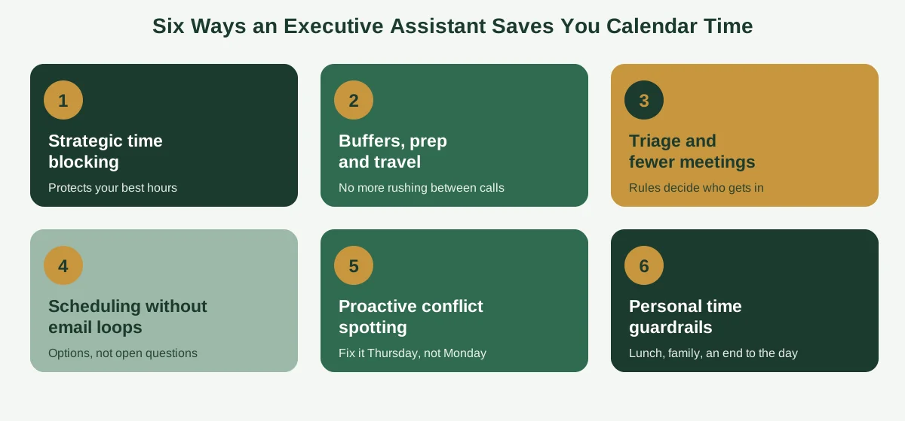
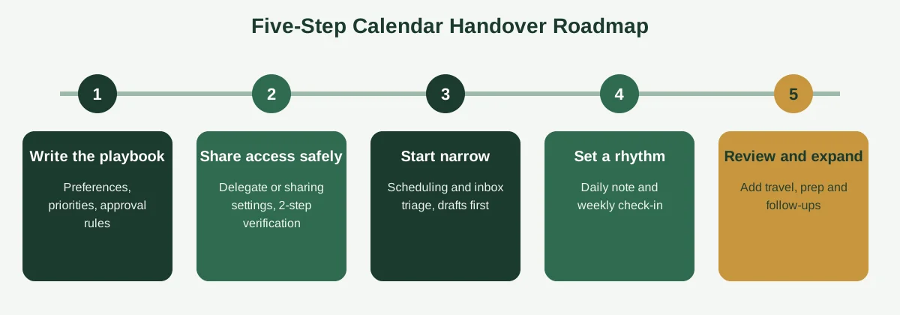

Imagine your calendar sent you an itemized receipt at the end of every week. Forty minutes on emails about availability. Twenty on a meeting that moved twice. Fifteen hunting for a dial-in link, ten untangling a time zone, and an hour of "quick" decisions about who deserves a slot.

Most leaders have never seen that receipt, which is exactly why the cost stays hidden. But add it up, and you'll often find hours every week going to work that doesn't need you. That's the gap executive assistant calendar management is built to close.

This guide shows you where those hours go, the six ways an assistant gives them back, how to estimate your own savings (without trusting anyone's marketing numbers), and how to hand over your calendar without losing control. If you want the basics first, our guide on [what calendar management is](https://insyncea.com/blog/what-is-calendar-management/) is a good place to start.

## Where Your Calendar Hours Actually Go

Before you can save time, you need to see where it leaks. Most of the loss isn't in meetings themselves. It's in everything around them.

Here's what that hidden work usually looks like.

**Scheduling back-and-forth.** "Does Thursday work?" "How about Friday?" Each round takes a minute or two, but a single meeting can take four or five rounds, and you probably book dozens a month.

**Rescheduling and conflict fixing.** Meetings move, double-bookings appear and priorities change. Every change ripples through other people's calendars.

**Hunting for details.** Links, agendas, dial-ins and background documents get scattered across emails. Finding them takes minutes, and those minutes land right before the meeting starts.

**Time zone math.** Converting times, checking daylight saving changes and double-checking that "3 p.m." means the right 3 p.m.

**Decisions about who gets in.** Every request needs a yes, a no or a "let me check." Individually trivial, together exhausting.

**Context switching.** A calendar chopped into small pieces stops you doing sustained work. The cost isn't only the minutes in meetings but the recovery time around them.

That last point matters more than the rest. In the Harvard Business School study of 27 CEOs, published in [Harvard Business Review](https://hbr.org/2018/07/the-leaders-calendar), the researchers found that leaders' time was heavily shaped by meetings and reactive demands, and that how a CEO allocates time affects both personal effectiveness and company performance. The lesson holds for founders and executives at any scale: your calendar quietly decides your priorities.

An executive assistant doesn't just remove the small tasks. They change the shape of your week.

## How Executive Assistant Calendar Management Saves You Hours

A good assistant saves time in six different ways. Each one targets a different leak.

### 1. Strategic time blocking

An assistant builds an ideal week around your priorities, reserving your best hours for the work only you can do. Instead of a calendar that fills with whatever arrives first, you get one that's structured on purpose.

**Hours it saves:** the ones you'd otherwise lose to fragmented days. Deep work done in two protected blocks beats the same work scattered across ten gaps.

### 2. Buffers, prep and travel time

Assistants add short buffers between meetings, prep time before important calls and real blocks for travel. You stop rushing from one call to the next, and one overrun no longer wrecks the rest of the day.

**Hours it saves:** the recovery time and the "sorry, running late" scramble. It's harder to measure, but you'll feel it.

### 3. Triage and meeting minimization

Your assistant screens requests using rules you've agreed on. Some get booked right away, some come to you for a quick yes or no, and some are declined, delegated or turned into an email. They also make sure every meeting that does happen has an agenda and the materials you need in the invitation.

**Hours it saves:** every meeting that never reaches your calendar, plus the minutes you'd have spent preparing for unclear ones.

### 4. Scheduling without the email loop

By using tools like Calendly, shared availability and clear proposals, an assistant eliminates the multi-message back-and-forth. They offer two or three specific times with the time zone, and the meeting is booked in one exchange.

**Hours it saves:** the steady drip of scheduling emails that adds up to a surprising chunk of every week.

### 5. Proactive conflict and pattern spotting

An assistant looks two to four weeks ahead. They catch double-bookings, travel gaps, missing prep time and patterns like a recurring meeting that always overruns.

**Hours it saves:** the firefighting. Problems get solved on Thursday afternoon instead of at 8:00 a.m. on Monday.

### 6. Guardrails for your personal time

A good assistant protects lunch, exercise, family time and a sensible end to the working day. It's not an extra, because burned-out leaders make worse decisions.

**Hours it saves:** the slow leak of evenings and weekends, which is often where the real cost lands.

Boldly, an executive assistant staffing company, makes a similar point in its piece on [how an EA protects your time](https://boldly.com/blog/executive-assistant-time-strategy/), arguing that a strong assistant decides what gets onto the calendar in the first place. It's a good reminder that the real value is in judgment, not just logistics.

## How to Estimate Your Own Hours Saved

You'll see plenty of providers claim specific percentages, like "15 to 20 percent more productive" or "5 to 10 hours back every week." Treat those as marketing, not data. They come from particular leaders in particular situations, and your calendar isn't theirs.

The better approach is to measure your own. It takes about 20 minutes.

### Step 1: Log a typical week

For one week, note every time you spend on calendar-related work. Include scheduling emails, rescheduling, hunting for links, time zone checks, travel planning, reviewing the week ahead and deciding who gets a slot.

### Step 2: Multiply it out

Here's an example. The numbers below are purely illustrative, so replace them with your own.

| Task                              | How often            | Time each | Weekly total                          |
| --------------------------------- | -------------------- | --------- | ------------------------------------- |
| Scheduling emails                 | 6 per day, 5 days    | 3 min     | 90 min                                |
| Rescheduling and conflicts        | 3 per week           | 10 min    | 30 min                                |
| Finding links and prep materials  | 20 meetings          | 2 min     | 40 min                                |
| Time zone checks                  | 4 per week           | 5 min     | 20 min                                |
| Travel logistics                  | About 1 trip a month | 90 min    | About 21 min                          |
| Weekly calendar review            | Once                 | 30 min    | 30 min                                |
| Declining or redirecting requests | 5 per week           | 4 min     | 20 min                                |
| **Total**                         |                      |           | **About 251 min, or roughly 4 hours** |

Four hours a week might not sound dramatic. Over a working year, it's roughly 200 hours, which is five full working weeks. And that's before counting the focus time you gain from a better-structured calendar.

### Step 3: Compare it with the cost

Use a simple formula:

**Value of your time × hours saved − assistant cost = net gain**

Say your time is worth $100 an hour (a rough placeholder, so use your own number). Four hours a week is worth about $400. If an assistant needs three hours a week at $25 an hour, that's $75, leaving a gain of roughly $325 a week in this example.

It's a rough estimate, and it ignores the biggest benefits, like better decisions and fewer dropped balls. But it shows you quickly whether the numbers are in the right direction.

### Step 4: Check the hidden savings

The hours you can count are only part of the story. Also consider:

* Meetings that were declined or shortened
* Mistakes avoided, such as missed calls and double-bookings
* Focus time protected for important work
* Mental energy saved from not carrying the schedule in your head

If you're curious about typical pricing, our guide to [virtual assistant calendar management](https://insyncea.com/blog/virtual-assistant-calendar-management/) covers what different hiring models cost and what to look for.

## A Week With and Without an Assistant

It helps to picture the difference. Here's the same week handled two ways.

| Moment                         | Without an assistant                   | With an assistant                                        |
| ------------------------------ | -------------------------------------- | -------------------------------------------------------- |
| Monday morning                 | You scan the week and find two clashes | The clashes were fixed on Friday                         |
| New meeting request            | You reply, wait, reply again           | Two options are offered, and it's booked in one exchange |
| Before a key call              | You search for the link and notes      | The agenda, link and background are in the invitation    |
| A request you'd rather decline | You put it off, then feel guilty       | A polite decline goes out the same day                   |
| Travel                         | You juggle flights, hotels and calls   | Travel is blocked as real time with buffers              |
| Thursday afternoon             | You work through lunch to catch up     | Flex time absorbs the overruns                           |
| Friday                         | You hope nothing slipped               | A short review confirms next week is clear               |

Nothing in the right-hand column is magic. It's just consistent attention from someone whose job is to give the calendar that attention.

## What You Still Need to Do

An assistant can't read your mind, and handing over the calendar doesn't mean handing over every decision. A few things stay with you.

**Set the priorities.** Tell your assistant what you're working toward this quarter. Without it, they can follow rules but not make good judgment calls.

**Write down your preferences.** Working hours, focus time, meeting lengths, who always gets in and who needs approval. A one-page playbook covers it, and our guide on [how to effectively manage an executive calendar](https://insyncea.com/blog/how-to-manage-an-executive-calendar/) includes a preferences brief you can copy.

**Give quick feedback.** In the first month, a short "perfect" or "next time, offer afternoon slots" teaches more than any document.

**Keep the high-stakes decisions.** Sensitive conversations, major relationships and decisions involving serious money or legal matters are yours. Your assistant can prepare them and schedule them, but you decide.

A useful way to think about it is in three levels. Some things you delegate fully, like routine scheduling and reminders. Some you delegate with approval, like new contacts and vendor pitches. And some you keep. You can move items between levels as trust grows.

## How to Hand Over Your Calendar in 5 Steps

Handing off well is what separates a smooth start from a frustrating one. Here's a simple path.

### Step 1: Write the playbook

Spend 30 minutes on your preferences, priorities and approval rules. Keep it to a page.

### Step 2: Share access safely

Use proper sharing or delegate settings, not your password. In Outlook, that's delegate access, which Microsoft explains in its guide to [giving someone delegate access to your mail and calendar](https://support.microsoft.com/en-us/office/give-someone-delegate-access-to-your-mail-and-calendar-901d08a6-e496-4547-b0dd-1520d05b714c). In Google Calendar, share with the specific person at the level that lets them make changes to events. Turn on two-step verification, and keep any shared credentials in a password manager.

### Step 3: Start with a narrow scope

Begin with scheduling and inbox triage. Let your assistant draft replies for the first week or two, so they learn your voice before sending anything alone.

### Step 4: Set a rhythm

A short daily note and a weekly check-in keep you aligned without taking much time. Decide how urgent items should reach you.

### Step 5: Review and expand

After a month, look at what's working, update the playbook and add more, such as travel, meeting prep and follow-ups.

Documenting the process also helps when you grow. Our guide on [building business systems for growth](https://insyncea.com/blog/business-systems-for-growth/) explains how to turn a habit into something anyone could follow.

## Human, AI or Both?

You've probably wondered whether software could do all this. Partly, yes.

AI schedulers and tools like Calendly handle routine logistics well: finding open slots, converting time zones and sending reminders. They don't get tired, and they respond instantly.

What they struggle with is context. They can't tell that a "routine" call is with a nervous investor, or that a certain colleague needs a gentle decline. They also don't notice the pattern that a meeting always overruns or that you've been working too many evenings.

That's why many leaders use tools for the logistics and an assistant for the judgment. Our guide to [executive calendar management tools](https://insyncea.com/blog/executive-calendar-management-tools/) compares the main options and shows how to pick a small stack.

## Common Mistakes When Delegating Your Calendar

Most problems come from how the arrangement starts, not from the assistant.

**1. Handing over access with no rules.** An assistant with permission but no playbook is guessing.

**2. Delegating everything at once.** Start narrow, then widen the scope as trust builds.

**3. Skipping feedback.** Silence leaves your assistant unsure what you want.

**4. Being vague about priorities.** If they don't know what matters, they can't protect it.

**5. Sharing passwords.** Use built-in sharing instead. It's safer and more transparent.

**6. Treating the assistant as a human calendar app.** The most valuable ones anticipate and advise. Give them context, and invite their input.

Our guide on [common calendar management mistakes](https://insyncea.com/blog/calendar-management-mistakes/) covers more of these, along with simple fixes.

## Is It Worth It? Who Benefits Most

It isn't for everyone, and that's fine. Here are the signs it's probably worth it:

* Scheduling takes real time every day
* Double-bookings or last-minute reschedules keep happening
* Your best hours get eaten by routine meetings
* Follow-ups slip through the cracks
* You work evenings to catch up on the real work
* You're the only person who understands how your calendar works

If three or more of those ring true, try it. You don't need a full-time hire to find out. Many founders start with a few hours a week, and grow the scope as the value becomes clear.

Our [executive assistant support](https://insyncea.com/services/executive-support/) covers calendar and inbox management, meeting coordination, travel and follow-ups, and support starts at $10 per hour. If you'd like to talk through what to hand over first, you can [book a discovery call](https://insyncea.com/contact/#book).

## FAQ

### How does an executive assistant save you time?

By taking over the work around your calendar: scheduling, rescheduling, triaging requests, preparing meeting materials, handling time zones and travel, spotting conflicts early and protecting your focus time. They also reduce the number of low-value meetings that reach you.

### How many hours can an executive assistant save you?

It depends on your schedule. Rather than trusting a fixed number, log one typical week of calendar-related tasks, multiply it out and compare it with the cost. Many leaders find several hours a week in routine tasks alone.

### What does an executive assistant do for calendar management?

They schedule and reschedule meetings, screen requests, protect focus time, add prep and travel time, coordinate time zones, send daily summaries and follow up on action items. They also review the next two to four weeks to catch problems early.

### Can I delegate my calendar without losing control?

Yes. Write down your rules, share access using proper delegate or sharing settings, start with a narrow scope and agree on what needs your approval. A daily note and weekly check-in keep you informed.

### Is it better to hire an in-house assistant or a virtual one?

It depends on your needs. In-house assistants offer a full-time presence at a higher fixed cost. Virtual assistants offer flexible hours and lower commitment, which suits growing businesses. Either can manage a calendar well if the rules are clear.

### Can AI replace an executive assistant for calendar management?

AI can handle routine logistics, but it struggles with context, nuance and high-stakes relationships. Most leaders use tools for the logistics and a person for judgment and exceptions.

### What should I give my assistant before they start?

Give them access, a one-page playbook of your preferences, your top priorities for the quarter and a list of who always gets in and who needs approval. Add a clear way to reach you for urgent items.

### How do I know if it's working?

Look for fewer double-bookings, more protected focus time, fewer scheduling emails and agendas attached to your key meetings. Review it monthly, and update the playbook as you learn.

### How much does executive assistant calendar management cost?

It varies by experience, scope and hiring model. At InSyncEA, support starts at $10 per hour. Compare the cost with the value of the hours you'd get back.

## Conclusion

Executive assistant calendar management isn't about having someone type your meetings into a grid. It's about giving you back the hours lost to scheduling, rescheduling, preparing and deciding, and protecting the time that remains for the work only you can do.

To recap, see where your calendar hours go, and understand the six ways an assistant gives them back. Estimate your own savings instead of trusting someone else's numbers. Hand over the calendar in steps, with a playbook, safe access and regular feedback.

Make it your own. A founder with clients across several time zones will start in a different place from a leader with a steady local schedule, so begin with the tasks that cost you the most.

And keep confidentiality at the center. Share access only with people who need it, use proper sharing settings and keep sensitive details out of visible event titles.

If you'd like to see what you could hand over, [book a discovery call](https://insyncea.com/contact/#book) and we'll look at your calendar together. And if you've handed off a task that changed your week, we'd love to hear what it was.