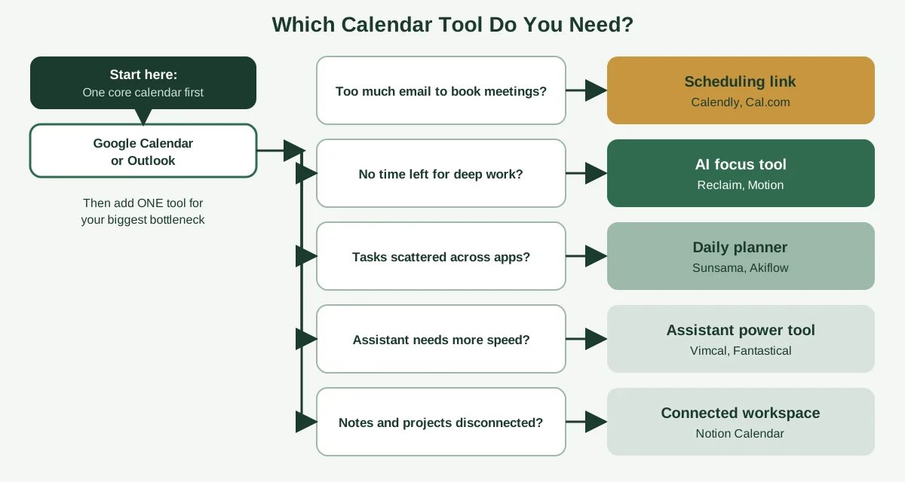
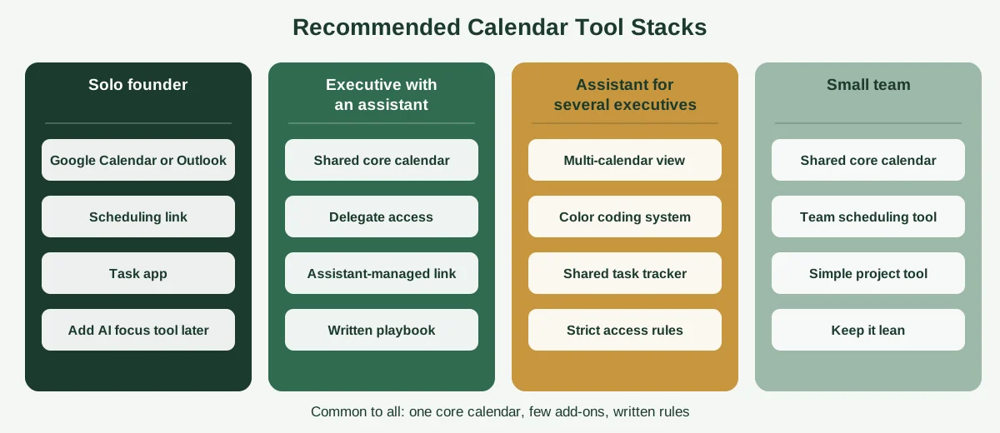

Most executives don't have a tool problem. They have a rules problem, a delegation problem or a "yes to everything" problem, and a new app gets blamed for all three. Still, the right tools make good habits much easier to keep, and the wrong ones quietly add friction to every single day.

So let's do this properly. Below, you'll find the main executive calendar management tools compared side by side: core calendars, scheduling links, AI schedulers and daily planners. Instead of ranking them from "best" to "worst" (the honest answer is that it depends), you'll get a simple way to pick based on your actual bottleneck.

Along the way, we'll cover what each tool is good at, where it falls short, what to check before you connect it to a sensitive calendar, and which stacks suit which situations. A quick note on sources: features and prices come from vendor information and 2026 roundups, and software changes fast, so confirm anything important on the vendor's own site before you buy. If you're new to the topic, our guide on [what calendar management is](https://insyncea.com/blog/what-is-calendar-management/) is a good starting point.

## How to Choose Executive Calendar Management Tools

Before comparing apps, work out what's actually going wrong. Tools fall into a few categories, and each one solves a different problem.

| If your bottleneck is...                          | You need...                        | Example tools                      |
| ------------------------------------------------- | ---------------------------------- | ---------------------------------- |
| Seeing and sharing availability across the team   | A core calendar                    | Google Calendar, Microsoft Outlook |
| Too much email back-and-forth to book meetings    | A scheduling link                  | Calendly, Cal.com                  |
| No time left for deep work                        | An AI focus and time-blocking tool | Reclaim, Motion                    |
| Tasks and meetings scattered across apps          | A daily planner                    | Sunsama, Akiflow                   |
| An assistant who needs speed                      | An EA-focused calendar tool        | Vimcal, Fantastical                |
| Notes and projects disconnected from the calendar | A connected workspace              | Notion Calendar                    |

Then ask five questions about any tool you're considering.

**1. Does it fit the ecosystem your executive already lives in?** If they're in Google Workspace, tools that sync cleanly with Google will feel natural. If they're on Microsoft 365, Outlook's native features are hard to beat.

**2. Who will use it day to day?** A tool built for one person is different from one that an executive assistant will use for hours. Speed, keyboard shortcuts and shared views matter more to an assistant than to a casual user.

**3. How much judgment is involved?** Routine tasks, like finding slots and sending reminders, are easy to automate. Decisions about who gets in, what to decline and how to handle a sensitive conflict still need a human.

**4. What does it need access to?** Many tools ask to read and write your calendar, and some want your email too. We'll cover this in detail in a moment.

**5. What will it really cost?** Per-seat pricing adds up, and add-ons raise the total. Count everyone who needs a seat, including assistants.

One more rule of thumb: add tools one at a time. A new app layered on unclear habits just creates another place for things to go wrong.

## Executive Calendar Management Tools at a Glance

Here's the side-by-side view. Prices are approximate and drawn from 2026 roundups and pricing pages, so treat them as a guide and check current rates.

| Tool              | Category                      | Approx. price                                            | Best for                                           | Watch out for                                       |
| ----------------- | ----------------------------- | -------------------------------------------------------- | -------------------------------------------------- | --------------------------------------------------- |
| Google Calendar   | Core calendar                 | Free, or included with Workspace plans                   | Universal integration and easy sharing             | Fewer advanced controls than some enterprise setups |
| Microsoft Outlook | Core calendar                 | Included in Microsoft 365 plans                          | Corporate environments and delegate access         | Can feel heavy outside the Microsoft world          |
| Calendly          | Scheduling link               | Free; paid from about $10 per seat a month billed yearly | High volume of external bookings                   | Free plan limits you to one event type              |
| Cal.com           | Scheduling link               | Free tier available                                      | Teams who want flexibility and open-source options | More setup than a plug-and-play tool                |
| Reclaim           | AI focus and habits           | Free and paid tiers                                      | Protecting focus time automatically                | Automation needs rules you trust                    |
| Motion            | AI task and calendar planning | Roughly $34 a month in recent roundups                   | Auto-rescheduling tasks and meetings               | Higher price, and it works best if you commit to it |
| Sunsama           | Daily planner                 | Roughly $22 a month                                      | Calm, intentional daily planning                   | Less suited to heavy external scheduling            |
| Akiflow           | Task and calendar capture     | Roughly $19 a month                                      | Pulling tasks from many apps into one timeline     | Another place to check each day                     |
| Notion Calendar   | Connected workspace           | Free                                                     | Linking calendars to Notion databases              | Best if you already use Notion                      |
| Fantastical       | Power-user calendar           | Roughly $5 to $8 a month                                 | Natural language entry and polish                  | Mainly valued by Apple-centric users                |
| Vimcal            | EA-focused calendar           | Paid                                                     | Speed, shortcuts and fast availability sharing     | Another subscription on top of your main calendar   |

Notice that almost none of these replace your core calendar. Most of them sit on top of Google Calendar or Outlook and make one part of the job easier. That's why the best setups are usually a small stack, not a single "perfect" app.

## The Core Calendar: Google Calendar vs Microsoft Outlook

Every executive needs one calendar that acts as the single source of truth. For most people, that means Google Calendar or Outlook.

### Google Calendar

Google Calendar is the most widely used option, and for good reason. It's free for personal use, it's included in Google Workspace and it integrates with almost everything.

**What it does well:**

* Easy sharing, with different permission levels for different people
* Working hours, time zone support and color-coding
* Smooth integration with scheduling tools, task apps and video meetings
* Basic booking features for taking appointments

**Where it can frustrate you:**

* Some advanced features depend on your Workspace plan
* Managing someone else's calendar works through sharing settings, so it's worth setting permissions carefully

For assistants, the key setting is sharing with specific people at the "make changes to events" level. That gives them enough access to schedule, edit and cancel without handing over a password.

### Microsoft Outlook

Outlook is the default in many corporate environments, and it has features that suit executive support especially well.

**What it does well:**

* Delegate access, which lets an assistant manage mail and meeting requests on someone's behalf
* The Scheduling Assistant view, which shows when several people are free
* Color categories for organizing events
* Deep integration with Teams and the rest of Microsoft 365

**Where it can frustrate you:**

* It can feel heavier than lighter apps, especially outside the Microsoft ecosystem
* Delegate setups need to be configured properly, or things get confusing fast

Microsoft explains how delegate access works in its guide to [giving someone delegate access to your mail and calendar](https://support.microsoft.com/en-us/office/give-someone-delegate-access-to-your-mail-and-calendar-901d08a6-e496-4547-b0dd-1520d05b714c).

### Which should you choose?

Usually, you don't get to choose. Go with whichever your executive and team already use. Switching core calendars is a big change, and it rarely solves a problem that better rules wouldn't fix.

If you're starting from scratch, Google Calendar is simpler for small teams, and Outlook is a better fit for larger organizations on Microsoft 365. What matters most is that every meeting lives in one place.

## Scheduling Link Tools: Calendly and Alternatives

If a big chunk of your day goes to emails like "Does Thursday work?", a scheduling link tool can give you hours back. You share a link, people pick from approved times, and the event lands on your calendar.

### Calendly

Calendly is the best-known option. As of October 2026, it offers a free plan, a Standard plan at about $10 per seat a month billed yearly ($12 monthly), and a Teams plan at about $16 a month billed yearly ($20 monthly). Enterprise pricing is higher and custom.

The free plan works for simple needs, but the main limit is the number of event types. A summary of [what Calendly's free plan covers](https://dupple.com/learn/is-calendly-free) explains the limit well. If you need different links for different meeting types, you'll probably want a paid plan.

**Best for:** executives and assistants with a steady flow of external meetings, such as clients, candidates and partners.

**Watch out for:** seat costs for assistants, and the temptation to give everyone access to your calendar. Be careful about which meeting types you open up.

### Cal.com and other alternatives

Cal.com is a popular alternative that offers a free tier and more flexibility, including open-source options. Roundups also mention tools like Acuity Scheduling and Doodle, which suit different mixes of appointments and group polling.

**Best for:** teams who want more control, custom workflows or lower cost.

**Watch out for:** more setup time than a plug-and-play tool.

### How to use scheduling links without being rude

A link can feel impersonal if it's used badly. A few habits help:

* Offer a personal note, not just a link, for important contacts
* Build in buffers and daily limits, so you don't get overbooked
* Create separate links for different meeting types, like a 20-minute intro and a 50-minute working session
* Keep VIP meetings out of the public link, and have your assistant arrange them directly

Used well, links save time without costing relationships. Used badly, they can make you look hard to reach.

## AI Scheduling and Focus Tools: Reclaim and Motion

AI-powered tools promise to manage your calendar for you. Some of that promise is real, and some of it isn't.

### What AI does well

These tools handle routine logistics: finding open slots, resolving simple conflicts, converting time zones, sending reminders and protecting blocks of focus time. They never get tired, and they respond instantly.

**Reclaim** focuses on protecting your time. It can defend focus blocks, schedule habits and shift flexible tasks around meetings. It has free and paid tiers.

**Motion** goes further, automatically planning your tasks and rescheduling them when plans change. It's priced higher, at roughly $34 a month in recent roundups, and it works best if you're willing to let it run your task list.

### What AI doesn't do well

AI struggles with context. It can't tell that a "routine" call is actually with a nervous investor, or that a particular colleague needs a gentle decline. High-stakes relationships, emotional nuance and judgment calls still belong to a person.

That's why many executives use AI to handle logistics and keep a human, whether that's an in-house assistant or a [virtual assistant](https://insyncea.com/blog/virtual-assistant-calendar-management/), in charge of decisions and exceptions.

### Questions to ask before you trust an AI scheduler

* What data does it read and store, and where?
* Can you limit it to calendar data and keep it out of your email?
* Can you review and undo what it changes?
* Does it respect your meeting rules and protected blocks?
* What happens when it gets something wrong?

If you can't answer those clearly, start with a small test, like one person's calendar for a few weeks, before rolling it out.

## Daily Planners and EA Power Tools

The last group sits closer to how you plan your day than how you book your meetings.

### Sunsama and Akiflow

**Sunsama** is built around a daily planning ritual. You pull in tasks, decide what fits today, and finish with a short reflection. It's priced at roughly $22 a month, and it suits people who want a calm, intentional workday.

**Akiflow** collects tasks from many apps into one timeline alongside your calendar, at roughly $19 a month. It's useful when your work is scattered across email, project tools and notes.

**Best for:** executives who struggle with internal fragmentation and deep-work starvation, more than with external bookings.

### Vimcal and Fantastical

**Vimcal** is designed for speed, with keyboard shortcuts, fast availability sharing and features that suit assistants managing busy calendars.

**Fantastical** is a polished calendar app known for natural language entry, such as typing "lunch with Sam Friday at noon," and for cross-platform reliability. It's priced at roughly $5 to $8 a month.

**Best for:** executive assistants who live in the calendar all day and want to shave seconds off every action.

### Notion Calendar

If your team already runs on Notion, Notion Calendar links your calendars to your databases, so meetings, notes and projects connect. It's free to use.

**Best for:** teams that already plan and document work in Notion.

Whichever you choose, remember the point we started with. These tools make good habits easier. They don't replace them.

## Security and Access: What to Check Before You Connect Any Tool

An executive's calendar reveals who they're meeting and what's coming, sometimes before it's public. Every tool you connect is another door into that information.

Here's a simple checklist.

| Question                                         | Why it matters                                                                      |
| ------------------------------------------------ | ----------------------------------------------------------------------------------- |
| What permissions does the tool request?          | Ask for the minimum needed. Calendar-only access is safer than calendar plus email. |
| Who will have access inside your team?           | Limit access to people who need it, and review it every few months.                 |
| Does it use proper delegate or sharing settings? | Avoid sharing passwords. Built-in sharing keeps a clear record of who did what.     |
| Is two-step verification available?              | Turn it on for calendar, email and any connected app.                               |
| Where is data stored and who can see it?         | Read the privacy and security pages before connecting sensitive accounts.           |
| Can you revoke access easily?                    | You should be able to disconnect a tool in minutes.                                 |
| Do event titles reveal too much?                 | Keep sensitive details out of titles that others can see.                           |

Store shared credentials in a password manager, never in chat or email. For assistants, a written confidentiality agreement adds another layer of trust.

It's also a good idea to audit connected apps now and then. Most calendars collect a few forgotten integrations over the years, and each one is a possible weak spot.

## Recommended Calendar Tool Stacks by Situation

Here's how these tools tend to fit together in practice. These aren't rules, just sensible starting points.

**The solo founder.** Google Calendar or Outlook as the core, a scheduling link for external bookings, and a task app. Add an AI focus tool later if protecting deep work becomes the main problem.

**The executive with an assistant.** A shared core calendar with delegate access, a scheduling link the assistant manages and a written playbook. The assistant may add an EA-focused tool like Vimcal to work faster.

**The assistant managing several executives.** A core calendar view across all of them, careful color coding, a shared task tracker and strict access rules. Speed tools matter more here.

**The small team.** A shared core calendar, a team scheduling tool for client bookings, and a simple project tool. Keep it lean, so everyone actually uses it.

Notice what's common to all four. There's a single core calendar, a small number of add-ons and a set of written rules. The rules are what make the tools work.

If you want help documenting those rules, our guide on [how to effectively manage an executive calendar](https://insyncea.com/blog/how-to-manage-an-executive-calendar/) includes a preferences brief and a weekly template, and the guide to [building business systems for growth](https://insyncea.com/blog/business-systems-for-growth/) shows how to turn habits into repeatable processes.

## When Tools Aren't the Fix

Sometimes the honest answer is that no app will solve the problem. If you recognize any of these, look at the habits first.

* Meetings keep piling up because nobody has agreed what gets in
* Double-bookings happen because several people edit the calendar with no rules
* Focus time disappears because it was never protected
* Follow-ups slip because nobody owns them

Those are people and process problems. Our guide on [common calendar management mistakes](https://insyncea.com/blog/calendar-management-mistakes/) covers the most frequent ones, and the [15 calendar management tips for executive assistants](https://insyncea.com/blog/calendar-management-tips-for-executive-assistants/) show what good habits look like in practice.

It's also where a dedicated person makes the biggest difference. A good executive assistant combines tools with judgment, applying your rules, protecting your time and handling the exceptions software can't. Our [executive assistant support](https://insyncea.com/services/executive-support/) covers calendar and inbox management, meeting coordination, travel and follow-ups, using the tools your executive already prefers. If you'd like to talk it through, you can [book a discovery call](https://insyncea.com/contact/#book).

## FAQ

### What are the best executive calendar management tools?

For most executives, a core calendar such as Google Calendar or Microsoft Outlook, plus a scheduling link like Calendly, covers the essentials. Add an AI focus tool like Reclaim or a daily planner like Sunsama only if you have a specific problem to solve.

### Which is better for executives, Google Calendar or Outlook?

Whichever your executive and team already use. Outlook has strong delegate access and the Scheduling Assistant, which suits corporate environments. Google Calendar is simpler and integrates with many tools, which suits smaller teams.

### Is Calendly free?

Calendly has a free plan, but it limits you to one event type. Paid plans start at about $10 per seat a month billed yearly, as of October 2026. Check Calendly's pricing page for current rates.

### Can AI manage an executive's calendar?

AI can handle routine logistics, like finding slots, converting time zones, sending reminders and protecting focus time. It struggles with context, nuance and high-stakes relationships, so most executives pair AI with a human who handles decisions and exceptions.

### What is the best calendar tool for an executive assistant?

Most assistants use the same core calendar as their executive, often with delegate access in Outlook or shared access in Google Calendar. Many add a speed-focused tool such as Vimcal or Fantastical, plus a scheduling link and a task tracker.

### How do I choose between calendar tools?

Start with your biggest bottleneck. If it's email back-and-forth, choose a scheduling link. If it's lost focus time, try an AI focus tool. If it's scattered tasks, try a daily planner. Add one tool at a time.

### Are calendar tools safe for sensitive executive schedules?

They can be, if you check permissions, use proper sharing or delegate settings, turn on two-step verification and review what each tool can access. Keep sensitive details out of event titles, and audit connected apps regularly.

### What is the best way to manage multiple calendars?

Keep one source of truth by syncing or overlaying your calendars, give each a color and make sure personal commitments show as busy on the work calendar. Review everything weekly.

### Do I need paid tools to manage an executive calendar well?

Not necessarily. Many people do well with a free core calendar and a free scheduling link. Paid tools help when you have a specific problem, such as heavy external booking or constant focus-time loss.

## Conclusion

The best executive calendar management tools are the ones that quietly remove friction without adding new problems. For most people, that's a solid core calendar, a scheduling link and maybe one extra tool aimed at their biggest bottleneck.

To recap, start by naming the problem. Choose a core calendar that fits your ecosystem, add a scheduling link if email back-and-forth is eating your day and consider AI or planning tools only when they solve something specific. Check security before connecting anything, and write down the rules that make the tools work.

Make it your own. A solo founder, a CEO with an assistant and an assistant supporting five executives will end up with very different stacks, and that's exactly as it should be.

And remember that a calendar is confidential. Limit access, use proper sharing settings, turn on two-step verification and keep private details out of visible titles.

If you'd like help setting up the calendar and the habits around it, [book a discovery call](https://insyncea.com/contact/#book) and we'll look at what to hand over first. And if there's a tool that changed your week, we'd love to hear which one.