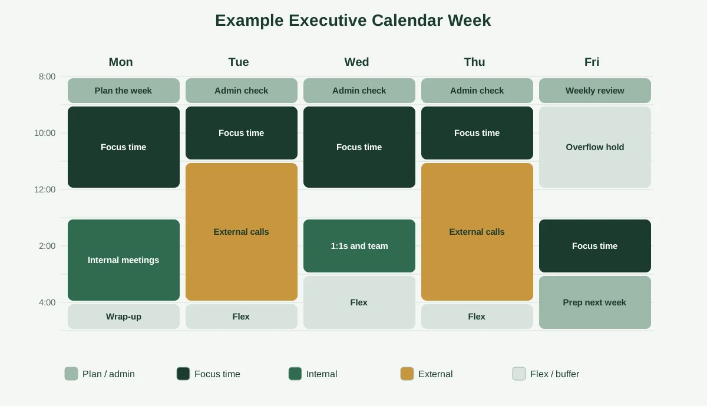
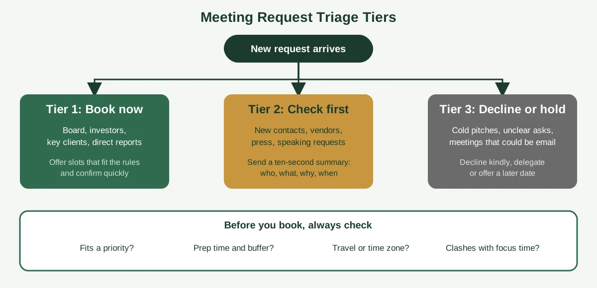

Nobody gets hired as an executive assistant because they can find an empty slot. Anyone can find an empty slot! The real skill is knowing which slots should stay empty, and defending them politely when the requests start rolling in.

That's the difference between a calendar that's merely full and one that's actually managed. If you're learning how to effectively manage an executive calendar, whether it's your own, your boss's or a client's, you're really learning how to turn priorities into protected time.

This guide walks you through it step by step. You'll get a setup checklist, an eight-step method, a weekly template you can copy, a simple way to triage meeting requests, and the routines that keep everything tidy. If you want the big-picture definition first, start with our guide on [what calendar management is](https://insyncea.com/blog/what-is-calendar-management/), then come back here.

## What Effective Executive Calendar Management Really Involves

**Managing an executive calendar means controlling how a leader's time is planned, protected and used, so their schedule reflects their priorities instead of everyone else's requests.** It covers scheduling, gatekeeping, preparation, travel, follow-ups and constant adjusting.

That's a bigger job than it sounds. A personal calendar holds your own commitments. An executive calendar holds commitments that involve many other people, so a single change can ripple through a whole week.

Picture a founder with a Tuesday that looks fine on paper. A client call, a team check-in, a vendor meeting and a partner intro, all neatly spaced. But the client call needs prep, the partner is in another time zone, and the vendor meeting has no agenda. By Tuesday afternoon, the founder is already behind.

An assistant who manages the calendar well spots all of that before Tuesday arrives. They see the prep time that's missing, the time zone that needs checking, and the meeting that probably shouldn't exist.

Effective executive calendar management rests on four habits:

* **Anticipating.** You look ahead at the next one to two weeks, not just tomorrow.
* **Prioritizing.** You know which commitments are fixed and which can move.
* **Protecting.** You guard focus time, thinking time and breaks.
* **Communicating.** You keep the executive informed in short, plain updates, so there are no surprises.

You'll notice none of those is about software. Tools help, but the judgment is what makes the difference, and judgment comes from understanding how your executive works.

So before we get into the steps, let's talk about what to set up first. Skipping this part is the most common reason new assistants struggle in their first month.

## Before You Start: Access, Preferences and Priorities

The best calendar plan falls apart if you can't see the calendar, don't know the executive's preferences or aren't sure what matters most. Spend the first week getting these three things right.

### Get the right level of access

You'll need permission to view, create and change events. In Google Calendar, that usually means being shared with permission to make changes to events, and in Outlook it often means delegate access. Access should be limited to what the job needs, and passwords should live in a password manager, not in a chat message.

Ask also whether you'll manage one calendar or several. Many executives have a work calendar, a personal calendar and sometimes a team or travel calendar, and a free slot on one may not be free on another.

### Write down the preferences

Don't rely on guessing. Sit down with the executive for 30 minutes and fill out a simple preferences brief like this one.

| Preference                   | Example answer                                         |
| ---------------------------- | ------------------------------------------------------ |
| Best hours for deep work     | Mornings, 9:00 to 12:00                                |
| Meeting-free days or windows | Wednesdays, and before 10:00                           |
| Default meeting length       | 25 or 50 minutes                                       |
| Buffer between meetings      | 10 to 15 minutes                                       |
| Who always gets in           | Board, investors, key clients, direct reports          |
| Who needs approval first     | New contacts, vendors, press, speaking requests        |
| Travel preferences           | Window seat, no flights before 8:00, buffer on arrival |
| Time zone rules              | Offer windows between 10:00 and 15:00 Eastern          |
| Lunch and breaks             | Protected 12:30 to 13:15                               |

This single page will answer about 80 percent of your future decisions. Keep it in a shared document and review it every quarter.

### Agree on the top priorities

Ask the executive for their top three to five priorities this quarter. When a request doesn't connect to one of them, it should face a higher bar for a slot.

If you want to make this a repeatable routine instead of a one-off chat, our guide to [building business systems for growth](https://insyncea.com/blog/business-systems-for-growth/) shows how to turn loose habits into a clear, owned process.

Once you've got access, preferences and priorities in place, you're ready to work through the steps.

## How to Effectively Manage an Executive Calendar in 8 Steps

Work through these in order the first time. After that, they become a rhythm you run each week.

### Step 1: Audit the calendar you inherit

Look back over the last four weeks. Mark each recurring event as keep, shorten, move or cancel, and ask the executive about anything that looks stale.

Most inherited calendars contain a few recurring meetings that nobody can explain. Removing them is the quickest win you'll get.

### Step 2: Block the non-negotiables first

Before any meeting goes in, add the things that must be protected: focus time, planning time, lunch, workouts, family commitments and travel. These blocks aren't decoration. They're the foundation the rest of the week sits on.

### Step 3: Set rules, then write them down

Turn the preferences brief into simple rules, such as "no meetings before 10:00" and "external calls only on Tuesday and Thursday." Rules let you say yes, no or "how about Thursday?" without asking each time.

### Step 4: Batch similar meetings

Group one-on-ones, external calls and internal reviews into themed blocks. Fewer context switches means more energy for the work itself, and it makes the week easier to read at a glance.

### Step 5: Build in preparation and buffer time

Every important meeting needs prep, and every day needs slack. Add a short prep block before key calls and 10 to 15 minutes between meetings, so one overrun doesn't wreck the afternoon.

### Step 6: Triage every new request

Run each new invitation through a consistent filter, which we'll cover in the next sections. Consistency is what makes your decisions feel fair to the people on the other side.

### Step 7: Prepare the day before

At the end of each day, check tomorrow. Confirm links and locations, attach agendas and notes, and send the executive a short summary of what's ahead and what needs a decision.

### Step 8: Review and reset every week

Spend 20 to 30 minutes each week looking at the next two weeks. Fix conflicts, fill gaps in prep time, and tell the executive about anything that needs a call.

That last step is what keeps the whole thing honest. A calendar left alone for two weeks will drift back toward chaos, no matter how good your rules are.

If you want to map any of these steps as a repeatable process, the guide on [how to create workflows](https://insyncea.com/blog/how-to-create-workflows/) is a good companion.

## An Executive Calendar Template You Can Copy

A template saves you from starting from scratch every week. The diagram below shows an example week that protects focus time, groups meetings and leaves room for overflow.

Notice a few things about it.

**Every day starts with a short admin block.** It gives the assistant and the executive a quick window to check what's changed before the day gets busy.

**Focus time sits in the morning.** For many people, that's when the sharpest thinking happens. If your executive is a night owl, swap it around, and let their energy decide.

**Meetings are grouped by type.** Internal meetings share a day, and external calls share another. That keeps the rest of the week free for deep work.

**Friday has room to spare.** The flexible block catches overflow, urgent requests and anything that slipped. It's also when you prepare for next week.

Treat this as a starting point, not a rule. A sales-heavy executive may need more external blocks, and a product-focused founder may need longer stretches of focus. Adjust the template until it fits the person.

Once you've settled on a layout, save it as a recurring set of blocks, so each new week starts with the structure already in place. You'll only have to tweak it, not rebuild it.

## How to Handle Meeting Requests Without Becoming the Bottleneck

This is where most of the daily stress lives. Requests arrive from everywhere, and every one of them feels urgent to the sender.

The fix is to sort requests into tiers, so you don't have to decide from scratch each time.

**Tier 1: Book now.** These are the people your executive has already said always get in, like the board, investors, key clients and direct reports. Offer times that fit the preferences brief and confirm quickly.

**Tier 2: Check first.** New contacts, vendors, press and speaking requests need a quick yes or no from the executive. Send a short message with the who, what, why and suggested time, so the answer takes ten seconds.

**Tier 3: Decline, delegate or hold.** Cold pitches, unclear requests and meetings that could be an email fall here. Reply politely, suggest another person or offer a later date.

Before you book anything, run four quick checks:

* Does it connect to a current priority?
* Is there prep time before it, and a buffer after?
* Does travel or a time zone change affect it?
* Will it collide with protected focus time?

A good decline is short and kind. Something like "Thanks for reaching out. \[Name] isn't able to take this on right now, but you're welcome to send a short summary and we'll be in touch if it becomes a fit" does the job without burning a bridge.

The tiers also protect you. When someone asks why a meeting wasn't scheduled, you can point to a clear rule, not a personal judgment.

Keep a tiny list of the tier 1 names in your preferences brief, and update it when priorities change. That one list will save you hours.

## Managing Travel, Time Zones and Buffers

Travel and time zones are where calendars quietly break. They're also where a careful assistant earns an executive's trust.

### Put travel on the calendar as real time

Don't treat travel as a note in the corner of a day. Add the drive to the airport, the flight, check-in time and the trip to the hotel as separate blocks, so nobody books a call during a flight by mistake.

Also add a buffer on arrival. A flight that lands at 2:00 p.m. doesn't mean the executive is ready for a 2:30 call.

### Be explicit about time zones

Set the calendar to the executive's home time zone, and always state the zone when you share times with others. When you're proposing windows, offer a range that works for both sides, like "between 10:00 and 14:00 Eastern."

Watch out for the weeks when daylight saving changes happen in different countries on different dates. Those are the weeks when double-checking pays off.

### Use buffers on purpose

Buffers aren't wasted time. They're what keeps one long conversation from derailing everything after it.

Add a buffer before and after anything that tends to overrun, like board discussions, interviews and client calls. For routine meetings, 10 to 15 minutes is usually enough.

### Plan around energy, not only availability

An executive might be technically free at 4:30 p.m. after seven hours of calls, but that doesn't make it a good time for a difficult conversation. Where you can, place the important meetings in the hours when the executive is at their best.

A calendar that looks full but flows well beats one that looks tidy but wears the person out. Pay attention to how the executive feels at the end of a day, and adjust.

## Daily and Weekly Routines That Keep the Calendar Clean

A clean calendar is a habit, not an event. Short routines, done consistently, prevent the big cleanups.

**Every morning (10 minutes):** Check today's schedule, confirm links and locations, flag anything that changed overnight, and send the executive a short summary.

**Every evening (10 minutes):** Look at tomorrow, attach agendas and notes, and make sure travel and prep time are in place.

**Every week (20 to 30 minutes):** Review the next two weeks, resolve conflicts, update the preferences brief if anything has changed, and plan next week's focus blocks.

Here's a checklist you can copy.

| Routine check                                 | Daily | Weekly |
| --------------------------------------------- | ----- | ------ |
| Review today's and tomorrow's schedule        | ✅     |        |
| Confirm links, locations and dial-ins         | ✅     |        |
| Attach agendas and prep notes                 | ✅     |        |
| Send the executive a short summary            | ✅     |        |
| Resolve conflicts and double-bookings         | ✅     | ✅      |
| Check travel and time zone details            |       | ✅      |
| Review and cancel meetings with no purpose    |       | ✅      |
| Protect next week's focus blocks              |       | ✅      |
| Schedule follow-ups from last week's meetings |       | ✅      |
| Update the preferences brief                  |       | ✅      |

Pair the routine with a simple message format. A short "Today at a glance" note with three lines (what's on, what needs a decision, what's coming up) keeps the executive informed without adding to their inbox.

If you're building this kind of routine across a whole team, it helps to see how steps fit together. Our guide to [workflow steps](https://insyncea.com/blog/workflow-steps/) breaks down how to turn a messy task into a clear, repeatable process.

## Common Mistakes When Managing an Executive Calendar

Everyone makes a few of these early on. The goal is to catch them before they cost you.

**1. Booking without checking priorities.** A free slot isn't a reason to book. Check the request against the priorities first.

**2. Leaving no prep time.** A meeting with no preparation wastes the executive's time and the other person's. Block prep before anything important.

**3. Stacking back-to-back meetings.** It looks efficient, but it leaves no room for notes, breaks or overruns. Add buffers.

**4. Forgetting travel and time zones.** These are the easiest details to miss and the most embarrassing to get wrong. Put them on the calendar as real blocks.

**5. Saying yes too quickly to senior requests.** Even tier 1 requests need to fit around focus time. You can usually offer a different slot without any loss of goodwill.

**6. Not communicating changes.** If a meeting moves, the executive should hear it from you before they find out the hard way. Send a quick note.

**7. Keeping the rules in your head.** If only you know how the calendar works, it breaks when you're away. Write the rules down.

**8. Skipping the weekly review.** Small problems pile up fast, and the review is where you catch them.

If you spot two or three of these in your own work, don't worry. Pick one, fix it this week, and move to the next.

## Tools and Setup Tips for Google Calendar and Outlook

Most executives use either Google Calendar or Microsoft Outlook, and both can handle the job when they're set up well. You don't need extra software to start.

**Set working hours.** Both tools let you mark when the executive is available, so invitations outside those hours are flagged.

**Use color-coding.** Assign one color to external meetings, one to internal, one to focus time and one to personal commitments. A glance at the week tells you what's balanced and what isn't.

**Turn on shared access carefully.** Give the assistant the permission level they need and no more. Review who has access every few months.

**Use separate calendars when it helps.** A travel calendar or a personal calendar layered over the main one keeps things readable. Make sure free and busy times show up across all of them.

**Add scheduling links for routine bookings.** Tools like Calendly let people pick a time from approved slots, which reduces email back-and-forth. Keep a different link for each meeting type, like a 20-minute intro and a 50-minute working session.

**Create recurring blocks.** Save your weekly template as recurring events, so focus time and admin blocks appear automatically.

**Keep notes and agendas in the invitation.** The calendar event should be the one place where the link, agenda and background live.

Before adding another tool, ask what problem it solves. Extra apps on top of unclear habits only make a mess faster.

## When It's Time to Get Dedicated Help

Managing an executive calendar well takes time, and for a busy founder, it can take more time than they have. If the calendar keeps slipping, the fix usually isn't a better app. It's a person who owns it.

Here are signs it's time to bring in help:

* Your inbox and calendar eat the first half of your day
* Meetings are double-booked or moved at the last minute
* Follow-ups from calls are slipping through the cracks
* You're working evenings to catch up on real work
* Nobody else knows how your schedule works

A virtual executive assistant can take all of this off your plate, from scheduling and rescheduling to protecting focus time, coordinating travel and following up after meetings. They work inside your calendar and inbox with the access you give them and the rules you set.

The best starting point is the preferences brief from earlier in this guide. Fill it in, share it, and you'll have a ready-made playbook for whoever supports you.

If you'd like help with this, our [executive assistant support](https://insyncea.com/services/executive-support/) covers calendar and inbox management, meeting coordination, travel and follow-ups. You can also [book a discovery call](https://insyncea.com/contact/#book) and tell us what's taking up your time.

## FAQ

### How do you effectively manage an executive calendar?

Start by getting access, writing down the executive's preferences and agreeing on their top priorities. Then block focus time first, set meeting rules, batch similar meetings, add prep and buffer time, triage every request, prepare the day before and review weekly.

### How do you manage someone else's calendar?

Ask for the right level of access, then fill out a preferences brief covering working hours, meeting lengths, priority contacts and approval rules. Check requests against those rules, keep the executive updated with short summaries, and review the next two weeks every week.

### What is the best executive calendar template?

A good template protects focus time in the executive's best hours, groups similar meetings on the same days, adds buffers between calls and leaves a flexible block for overflow. The example week in this guide is a good starting point to adapt.

### How do you answer the interview question "How do you manage an executive's calendar?"

Describe your process in a few clear steps. Mention learning the executive's priorities and preferences, protecting focus time, triaging requests, adding prep and buffer time, and doing daily and weekly reviews. A short example of a conflict you resolved makes the answer stronger.

### How far ahead should you plan an executive's calendar?

Look at least one to two weeks ahead every week, and further for travel, board meetings and key events. A rolling view helps you spot conflicts and missing prep time before they become problems.

### What tools help with executive calendar management?

Google Calendar and Microsoft Outlook cover most needs, with shared access, working hours, color-coding and time zone support. A scheduling link such as Calendly can reduce email back-and-forth for routine bookings.

## Conclusion

Managing an executive calendar well isn't about squeezing in more. It's about making sure the hours that exist go to the work that matters most, and that nothing important gets lost along the way.

To recap, set up access, preferences and priorities. Then audit the calendar, block the non-negotiables, write the rules, batch meetings, add prep and buffer time, triage requests, prepare the day before and review every week.

Adapt all of it to the person you support. A founder juggling client calls across time zones needs different rules from a leader with a steady weekly rhythm, so tweak the template until it feels natural.

Keep in mind that a calendar reveals who an executive is talking to and what's coming. Treat it as confidential, share access only with the people who need it, and keep credentials in a password manager.

If you're ready for fewer moving pieces, [book a discovery call](https://insyncea.com/contact/#book) and we'll look at your calendar together. And if you've found a habit that keeps your own schedule under control, we'd love to hear it.