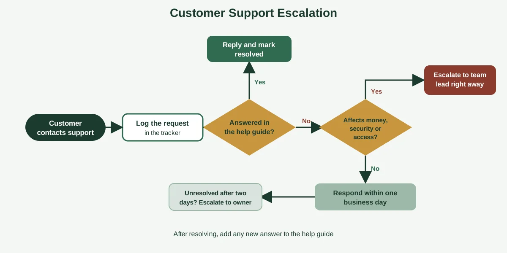
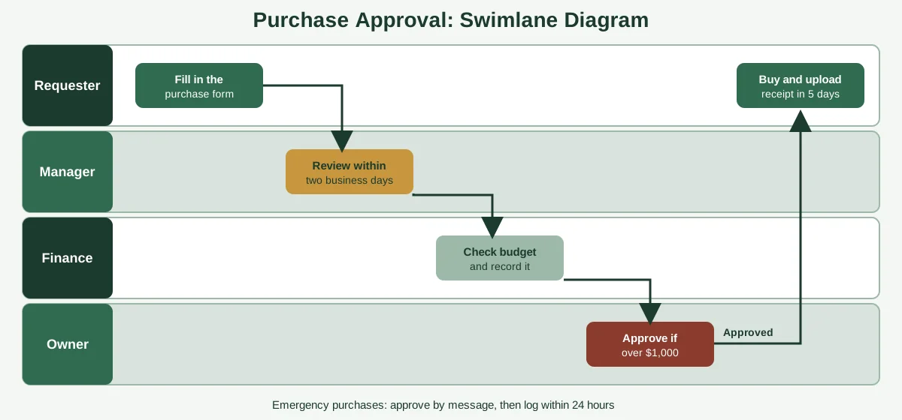

"Send the usual welcome email." It's a perfectly reasonable instruction if you've worked there for three years. It's useless to the new hire who's never seen the usual, and it's the kind of two-word shortcut that quietly makes a business fragile.

Good process documentation replaces "the usual" with something anyone can follow. But knowing that and writing it are different skills, and most people get stuck at the blank page. That's why seeing real process documentation examples helps so much. Copying a good structure beats inventing one from scratch.

Below you'll find eight examples built for small businesses, from order fulfillment and employee onboarding to approvals, customer support and a "website is down" runbook. Each one shows the purpose, trigger, owner, steps, exceptions and a quality check, in a format you can paste and adapt. If you want the fundamentals first, start with our guide to [process documentation](https://insyncea.com/blog/process-documentation/).

## What Good Process Documentation Looks Like

Before the examples, it helps to see what separates a useful document from a useless one. Every example below follows the same simple anatomy.

| Part              | What it answers                 | Example                                                            |
| ----------------- | ------------------------------- | ------------------------------------------------------------------ |
| **Purpose**       | Why does this process exist?    | "Ship every order accurately within one business day"              |
| **Trigger**       | What starts it?                 | "A paid order arrives"                                             |
| **Owner**         | Who keeps it accurate?          | "Operations lead"                                                  |
| **Steps**         | What happens, in order?         | Numbered, starting with a verb                                     |
| **Exceptions**    | What if something goes wrong?   | "If an item is out of stock, contact the customer within 24 hours" |
| **Quality check** | How do we know it's done right? | "Tracking number sent, order marked complete"                      |
| **Review date**   | When was it last checked?       | "Reviewed 1 March, version 2"                                      |

The structure is simple on purpose. A person who has never done the task should be able to read it and get it right the first time.

### A before-and-after example

Here's how much a rewrite can change a document.

| Vague version                      | Clear version                                                                                                                                                             |
| ---------------------------------- | ------------------------------------------------------------------------------------------------------------------------------------------------------------------------- |
| "Handle the new client paperwork." | "1. Save the signed contract in the client folder. 2. Create the client record in the CRM using the new-client template. 3. Send the intake form link and note the date." |
| "Do the usual welcome email."      | "Send the welcome email template within one business day. Replace the name and project details, and attach the onboarding guide."                                         |
| "Check with finance if needed."    | "If the invoice is over $1,000, send it to the finance lead for approval before payment."                                                                                 |

The clear versions name the action, the object and the condition. That's the whole trick. When you're writing your own, read each step and ask: could a brand-new colleague do this without asking me anything?

Asana makes a similar point in its [guide to SOPs and templates](https://asana.com/resources/sop-template): documenting important processes helps people learn or relearn tasks, and the format can be team-wide or company-wide.

## Customer-Facing Process Documentation Examples

These three examples cover the moments when your customers feel your processes most directly. Mistakes here cost money and trust, so they're good candidates to document first.

### Example 1: Order fulfillment

**Purpose:** Ship every order accurately within one business day.
**Trigger:** A paid order arrives.
**Owner:** Operations lead.
**Tools:** Store dashboard, shipping software, packing checklist.

1. Open the new order in the store dashboard, and confirm payment has cleared.
2. Print the packing slip and pick each item from stock.
3. Check item, size and quantity against the packing slip.
4. Pack the order using the standard box size, and add the thank-you card.
5. Buy the shipping label, and attach it to the package.
6. Mark the order as shipped, so the customer receives the tracking email.
7. Move the package to the outgoing shelf.

**Exceptions:**

* If an item is out of stock, email the customer within 24 hours with options: wait, substitute or refund.
* If the address looks incomplete, contact the customer before shipping.
* If an order is over $200, take a photo of the packed items before sealing.

**Quality check:** Tracking number sent, order marked complete, and stock count updated.

**Why it works:** The steps are short, there's a clear check at each stage, and the exceptions cover the three situations that cause most problems.

### Example 2: Client communication standards

Not every process involves software. Communication standards are a process too, and writing them down stops clients from getting different experiences from different team members.

**Purpose:** Keep clients informed and confident, with no surprises.
**Trigger:** Any client message or milestone.
**Owner:** Account manager.

1. Acknowledge every client email within one business day, even if the full answer takes longer.
2. If you can't answer fully, say when you will, and put that date in your calendar.
3. Send a short project update every Friday: what was done, what's next and anything you need from the client.
4. Flag delays as soon as you know, with a new date and the reason.
5. Log any request that changes the scope, and confirm it in writing before starting work.
6. After each major milestone, send a short summary and ask whether anything needs to change.

**Exceptions:**

* For urgent issues, call first, then follow up by email.
* If a client is unhappy, escalate to the owner within 24 hours.

**Quality check:** Every client has received an update this week, and no message has gone unanswered for more than one business day.

**Why it works:** It sets clear time limits, so "responsive" stops being a matter of opinion.

### Example 3: Customer support escalation

This is a case where a flowchart works better than a list, because the next step depends on the situation.

**Purpose:** Resolve customer issues quickly and get the right person involved when needed.
**Trigger:** A customer contacts support.
**Owner:** Support lead.

1. Log the request in the support tracker with the date and customer name.
2. Check the help guide. If the answer is there, reply and mark it resolved.
3. If it isn't covered, ask whether it affects money, security or access to the service.
4. If yes, escalate to the team lead right away, and tell the customer when they'll hear back.
5. If no, respond within one business day with the best available answer.
6. If the issue is unresolved after two business days, escalate to the owner.
7. After resolving, add the answer to the help guide if it's new.

**Quality check:** Every request is logged, every customer has a response time and new answers go into the guide.

**Why it works:** The decision points are explicit, and step 7 turns every problem into an improvement.

## People and Team Process Documentation Examples

These examples help your team work smoothly together, and they're where documentation saves the most time in a growing business.

### Example 4: Employee onboarding

Onboarding is one of the most common process documentation examples, and for good reason. Every new hire runs through it, and gaps show up immediately.

**Purpose:** Get every new hire set up, informed and productive in their first two weeks.
**Trigger:** An offer is accepted.
**Owner:** Operations manager or HR lead.

**Before day one:**

1. Send the welcome email with start time, location or login details, and what to expect.
2. Collect signed contracts, tax forms and bank details through the secure form.
3. Set up accounts: email, project tools, shared drives.
4. Order or prepare equipment.
5. Add the new hire to the team calendar, and schedule a first-week plan.

**Week one:**

1. Welcome them, and walk through the team, tools and ways of working.
2. Share the role guide, key documents and the process library.
3. Assign a buddy for questions.
4. Hold a check-in at the end of day one and day five.

**Weeks two to four:**

1. Review the first set of tasks together.
2. Set goals for the first 30, 60 and 90 days.
3. Ask for feedback on the onboarding itself, and update this document.

**Quality check:** Accounts work on day one, the new hire has completed training tasks, and feedback has been collected.

**Why it works:** It's split by time, which makes it easy to follow, and it ends with a feedback step that improves the process every time it's used.

### Example 5: Internal approval (purchases and expenses)

Approvals involve several people, so a swimlane diagram, which shows who does what, is the clearest format.

**Purpose:** Make sure spending is approved, recorded and within budget.
**Trigger:** A team member needs to buy something.
**Owner:** Finance lead.

1. The requester fills in the purchase form with item, cost, reason and date needed.
2. The manager reviews it within two business days, and approves, declines or asks for changes.
3. Finance checks the budget and records the request.
4. If the cost is over $1,000, the owner approves it too.
5. Once approved, the requester or finance makes the purchase.
6. The receipt is uploaded to the expense tracker within five days.

**Exceptions:**

* Emergency purchases can be approved by message, but must be logged within 24 hours.
* Anything outside the budget goes to the owner.

**Quality check:** Every purchase has an approval, a receipt and a budget line.

**Why it works:** The swimlane makes each person's role obvious, and the approval limits are written down, so nobody has to guess.

Adjust the dollar amounts to suit your business. The structure stays the same.

## Marketing and Operations Process Documentation Examples

The last group covers recurring operational work. These tasks are usually done by one or two people, which makes them risky when someone's away.

### Example 6: Content publishing

**Purpose:** Publish each article to a consistent standard.
**Trigger:** A draft is marked ready for review.
**Owner:** Content lead.

1. Check the draft against the brief: topic, keyword, length and audience.
2. Edit for clarity, accuracy and tone, and fix any formatting.
3. Add the title, meta description, URL slug and category.
4. Add images with descriptive file names, alt text and titles.
5. Add internal links to two or three relevant pages.
6. Preview the page on desktop and mobile.
7. Publish, then share on the agreed channels.
8. Record the date and link in the content tracker.
9. Review performance after 30 days.

**Quality check:** The checklist is complete, the page loads properly and the tracker is updated.

**Why it works:** It's a checklist, which suits a task that repeats often and has a lot of small steps people forget.

### Example 7: "Website is down" runbook

A runbook is a process document for when something breaks. It's especially valuable because it's used under stress, when nobody wants to think.

**Purpose:** Get the website back online quickly and keep customers informed.
**Trigger:** An alert or report that the site isn't loading.
**Owner:** Website manager.

1. Confirm the problem: try loading the site on another device and network.
2. Check the hosting status page for outages.
3. If it's a hosting problem, contact the host's support with the account details and time it started.
4. If it's not, check for recent changes: plugin updates, theme changes or new code. Undo the most recent one.
5. Restore from the latest backup if the site is still down after 30 minutes.
6. Post a short notice on social media or the status page if the outage lasts over an hour.
7. When it's back, test the key pages, forms and checkout.
8. Write a short note on what happened and how to prevent it.

**Quality check:** Site tested, customers informed, and the incident note saved.

Recurring site care is another good thing to document. Our [WordPress website management case study](https://insyncea.com/case-studies/wordpress-website-management/) shows what ongoing maintenance looks like in practice.

### Example 8: Month-end bookkeeping checklist

**Purpose:** Close the month's books accurately and on time.
**Trigger:** The last working day of the month.
**Owner:** Finance lead or bookkeeper.

1. Reconcile every bank and card account against statements.
2. Record and categorize any uncategorized transactions.
3. Chase missing receipts and invoices.
4. Review outstanding customer invoices, and send reminders.
5. Review bills due next month.
6. Run the profit and loss report and balance sheet.
7. Compare with last month and budget, and note any large differences.
8. Save reports in the shared folder, and share a short summary with the owner.

**Quality check:** All accounts reconciled, reports saved and the summary sent by the fifth working day.

**Why it works:** The order matters, and the checklist keeps it the same every month.

If you'd like more ideas for repeatable work, the first four examples in our main guide to [process documentation](https://insyncea.com/blog/process-documentation/) cover client onboarding, handling meeting requests, website maintenance and invoice approval.

## Which Format Fits Which Process?

You've now seen checklists, numbered steps, flowcharts and swimlane diagrams. Here's how to choose between them.

| Format                      | Best when                                             | Example from above                  |
| --------------------------- | ----------------------------------------------------- | ----------------------------------- |
| **Checklist**               | The task repeats often and has many small steps       | Content publishing, month-end close |
| **Numbered steps (SOP)**    | The order matters and detail is needed                | Order fulfillment, onboarding       |
| **Flowchart**               | The next step depends on a decision                   | Customer support escalation         |
| **Swimlane diagram**        | Several people or teams are involved                  | Purchase approval                   |
| **Runbook**                 | Something has broken, and speed matters               | Website is down                     |
| **Standards or guidelines** | You're describing how to behave, not a fixed sequence | Client communication                |

Plane's overview of [the main types of process documentation](https://plane.so/blog/what-is-process-documentation-meaning-types-and-best-practices) covers the same range, and it makes the point that checklists are the simplest, most usable place to begin.

A simple rule: use the simplest format that captures the process completely. If a checklist does the job, don't build a flowchart.

You can also mix them. An onboarding document might be numbered steps with a checklist at the end and a short video for tool setup.

## How to Turn These Examples Into Your Own

You don't need to write from scratch. Here's a quick way to adapt any example above.

### Step 1: Pick the closest example

Choose the one that most resembles your process. A hair salon's booking process looks a lot like client onboarding, and a bakery's order process looks a lot like fulfillment.

### Step 2: Replace the details

Swap in your tools, names, time limits and approval limits. Keep the structure, since it's what makes the document easy to follow.

### Step 3: Watch the work happen

Sit with the person who does the task, and compare the draft with what they really do. Fix anything that's different. Capture the exceptions they mention, because that's where the real knowledge lives.

### Step 4: Test it

Give it to someone who's never done the task and watch them follow it. Where they pause or ask a question, the document needs another line.

### Step 5: Add an owner and a review date

Put a name and a date at the top. That small step is what keeps the document alive.

### Step 6: Store it in one place

Keep every process document where your team can find it, and tell them where it is. If it takes more than 30 seconds to find, they won't use it.

If you'd like to go deeper on workflows, our guides to [how to create workflows](https://insyncea.com/blog/how-to-create-workflows/) and [workflow steps](https://insyncea.com/blog/workflow-steps/) are good next reads.

## Good Documentation Practices to Copy

Across all eight examples, a few habits show up again and again. They're worth copying.

* **Start every step with a verb.** "Send," "check," "book," "save."
* **Keep steps short.** One action per step.
* **Name the owner.** Every document has one person responsible.
* **State the trigger and the finish line.** People should know when to start and when they're done.
* **Include exceptions.** The "what if" cases are where mistakes happen.
* **Add a quality check.** A final step that confirms the work is right.
* **Write in plain language.** If a new hire wouldn't understand it, rewrite it.
* **Link to the tools and templates.** Don't make people hunt.
* **Date it.** A review date builds trust in the document.

Don't forget security. Process documents can contain customer details and access information, so keep passwords out of them, link to a password manager instead and limit who can edit.

## Need Help Documenting Your Processes?

Writing good process documents takes time, and it's easy to put off when you're busy running a business. If you'd like someone to interview your team, map the real steps and turn them into clear, usable documents, we can help.

Our [business operations support](https://insyncea.com/services/business-operations-support/) covers documenting processes, building SOPs and organizing workflows. You can also [book a discovery call](https://insyncea.com/contact/#book) and tell us which processes you'd like to start with.

## FAQ

### What are some examples of process documentation?

Common examples include order fulfillment procedures, employee onboarding checklists, client communication standards, internal approval workflows, customer support escalation flowcharts, content publishing checklists, incident runbooks and month-end bookkeeping checklists.

### How do you write a process document?

Choose one specific process, define where it starts and ends, involve the person who does the work, capture the real steps, write them as short numbered actions, add exceptions and a quality check, and test the draft with someone new. Then publish it with an owner and a review date.

### What should a process document look like?

It should be short and scannable, with a clear title and purpose, a trigger, an owner, numbered steps, exceptions, a quality check and a review date. Most small-business processes fit on one or two pages.

### What are the three types of documentation?

It depends on the field. In business, a common split is process documentation (how work gets done), project documentation (plans and records for a specific project) and product or system documentation (how something works). Quality systems often use policies, procedures and work instructions.

### What are the five main types of documents?

In quality and operations work, they're often listed as policies, procedures (SOPs), work instructions or checklists, forms and templates, and records. Different organizations use different lists, so treat it as a guide.

### What is the best tool for process documentation?

Start with what your team already uses, such as Google Docs or Notion. Add a screen recorder like Loom for digital tasks, a diagramming tool such as Draw.io or Miro for flowcharts, and a process platform like SweetProcess or Process Street if you need ownership and review features.

### What are examples of documentation tools?

Google Docs, Notion, Confluence, Loom, Draw.io, Miro, SweetProcess, Process Street and task tools such as Asana, Trello and ClickUp.

### What are the 5 principles of good documentation?

A practical set is clear, complete, consistent, correct and current. Many people add concise and accessible, which gives you the commonly cited 7 C's.

### What are some methods of documentation?

Common methods include written steps, checklists, flowcharts and swimlane diagrams, screenshots with captions, screen recordings and interviews or observation of the person doing the work.

### What are examples of good documentation practices?

Start each step with a verb, keep steps short, name an owner, include exceptions and a quality check, link to tools and templates, test the document with a newcomer and review it on a schedule.

### What is the format of process documentation?

There's no single format. Checklists suit repeated tasks, numbered steps suit detailed procedures, flowcharts suit decisions and swimlane diagrams suit multi-person processes. Choose the simplest one that captures the process.

## Conclusion

The best process documentation examples share a few simple traits. They have a clear purpose, a named owner, short verb-led steps, honest exceptions and a quality check at the end. None of them are long, and none of them are complicated.

To recap, pick the example closest to your process, swap in your details and test it with someone who's never done the task. Choose the simplest format that works, and give every document an owner and a review date.

Make it your own. A two-person service business and a growing agency will document different things, so start with the process that causes the most pain, and go from there.

And remember that process documents can hold sensitive information. Store them in one secure place, limit editing to the people who need it and keep passwords out of the text.

If you'd like help writing yours, [book a discovery call](https://insyncea.com/contact/#book) and we'll look at which processes to document first. And if you've got a process document that saved your team time, we'd love to hear about it.