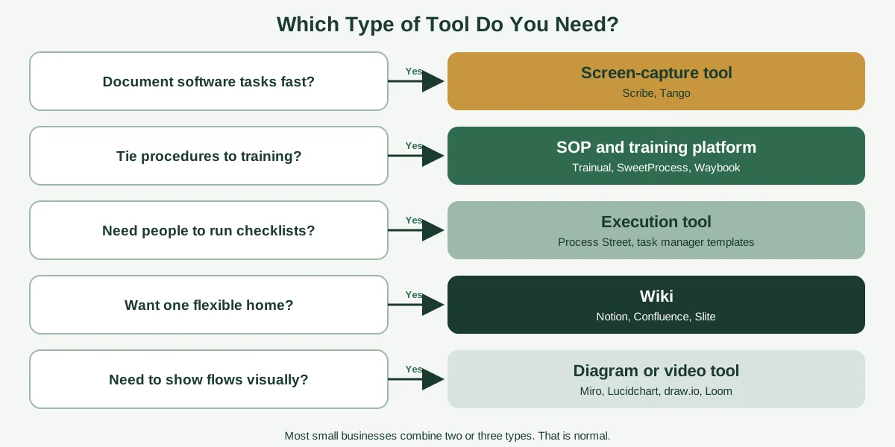
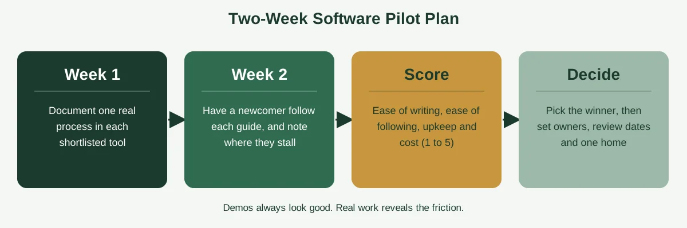

Most teams shop for process documentation software the way people join gyms. They compare the shiny features, sign up with big intentions, document three processes in the first week and quietly stop logging in by month two.

The software was fine. The problem was that nobody decided how the team would actually capture, store and keep up processes before picking the tool. And that's the part that matters, because "process documentation software" covers five quite different kinds of products, and the right one depends entirely on how your team works.

This guide compares the main options by type, with a plain-English look at what each is good at and where it falls short. You'll also get a feature checklist, a six-step way to choose, a two-week trial plan and honest notes about free and open-source options. If you haven't yet written down any processes, start with our guide to [process documentation](https://insyncea.com/blog/process-documentation/), because software works best when you know what you're putting into it.

## What Is Process Documentation Software?

**Process documentation software is a tool for capturing, organizing, sharing and maintaining step-by-step instructions for how work gets done in your business.** It replaces scattered documents, chat threads and memory with one place where people can find the current way of doing a task.

At its simplest, it might be a shared wiki. At its most advanced, it records your screen as you work, writes the steps for you, assigns tasks, sends review reminders and tracks who has read what.

Most products offer some mix of these features:

* **Capture:** recording or writing the steps
* **Storage:** a central, searchable library
* **Structure:** templates, folders and roles
* **Execution:** turning steps into checklists that people run
* **Training:** tying procedures to onboarding and quizzes
* **Maintenance:** version history, owners and review dates

What it isn't is a substitute for deciding what your process actually is. Software can't tell you the right steps. It can only hold them, and make them easier to follow and update. Our [process documentation examples](https://insyncea.com/blog/process-documentation-examples/) and [process template](https://insyncea.com/blog/process-template/) guides help with the "what to write" part.

### How it differs from related tools

| Tool type                          | What it's for                                                                                                                                                |
| ---------------------------------- | ------------------------------------------------------------------------------------------------------------------------------------------------------------ |
| **Process documentation software** | Recording and sharing how work gets done                                                                                                                     |
| **Document control software**      | Managing approvals, versions and access for formal documents (see our [document control process](https://insyncea.com/blog/document-control-process/) guide) |
| **Workflow automation tools**      | Running steps automatically between apps                                                                                                                     |
| **Project management tools**       | Tracking tasks and deadlines for specific projects                                                                                                           |
| **Diagramming tools**              | Drawing flowcharts and process maps                                                                                                                          |

Some products blur the lines, but knowing which job you need done first saves a lot of confusion.

## Start With How You Work: Five Types of Process Documentation Tools

Before comparing brands, decide which style of tool fits your team. Most options fall into one of five types.

| Type                              | How it works                                                         | Best when                                          | Example tools                   |
| --------------------------------- | -------------------------------------------------------------------- | -------------------------------------------------- | ------------------------------- |
| **Screen-capture tools**          | Records your clicks and writes a step-by-step guide with screenshots | You document software tasks and want speed         | Scribe, Tango                   |
| **SOP and training platforms**    | A structured library of procedures tied to roles and onboarding      | You want consistent training and read-confirmation | Trainual, SweetProcess, Waybook |
| **Checklist and execution tools** | Turns a process into a checklist that people run each time           | Tasks repeat, and you need accountability          | Process Street                  |
| **Wikis and knowledge bases**     | Flexible pages with search and links                                 | You want one home for all company knowledge        | Notion, Confluence, Slite       |
| **Diagram and video tools**       | Draws process maps or records walkthroughs                           | A visual explains it better than text              | Miro, Lucidchart, draw.io, Loom |

Most small businesses end up with a combination, such as a wiki for storage, a capture tool for fiddly software steps and a diagram tool for the occasional flowchart. That's normal, and it's often cheaper and more flexible than a single all-in-one platform.

## Process Documentation Software Compared

Here's a side-by-side look at the tools that come up most often. A note on pricing: published comparisons disagree, and several vendors have changed or hidden their prices, so I've left out exact figures. Check each vendor's site for current plans, and be cautious with comparison pages written by the vendors themselves, since each one tends to rank its own product first.

| Tool                          | Type                    | Best for                                                 | Free option?         | Watch out for                                                             |
| ----------------------------- | ----------------------- | -------------------------------------------------------- | -------------------- | ------------------------------------------------------------------------- |
| **Scribe**                    | Screen capture          | Fast written guides for browser-based tasks              | Yes, limited         | Free plan has limits on capture types and exports                         |
| **Tango**                     | Screen capture          | Quick how-to guides and in-app walkthroughs              | Yes, limited         | Library and export features sit on paid plans                             |
| **Trainual**                  | SOP and training        | Onboarding and role-based training                       | Trial or demo        | Higher cost, and no built-in screen capture                               |
| **SweetProcess**              | SOP library             | Procedures, policies and task assignment for small teams | Free trial           | No automatic screen capture                                               |
| **Waybook**                   | SOP library             | Findability, role assignment and read confirmations      | Trial or free tier   | Newer platform, so check fit and support                                  |
| **Process Street**            | Checklist and execution | Recurring workflows with approvals and conditional logic | Limited or trial     | Pricing is often sales-led, and it suits larger or compliance-heavy teams |
| **Notion**                    | Wiki                    | Flexible all-in-one workspace                            | Yes                  | Needs structure, owners and review habits to avoid sprawl                 |
| **Confluence**                | Wiki                    | Larger teams and structured spaces                       | Yes, for small teams | More setup than lighter wikis                                             |
| **Slite**                     | Wiki                    | Keeping docs accurate as processes change                | Free tier            | Fewer execution features                                                  |
| **Miro, Lucidchart, draw.io** | Diagrams                | Process maps and swimlanes                               | Yes, limited         | Diagrams can drift from the written steps                                 |
| **Loom**                      | Video                   | Quick narrated walkthroughs                              | Yes, limited         | Videos are hard to search and update                                      |

None of these is "the best." Each one is best at something. The right question is: which problem are you trying to solve?

## Screen-Capture Tools: Scribe and Tango

If your team spends its day in web apps, such as CRMs, accounting software and admin dashboards, screen-capture tools are the fastest route to usable documentation. You click "record," do the task normally and the tool generates a step-by-step guide with screenshots and written instructions.

**What they do well:**

* Documenting a software task takes minutes, not hours
* Guides include real screenshots, which new hires love
* Easy to share as a link or embed in a wiki
* Low learning curve, so more people actually use them

**Where they fall short:**

* They capture clicks, not reasons. You still need to add the "why" and the exceptions.
* They don't cover offline tasks, phone calls or judgment calls.
* Edits can be fiddly after capture.
* Screenshots go stale when the software's interface changes.
* Free plans are limited, and some exports, branding and sensitive-data blurring sit on paid plans.

**Privacy note:** Screen capture can record sensitive data like customer details and account numbers. Check whether the tool blurs sensitive information, and review every guide before sharing it.

**Best for:** teams that document lots of software how-tos, and want something lightweight.

Scribe and Tango are close competitors, and the simplest way to choose is to try both on the same task. A fair comparison is more useful than any review.

## SOP and Training Platforms: Trainual, SweetProcess and Waybook

These tools are built around the idea that documentation and training belong together. You write or import procedures, organize them by role or department and track who has read and understood them.

**Trainual** focuses on onboarding and training, with quizzes, role-based content and completion tracking. It tends to cost more than lighter tools, and it doesn't record your screen, so you write or import the content yourself.

**SweetProcess** is a documentation-first library for procedures, policies and processes, with task assignment and sign-offs. It uses flat team pricing rather than per-user charges, and it's offered with a free trial.

**Waybook** positions itself as an SOP-first platform with strong search, role assignments and read confirmations, aimed at making sure people actually follow procedures.

**What they do well:**

* One structured home for every procedure
* Assign documents to people and roles, with read confirmations
* Tie SOPs directly to onboarding
* Support policies and compliance documents too

**Where they fall short:**

* More setup and discipline than a simple wiki
* Overkill if you just need a handful of guides
* Pricing can be a stretch for very small teams

**Best for:** growing teams with regular hiring, or businesses where following procedures consistently really matters.

## Checklist and Execution Tools: Process Street

Some processes need to be run, not just read. Execution tools turn a procedure into a checklist that someone works through each time, with due dates, assignments, conditional steps and approvals.

**What they do well:**

* Make sure every step gets done, every time
* Create a record of who completed what and when
* Handle conditional logic, such as "if the order is over $1,000, add an approval step"
* Work well for recurring compliance and quality tasks

**Where they fall short:**

* You build the templates yourself, and it takes effort
* Pricing is often sales-led and can be high for small teams
* Less suited to explaining background and reasoning

You can often get a lot of the same value from simple tools you already have. A checklist template in your task manager, such as Asana, Trello or ClickUp, can run recurring processes at no extra cost.

**Best for:** operations teams running the same process repeatedly, and needing accountability.

## Wikis and Knowledge Bases: Notion, Confluence and Slite

A wiki is the most flexible choice, and for many small businesses the sensible starting point. You create pages, link them together, search them and let anyone edit.

**Notion** is a flexible all-in-one workspace that many teams use as a company wiki. It's free to start and easy to shape.

**Confluence** is more structured, with spaces, permissions and templates, and it suits larger teams or those already using other Atlassian tools.

**Slite** focuses on keeping documentation accurate as things change.

If you work in the Microsoft world, options include SharePoint and OneNote for storage, Visio for diagrams and Power Automate for turning documented steps into automations.

**What they do well:**

* Highly flexible, and often cheap or free
* One place for processes, policies, notes and how-tos
* Familiar editing, so more people contribute
* Good search and linking

**Where they fall short:**

* Without rules, wikis turn into messy piles
* Owners, review dates and approvals are usually up to you
* Fewer built-in execution and training features

If you choose a wiki, set up the structure on day one: a clear folder or page hierarchy, a standard template, an owner on every page and a review date. Our guide on [document control](https://insyncea.com/blog/document-control-process/) explains simple ways to do this.

**Best for:** small teams that want flexibility and low cost, and are willing to set a few rules.

## Diagram and Video Tools: Miro, Lucidchart, draw.io and Loom

Sometimes a picture or a quick recording explains a process better than paragraphs of text.

**Diagram tools** such as Miro, Lucidchart and draw.io (diagrams.net) let you draw flowcharts, swimlanes and process maps. They're ideal for processes with decisions, or ones that involve several people. Our guide on [how to create workflows](https://insyncea.com/blog/how-to-create-workflows/) shows how to map steps before you draw them.

**Video tools** like Loom let you record a quick narrated walkthrough. They're great for fiddly tasks and for capturing the "why" in your own voice.

**What they do well:**

* Make complex flows easy to understand
* Fast to create
* Appeal to visual learners

**Where they fall short:**

* Diagrams drift out of date when they're separate from the written steps
* Videos are hard to search and edit
* Neither includes ownership, review dates or approval features

The best practice is to treat visuals as a companion to written steps, not a replacement. Embed the diagram or video in the document, and keep the text as the source of truth.

## Free and Open-Source Options (and Their Limits)

You can document processes without spending anything. Several tools have free plans, including Scribe, Tango, Notion, Confluence for small teams, Miro and Lucidchart, though each comes with limits. Open-source options such as BookStack and Wiki.js give you a self-hosted wiki, and diagrams.net is a free diagramming tool. Check each project's current status and support before relying on it.

The honest trade-off is that free tools usually lack the features that keep documentation alive. One independent-style comparison of [process documentation software](https://gluu.biz/process-documentation-software/) makes exactly this point: free tools work for a few guides or diagrams, but they typically lack owners, review dates and version control.

That doesn't mean free is a bad choice. It means you have to supply the missing pieces yourself. A simple process register, which we cover in our [process template](https://insyncea.com/blog/process-template/) guide, gives you owners, versions and review dates in a spreadsheet.

Limits on free plans also vary. Free capture tools often restrict desktop capture, exports or the number of shared guides. A roundup from [Vibrantsnap](https://www.vibrantsnap.com/blog/process-documentation-software) notes, for example, that Scribe's free plan covers web apps only. Since plans change, always check the current limits before you build a library on one.

## Features That Matter: A Buying Checklist

Whichever type you choose, these features separate tools that last from tools that get abandoned. Use this checklist when you compare.

| Feature                           | Why it matters                                    |
| --------------------------------- | ------------------------------------------------- |
| **Easy capture and editing**      | If it's a chore to write, nobody will             |
| **Search**                        | People must find the answer in seconds            |
| **Owners on every document**      | Someone is responsible for accuracy               |
| **Review reminders**              | Stops documents going stale                       |
| **Version history**               | Lets you see and roll back changes                |
| **Permissions and roles**         | Controls who can view and edit                    |
| **Templates**                     | Keeps documents consistent                        |
| **Checklists or assignments**     | Turns documents into action                       |
| **Read confirmations or quizzes** | Proves people have seen it                        |
| **Integrations**                  | Works with the tools you already use              |
| **Export options**                | Lets you take your content with you if you switch |
| **Security**                      | Protects sensitive procedures and data            |
| **Analytics**                     | Shows which documents are used or ignored         |
| **Mobile access**                 | Helps frontline and field teams                   |

You won't need every feature. Mark the five that matter most to your team, and treat the rest as nice to have.

Two features are worth special attention. **Export** protects you from lock-in, since you should always be able to take your documents with you. And **ownership plus review reminders** prevents the most common failure, which is a library that slowly goes out of date.

## How to Choose Process Documentation Software in 6 Steps

Here's a simple way to cut through the noise.

### Step 1: Write down the problem

What's going wrong today? Is it slow onboarding, inconsistent work, knowledge stuck in one person's head or documents nobody can find? The answer points to a tool type.

### Step 2: Decide who will write and who will read

If only one person writes, a simple tool is fine. If many people contribute, ease of use matters more than power. And think about readers too: do they work at a desk, on a phone or in the field?

### Step 3: Choose the type

Use the table earlier in this guide. Capture tool, SOP platform, checklist tool, wiki or diagram tool? Pick the one that matches your main problem.

### Step 4: Shortlist two or three tools

Don't compare ten. Choose two or three that fit your type, budget and existing software.

### Step 5: Run a two-week pilot

This is where the decision gets made. Pick one real process, document it in each tool and have someone who hasn't done the task follow the result.

Score each tool from 1 to 5 on the questions below.

| Question                                     | Tool A | Tool B | Tool C |
| -------------------------------------------- | ------ | ------ | ------ |
| How easy was it to write the document?       |        |        |        |
| Could a newcomer follow it without help?     |        |        |        |
| How easy is it to update?                    |        |        |        |
| Does it fit with our existing tools?         |        |        |        |
| Does it handle owners, reviews and versions? |        |        |        |
| Is the cost reasonable for our team size?    |        |        |        |
| **Total**                                    |        |        |        |

### Step 6: Decide, then set the habits

Choose the winner, and write down three rules: where documents live, who owns them and when they're reviewed. The software won't do that for you.

## Common Mistakes When Choosing Process Documentation Software

**1. Buying before documenting.** If you don't know what your processes are, a tool will just hold the confusion.

**2. Choosing on features, not habits.** A simple tool your team uses beats a powerful one they ignore.

**3. Trusting vendor comparison pages.** Most are written to favor the publisher. Run your own pilot.

**4. Skipping the pilot.** Demos always look good. Real work reveals the friction.

**5. Ignoring export.** If you can't take your content with you, you're locked in.

**6. Not assigning owners.** Even the best tool can't keep documents current on its own.

**7. Over-documenting.** Start with the two or three processes that matter most. Our guide to [process documentation](https://insyncea.com/blog/process-documentation/) explains how to prioritize.

**8. Forgetting security.** Process documents can include customer data and access details. Limit permissions, turn on two-step verification and keep passwords out of the text.

If you're building a wider set of systems, our guide to [building business systems for growth](https://insyncea.com/blog/business-systems-for-growth/) shows where documentation software fits.

## Can AI Create Your Process Documentation?

People often ask whether an AI assistant can create workflows or process documents. It can help, with limits.

**What AI does well:** drafting a first version of steps from your notes, tidying up wording, suggesting checklists and turning a rough outline into a clean template. Many capture tools now also use AI to write guides from recordings.

**What it can't do:** know how your business really works. It doesn't see the exceptions, the workarounds or the reasons behind the steps, unless you tell it. A confident-sounding draft can still be wrong.

**Good practice:**

* Use AI for a first draft, then check it with the person who does the work
* Test the result with a newcomer
* Don't paste confidential information into any tool without checking its privacy terms
* Keep a human owner responsible for accuracy

## Need Help Choosing and Setting Up?

The hardest parts of this aren't the software. They're deciding what to document, writing it clearly and building the habits that keep it up to date. If you'd like a hand, that's what we do.

Our [business operations support](https://insyncea.com/services/business-operations-support/) helps small businesses document their processes, choose simple tools that fit and set up review routines that last. You can also [book a discovery call](https://insyncea.com/contact/#book) and tell us what's slowing your team down.

## FAQ

### What is process documentation software?

It's a tool for capturing, organizing, sharing and maintaining step-by-step instructions for how work gets done. It ranges from simple wikis to platforms that record your screen, assign tasks and track training.

### What is the best process documentation software?

There isn't one best option. Screen-capture tools such as Scribe and Tango suit software how-tos. SOP platforms like Trainual and SweetProcess suit training and procedure libraries. Process Street suits recurring checklists. Wikis like Notion and Confluence suit flexible knowledge bases. Match the type to your problem.

### What is the best tool for process documentation?

For most small businesses, a wiki such as Notion plus a capture tool for software steps and a diagram tool for flowcharts is a flexible, low-cost combination. Run a two-week pilot to confirm.

### Is there free process documentation software?

Yes, with limits. Scribe and Tango offer free plans, Notion and Confluence have free tiers, and Miro and Lucidchart have free plans. Open-source options include BookStack and Wiki.js. Free tools often lack owners, review dates and version control, so you may need to add those yourself.

### What is process documentation software for Microsoft 365?

Microsoft users often combine SharePoint or OneNote for storage, Word for documents, Visio for diagrams and Power Automate to automate documented steps. It's worth checking what you already have before buying anything new.

### What are examples of documentation tools?

Examples include Scribe, Tango, Trainual, SweetProcess, Process Street, Notion, Confluence, Slite, Loom, Miro, Lucidchart and draw.io.

### What are the four main types of software documentation?

Lists vary by source. One common grouping is requirements, design, technical and user documentation. Another framework uses tutorials, how-to guides, reference and explanation. Business process documentation is a different thing, focused on how work is done.

### What are the four C's of documentation?

There's no single official list. Commonly cited qualities include clear, concise, complete and correct, and some versions add consistent, current and accessible.

### What is the best document processing software?

Document processing, meaning capturing and extracting data from documents, is different from process documentation. It depends on your documents and systems. Our guide to document processing explains the options.

### Can ChatGPT create workflows?

General-purpose AI assistants can draft workflow steps, checklists and templates from your description. They can't know your real exceptions, so always have the person who does the work check the result, and avoid pasting confidential data.

### How much does process documentation software cost?

It varies widely, from free plans to several hundred dollars a month for training and execution platforms. Published prices often disagree and change, so check each vendor's current plans and run a pilot before committing.

### Should I use a wiki or dedicated software?

A wiki is a good starting point for small teams, as it's flexible and low-cost. Move to dedicated software when you need role-based training, read confirmations, assignments or compliance tracking.

## Conclusion

Choosing process documentation software isn't about finding the tool with the longest feature list. It's about matching the type of tool to how your team works, and building the habits that keep documents alive.

To recap, decide whether you need capture, an SOP library, execution checklists, a wiki or diagrams. Shortlist two or three tools, run a two-week pilot on a real process and score them on ease of writing, ease of following, maintenance and cost. Then set simple rules for owners, review dates and where documents live.

Make it your own. A five-person agency and a growing service company will land on different tools, so start with the smallest setup that solves your biggest problem.

And treat what you document with care. Process documents can contain customer details and access information, so limit permissions, use two-step verification and keep passwords out of the text.

If you'd like help getting started, [book a discovery call](https://insyncea.com/contact/#book) and we'll look at where to begin. And if you've found a tool your team genuinely loves using, we'd love to hear which one.