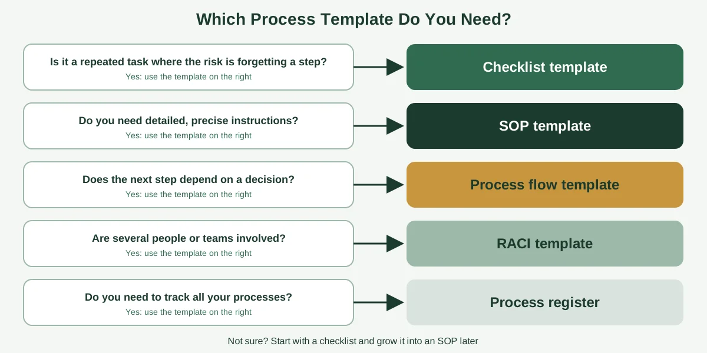
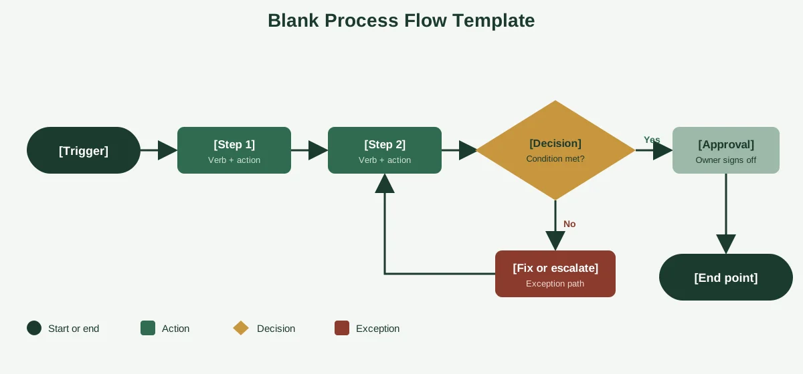

Somewhere on your computer there's probably a folder called "Templates (final)" that nobody opens. It's full of beautifully formatted documents with 14 mandatory fields, and every one of them takes longer to fill in than the task it describes.

That's the problem with most templates. They're built to look thorough, not to be used. A good process template is the opposite. It's short enough to fill in during a coffee break, clear enough that a new hire can follow the result and flexible enough to fit very different kinds of work.

Below you'll find six free, copy-and-paste templates for small businesses: a process documentation template, an SOP template, a process flow template, a checklist, a RACI chart and a process register. You'll also get a simple way to choose between them, tips for customizing them and advice on whether to build them in Word, Excel, Google Docs or software. If you'd like the full background first, start with our guide to [process documentation](https://insyncea.com/blog/process-documentation/).

## What Is a Process Template?

**A process template is a reusable, pre-built structure for recording how a repeatable piece of work gets done.** It gives you the headings and prompts (purpose, owner, steps, exceptions and so on), so you only have to fill in the details instead of designing a document from scratch each time.

Think of it as the blank form, and a process document as the completed one. If you want to see completed versions, our guide to [process documentation examples](https://insyncea.com/blog/process-documentation-examples/) has eight of them.

Templates earn their keep in three ways:

* **Speed.** You skip the blank-page problem, and get to the real content faster.
* **Consistency.** Every document in your business looks and works the same way, which makes them easier to find, read and trust.
* **Completeness.** The prompts remind you to include the things people forget, like exceptions, owners and review dates.

Atlassian makes a useful point in its guide to [process documentation templates](https://www.atlassian.com/software/confluence/resources/guides/how-to/process-documentation): a good template includes space for notes and improvements, so documents can evolve as people use them. It also recommends having someone unfamiliar with the process test the result.

### What should a process template include?

Whatever format you pick, most good templates share the same core components.

| Component                          | What it does                                         |
| ---------------------------------- | ---------------------------------------------------- |
| **Title and objective**            | Names the process and says why it exists             |
| **Scope and trigger**              | Says where it starts and ends, and what kicks it off |
| **Roles and responsibilities**     | Shows who does, approves and needs to know           |
| **Inputs and outputs**             | Lists what you need to begin and what you produce    |
| **Steps**                          | Gives clear, verb-led actions in order               |
| **Decision points**                | Shows what happens when conditions change            |
| **Exceptions**                     | Covers what to do if something goes wrong            |
| **Tools and links**                | Points to software, forms and shortcuts              |
| **Quality check**                  | Confirms the work was done correctly                 |
| **Owner, version and review date** | Keeps the document current                           |

A template with more than that usually becomes a burden. If you find people skipping fields, the field probably isn't needed.

## Which Process Template Do You Need?

"Process template" covers several different tools, and picking the wrong one is a common reason people give up on documentation. Start with what you're trying to do.



Here's the same guidance in a table.

| If you need to...                                      | Use this template                |
| ------------------------------------------------------ | -------------------------------- |
| Record the full picture of one process                 | Process documentation template   |
| Give detailed, step-by-step instructions for a task    | SOP template                     |
| Show the order of steps and the decisions between them | Process flow (workflow) template |
| Make sure a repeated task has no missed steps          | Checklist template               |
| Clarify who does what in a multi-person process        | RACI template                    |
| Keep track of all your documented processes            | Process register                 |

If you're not sure, begin with the checklist. It's the simplest to make, the easiest to use and often all a small task needs. You can grow it into an SOP later.

## Template 1: Process Documentation Template

This is the all-rounder. Use it when you want a complete record of one process, with owner, scope, steps and exceptions in one place.

Copy the table below into a document or Google Doc, and replace the prompts with your own details.

| Field                           | Fill in                                                        |
| ------------------------------- | -------------------------------------------------------------- |
| **Process name**                | A short, specific title (for example, "New client onboarding") |
| **Purpose**                     | One sentence on why this process exists                        |
| **Owner**                       | The person responsible for keeping it accurate                 |
| **Trigger**                     | What event starts the process                                  |
| **End point**                   | What marks it as finished                                      |
| **Who is involved**             | Roles, not just names                                          |
| **Inputs needed**               | Information, files, approvals or access required               |
| **Tools and links**             | Software, forms, templates and shortcuts                       |
| **Steps**                       | Numbered list, one action per step, each starting with a verb  |
| **Decision points**             | "If X, do Y. If not, do Z."                                    |
| **Exceptions and fixes**        | The common things that go wrong, and what to do                |
| **Outputs**                     | What the process produces                                      |
| **Quality check**               | How to confirm it was done correctly                           |
| **Time or deadline**            | How long it should take, or when it must be done               |
| **Notes and improvement ideas** | Space for feedback from the people using it                    |
| **Version and review date**     | When it was last updated, and when it's due again              |

### How to fill it in well

Start with the steps, not the header. The steps are the part that matters most, and filling them in first stops you from spending an hour on fields nobody will read.

Keep each step to a single action. "Create the client folder using the template" is one step. "Create the folder, send the email and book the call" is three.

Finally, put a real person's name in the owner field, not a department. If everyone owns it, no one does.

## Template 2: SOP Template

A standard operating procedure goes deeper than a general process document. Use it for tasks where precision matters, like handling money, customer data, quality checks or anything you'd want done identically every time.

Here's a plain-text version you can paste into any document.

```
SOP TITLE: [Name of the task]
SOP NUMBER: [Optional reference]
VERSION: [1.0]        LAST REVIEWED: [Date]        NEXT REVIEW: [Date]
OWNER: [Name and role]

1. PURPOSE
[One or two sentences: why this procedure exists.]

2. SCOPE
[Who this applies to, and what it does and doesn't cover.]

3. WHEN TO USE THIS PROCEDURE
[The trigger or situation.]

4. ROLES AND RESPONSIBILITIES
- [Role]: [What they do]
- [Role]: [What they do]

5. WHAT YOU NEED BEFORE YOU START
- [Tool, access, form or information]
- [Tool, access, form or information]

6. STEPS
1. [Verb + action.]
2. [Verb + action.]
3. [Verb + action.]
   - Note: [Tip or warning, if needed.]
4. [Verb + action.]

7. IF SOMETHING GOES WRONG
- If [problem], then [action].
- If [problem], then [action].

8. HOW TO CHECK IT WAS DONE CORRECTLY
- [Quality check]

9. RELATED DOCUMENTS
- [Link or name]

10. CHANGE LOG
[Date] - [Who] - [What changed]
```

If you'd like to see other SOP layouts, Asana has a helpful [SOP template guide](https://asana.com/resources/sop-template) explaining how teams write procedures at either the team or company level.

### SOP tips that save time

Keep it as short as it can be while remaining complete. If an SOP runs past two pages, think about splitting it into smaller ones.

Include warnings only where mistakes are costly. If everything is flagged as critical, nothing stands out.

And never put passwords or sensitive access details in an SOP. Link to your password manager instead.

## Template 3: Process Flow (Workflow) Template

When the next step depends on a decision, a visual flow is clearer than a list. This template shows the building blocks. Replace the placeholders with your own steps.



### The symbols you need

You only need four shapes.

| Shape           | Meaning                          |
| --------------- | -------------------------------- |
| **Rounded box** | Start or end                     |
| **Rectangle**   | An action or step                |
| **Diamond**     | A decision with yes and no paths |
| **Arrow**       | The direction of flow            |

Add a fifth, a document or file shape, only if you need to show forms or records.

### A simple six-phase blueprint

Many small-business processes follow the same shape. You can use this as the skeleton for your own flow and rename the phases to suit.

1. **Trigger:** Something starts the process, such as a request, an order or a signed contract.
2. **Sort and route:** Decide what type it is, how urgent it is and who handles it.
3. **Do the work:** Complete the core steps.
4. **Check or approve:** Someone reviews the result, or a limit triggers an approval.
5. **Deliver:** Send, ship, publish or hand over.
6. **Review and close:** Record the outcome, and capture anything to improve.

Not every process needs all six. A simple one might only have three.

If you'd like ready-made diagram layouts, Smartsheet offers downloadable [process map templates](https://www.smartsheet.com/content/process-map-templates) in Excel, Word and PDF formats. And our guides on [how to create workflows](https://insyncea.com/blog/how-to-create-workflows/) and [workflow steps](https://insyncea.com/blog/workflow-steps/) explain how to break work into clear stages.

## Template 4: Checklist Template

A checklist is the simplest process template, and for repeated tasks it's often the most useful. It works best when the steps are clear, and the main risk is forgetting one.

| \#  | Task             | Done | Who | Date | Notes |
| --- | ---------------- | ---- | --- | ---- | ----- |
| 1   | \[First action]  | ☐    |     |      |       |
| 2   | \[Second action] | ☐    |     |      |       |
| 3   | \[Third action]  | ☐    |     |      |       |
| 4   | \[Fourth action] | ☐    |     |      |       |
| 5   | \[Final check]   | ☐    |     |      |       |

At the top, add four lines: the checklist name, the owner, the date and the version.

### Make your checklist better

Group long lists under headings, such as "Before," "During" and "After." Put the most error-prone steps first, while people are paying attention.

Keep the wording short enough to read at a glance. If a step needs a paragraph of explanation, link to the SOP instead.

Add a "stop" item for any step that must pass before continuing, such as "Payment confirmed" or "Client approval received." This prevents people from skipping ahead.

## Template 5: RACI Template

When several people are involved, confusion about who does what causes more delays than the work itself. A RACI chart settles it. RACI stands for Responsible, Accountable, Consulted and Informed.

* **Responsible (R):** does the work
* **Accountable (A):** owns the outcome and has the final say (only one per task)
* **Consulted (C):** gives input before a decision
* **Informed (I):** is told what happened

Here's a blank template with an example row.

| Task or step                  | Account manager | Operations lead | Finance | Owner |
| ----------------------------- | --------------- | --------------- | ------- | ----- |
| \[Task 1]                     |                 |                 |         |       |
| \[Task 2]                     |                 |                 |         |       |
| \[Task 3]                     |                 |                 |         |       |
| *Example: Send welcome email* | **R**           | A               | I       | I     |
| *Example: Set up invoicing*   | C               | I               | **R**   | A     |

### How to fill it in

List the steps down the side and the roles across the top, then mark each cell. Every row needs exactly one A, and at least one R.

If a row has too many Cs, decisions will be slow. If it has none, mistakes get missed. Aim for a sensible balance.

Keep a RACI chart for processes that cross teams, like approvals and launches. For a simple, one-person task, it's overkill.

## Template 6: Process Register (Your Template Library Tracker)

The last template isn't for a single process. It's for keeping track of all of them. A process register is a simple spreadsheet that lists every documented process, who owns it, where it lives and when it was last checked.

It's the most overlooked tool in documentation, and it's what stops your library from turning into a pile.

| Process name          | Owner           | Format    | Location or link | Version | Last reviewed | Next review | Status   |
| --------------------- | --------------- | --------- | ---------------- | ------- | ------------- | ----------- | -------- |
| New client onboarding | Account manager | SOP       | \[Link]          | 2.0     | 1 March       | 1 Sept      | Current  |
| Order fulfillment     | Operations lead | Checklist | \[Link]          | 1.3     | 10 Jan        | 10 July     | Due soon |
| Purchase approval     | Finance lead    | Flowchart | \[Link]          | 1.0     | 5 Feb         | 5 Aug       | Current  |
| Month-end close       | Bookkeeper      | Checklist | \[Link]          | 1.1     | 3 Mar         | 3 Sept      | Current  |
| Website recovery      | Website manager | Runbook   | \[Link]          | 1.0     |               |             | Draft    |

Build it in Google Sheets or Excel. Add a filter for the status column, and set a monthly reminder to check what's due.

Here's what the register gives you:

* **One place to look.** Anyone can find any process in seconds.
* **Clear ownership.** You can see who's responsible for each document.
* **A review rhythm.** Nothing quietly goes out of date.
* **Visible gaps.** Blank rows show what you haven't documented yet.

If you've read our guide on [building business systems for growth](https://insyncea.com/blog/business-systems-for-growth/), you'll recognize this as the backbone of a working system.

## How to Use a Process Template (Without Creating Paperwork)

Templates only help if people finish them. Here's a simple routine that keeps things light.

### Step 1: Copy, don't edit the master

Keep one clean master of each template, and make a copy each time. That way the original stays intact for the next person.

### Step 2: Fill in the steps first

The steps are the heart of the document. Write them while watching, or talking to, the person who does the work.

### Step 3: Trim what you don't need

If a field doesn't apply, delete it. A short document that gets used beats a thorough one that doesn't.

### Step 4: Test it with a newcomer

Hand it to someone who's never done the task, and watch. Where they hesitate, add detail.

### Step 5: Save it in one place

Store every document somewhere searchable, and add it to your process register. A template that ends up in a random folder isn't doing its job.

### Step 6: Review on a schedule

Set a review date in the document, and in the register. Quarterly or twice a year is plenty for most processes.

Even the preferences brief in our guide on [how to effectively manage an executive calendar](https://insyncea.com/blog/how-to-manage-an-executive-calendar/) is a tiny process template. It's a single page that answers the questions an assistant would otherwise ask again and again. That's the standard to aim for.

## Where to Build Your Process Templates: Word, Excel, Google Docs or Software

People often search for a process template in Word, Excel or PowerPoint. Any of them can work, so choose based on how your team shares and edits documents.

| Format                                   | Best for                                             | Watch out for                                         |
| ---------------------------------------- | ---------------------------------------------------- | ----------------------------------------------------- |
| **Word or Google Docs**                  | SOPs and process documents with text and screenshots | Several versions floating around if files get emailed |
| **Excel or Google Sheets**               | Checklists, RACI charts and the process register     | Long text doesn't fit well in cells                   |
| **PowerPoint or Google Slides**          | Simple flow diagrams and training                    | Hard to search and update                             |
| **Diagram tools** (Draw.io, Miro, Canva) | Flowcharts and swimlanes                             | Diagrams can drift from the written steps             |
| **Knowledge base** (Notion, Confluence)  | A searchable library with owners and history         | Needs some setup                                      |
| **Process software**                     | Larger libraries, approvals and reminders            | Cost, and another tool to learn                       |

For most small businesses, a shared drive with Google Docs or Word for documents, Sheets or Excel for the register and a diagram tool for flows is plenty. You can always move to a dedicated platform later.

Whichever you choose, shared cloud storage beats emailed attachments. One live copy means one version of the truth.

## Common Process Template Mistakes

A few traps catch almost everyone.

**1. Building too many fields.** Every extra box is a reason not to finish. Keep only what people need.

**2. Starting with the template instead of the work.** Understand the process first, then pick the template.

**3. Using one template for everything.** A checklist, an SOP and a flowchart do different jobs.

**4. Leaving the prompts in.** If "\[Insert purpose here]" is still in the document, it isn't finished.

**5. No owner, no review date.** These two fields prevent most document decay.

**6. Not testing with a newcomer.** The author is the worst judge of their own document.

**7. Storing templates and documents in different places.** Keep them together, and link them in the register.

**8. Treating the template as the goal.** The goal is a team that does the work consistently. The template is just a tool.

## Need Help Building Your Process Library?

Setting up templates is the easy part. Filling them with accurate, useful content takes time, and that's usually where busy owners stall.

If you'd like help interviewing your team, mapping the real steps, building a template set and setting up a simple review routine, our [business operations support](https://insyncea.com/services/business-operations-support/) can do it with you. You can also [book a discovery call](https://insyncea.com/contact/#book) and tell us which processes you'd like to start with.

## FAQ

### What is a process template?

A process template is a reusable structure for recording how a repeatable piece of work gets done. It includes headings and prompts, such as purpose, owner, steps, exceptions and review date, so you only have to fill in the details.

### What should a process template include?

At minimum, a title and purpose, a trigger and end point, an owner, numbered steps, exceptions, a quality check and a review date. Add roles, inputs, outputs and tools if the process needs them.

### Is there a free process template I can use?

Yes. The templates in this guide are free to copy into Word, Excel or Google Docs. Many software providers also offer downloadable templates, including Smartsheet and Atlassian.

### What is the difference between a process template and a workflow template?

A process template is the broader document that records a process in full. A workflow template usually shows the sequence of steps and decisions, often as a diagram. Many teams use both together.

### Can I use Word or Excel for a process template?

Yes. Word or Google Docs suit written documents and SOPs, while Excel or Google Sheets suit checklists, RACI charts and registers. Pick whatever your team will actually use.

### What is a simple process template?

A simple template has a title, an owner, the trigger, numbered steps and a review date. For many tasks, a plain checklist is all you need.

### Should I use PowerPoint for process documentation?

PowerPoint or Google Slides works for simple diagrams and training, but it's harder to search and update than a document or knowledge base. Use it for visuals, and keep the full written steps elsewhere.

### What is a RACI template?

A RACI template is a table that shows who is Responsible, Accountable, Consulted and Informed for each step of a process. It clears up confusion in processes that involve several people or teams.

### How often should I update a process template?

Review your templates once or twice a year, and update them whenever you notice people skipping fields or adding the same information in the margins.

### How long should a process document made from a template be?

As short as it can be while staying complete. Most small-business processes fit on one or two pages. If one runs longer, consider splitting it into smaller documents.

## Conclusion

A good process template doesn't create more work. It removes the blank-page problem, keeps your documents consistent and reminds you to include the things that matter, like owners, exceptions and review dates.

To recap, choose the template that matches the job: a checklist for repeated tasks, an SOP for detailed steps, a flow for decisions, a RACI chart for several people and a register to keep track of everything. Fill in the steps first, trim what you don't need, test with a newcomer and review on a schedule.

Make it your own. A solo consultant and a ten-person agency will want different levels of detail, so start simple and add fields only when you find yourself needing them.

And keep sensitive information out of your templates. Link to your password manager, limit who can edit and store everything in one secure place.

If you'd like help setting up your own library, [book a discovery call](https://insyncea.com/contact/#book) and we'll look at where to start. And if you've built a template your team loves, we'd love to hear about it.