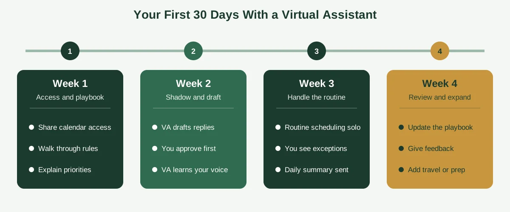
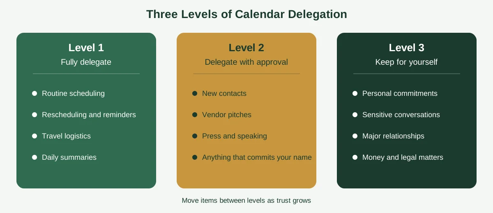

It's 11:40 p.m., and you're typing "Does Thursday at 3 work?" into an email reply. You've sent a version of that sentence a few hundred times this year. Each one took thirty seconds. Together, they've quietly eaten days of your life.

That's the exact job a virtual assistant can take off your plate. With the right setup, virtual assistant calendar management turns scheduling from a nightly chore into something that simply happens in the background, and you only hear about it when a decision is needed.

But handing over your calendar isn't something to do casually. It holds your meetings, your relationships and some of your most sensitive plans. This guide shows you what a virtual assistant actually does, the best practices that make the arrangement work, what it costs, and how to start safely. If you want the basics first, read our guide on [what calendar management is](https://insyncea.com/blog/what-is-calendar-management/).

## What Is Virtual Assistant Calendar Management?

**Virtual assistant calendar management is a service where a remote assistant plans, books, protects and adjusts your schedule for you, working inside your calendar and inbox with the access and rules you set.** They handle the back-and-forth so you don't have to.

You may also see it called a calendar management virtual assistant, remote scheduling support, diary management or schedule coordination. The names vary, but the job is the same: keep your time organized so you can focus on the work only you can do.

How is it different from an in-house executive assistant? The tasks overlap a lot. The difference is mostly in how the support is set up:

* A virtual assistant works remotely, often on flexible hours or a monthly retainer
* You usually pay for the time you use, instead of a full-time salary
* The role can be narrow (just scheduling) or broad (calendar, inbox, travel, follow-ups)
* Onboarding relies more on written instructions, since there's no desk next to yours

That last point matters more than people expect. A remote assistant can't read your mood across the room. They need clear rules, and when you provide them, the results can be excellent.

Think of it like hiring a very good house-sitter. You wouldn't just hand over the keys and walk away. You'd show them around, explain the quirks and tell them who's allowed in. The same goes for your calendar.

## What Does a Virtual Assistant Do for Your Calendar?

People often ask what an executive virtual assistant does day to day. For calendar work, it usually looks like this.

**Scheduling and rescheduling.** They find times that work, send invitations, handle replies and move things when plans change, across time zones if needed.

**Screening requests.** They sort incoming invitations using your rules, accepting what clearly fits, asking you about unclear ones and politely declining the rest.

**Protecting your focus time.** They block time for deep work, planning and breaks, and defend those blocks when someone asks to borrow them.

**Preparing you for meetings.** They attach agendas, links and background notes, and send a short summary of your day each morning.

**Coordinating travel.** They add real blocks for transit, check-in and arrival buffers, so nobody books a call while you're in the air.

**Following up.** They chase action items, schedule next steps and make sure meetings lead to something.

**Keeping the calendar clean.** They cancel stale recurring events, fix double-bookings and review the weeks ahead for gaps.

Many virtual assistants also handle inbox triage, since email and calendar are so closely linked. A scheduling request is just an email until someone turns it into an event.

What a good VA won't do is guess. When something isn't covered by your rules, they ask. That habit is worth more than speed, because one wrong assumption can cost a client relationship.

## Signs It's Time to Hand Your Calendar to a Virtual Assistant

You don't need a huge business to benefit. You just need a calendar that has become a job of its own. Here are the signs we see most often.

* **Scheduling takes real time.** You spend part of every day on emails about availability.
* **Double-bookings keep happening.** Two calendars, a quick reply on your phone, and suddenly you're in two places at once.
* **Time zones trip you up.** You've shown up an hour early, or late, more than once.
* **Follow-ups slip.** Good conversations happen, but the next steps go nowhere.
* **You're the only one who knows how it works.** If you disappear for a week, the calendar stops making sense.
* **Your best hours get eaten.** Prime thinking time is filled with routine calls.
* **You're working evenings to catch up.** The real work has been pushed into the margins.

If three or more sound familiar, it's worth trying. Start small, perhaps with scheduling and inbox triage for a few hours a week, and widen the scope once you trust the process.

A quick test can help too. Count the minutes you spent on scheduling this past week. If the number surprises you, that's your answer.

## Virtual Assistant Calendar Management Best Practices

The success of the arrangement depends less on the assistant's talent and more on how well you set things up. These best practices make the biggest difference.

### 1. Write down your rules before day one

Create a one-page playbook that covers working hours, focus time, meeting lengths, buffers, who always gets in and who needs your approval. If you want a ready-made format, our guide on [how to manage an executive calendar](https://insyncea.com/blog/how-to-manage-an-executive-calendar/) includes a preferences brief you can copy.

### 2. Start with a narrow scope

Begin with scheduling and inbox triage. Add travel, prep and follow-ups after a few weeks, once you've seen how the assistant handles judgment calls.

### 3. Share access at the right level

Give only the permissions the job needs, and use proper sharing settings rather than your password. More on this in the next section.

### 4. Agree on what needs your approval

Divide requests into three groups: book without asking, check with you first, and decline or redirect. The clearer those lines are, the fewer interruptions you'll get.

### 5. Set a communication rhythm

A short daily summary and a weekly check-in keep everyone aligned. Decide how urgent items should reach you, such as a text or a flagged email.

### 6. Give feedback early and often

In the first month, tell your assistant what you liked and what you'd change. A quick "perfect" or "next time, offer afternoon slots" teaches more than any instruction document.

### 7. Share the why, not just the what

Tell your assistant what you're working toward this quarter. When they know your priorities, they can say no to the right things on your behalf.

### 8. Review the playbook every quarter

Priorities shift, and your rules should too. A quick update each quarter stops the system from going stale.

Documenting all of this does something else useful. It turns your habits into a process anyone could follow, which is a core idea in our guide to [building business systems for growth](https://insyncea.com/blog/business-systems-for-growth/).

## Your First 30 Days With a Virtual Assistant

A clear onboarding plan prevents most early frustrations. Here's a simple four-week structure you can adapt.

**Week 1: Access and playbook.** Share calendar access, walk through the playbook and explain your priorities. Introduce the assistant to the people who'll be involved in scheduling.

**Week 2: Shadow and draft.** The assistant drafts replies and proposed times, and you approve them before anything is sent. It's slower at first, but it teaches them your voice.

**Week 3: Handle the routine.** Once drafts are consistently right, they take over routine scheduling on their own. You only see exceptions and summaries.

**Week 4: Review and expand.** Look at what's working, update the playbook, and decide whether to add travel, prep or follow-ups to the scope.

Most people find the second week feels like extra work. Hang in there. That investment is what makes weeks three and four feel effortless.

If you'd like to map the onboarding as a repeatable process, our guide on [workflow steps](https://insyncea.com/blog/workflow-steps/) walks through how to break a task into clear stages.

## What to Delegate and What to Keep

Not every calendar decision should be handed over on day one. A simple three-level model helps you decide.

**Level 1: Fully delegate.** Routine scheduling with known contacts, rescheduling, reminders, travel logistics and daily summaries. These are low risk and high volume.

**Level 2: Delegate with approval.** New contacts, vendor pitches, press, speaking requests and anything that might commit your time or reputation. Your assistant prepares the details, and you give a quick yes or no.

**Level 3: Keep for yourself.** Personal commitments, sensitive conversations, major relationships and anything involving serious money or legal matters. Your assistant may still schedule them, but the decision stays with you.

You can move items between levels as trust grows. Many people start with a small Level 1 and expand it over a few months.

## Tools and Access: How to Share Your Calendar Safely

Your calendar reveals who you talk to and what's coming. Treat access as seriously as you would a key to your office.

Here's a simple guide to permission levels.

| Access level                           | What it lets the assistant do          | Good for                      |
| -------------------------------------- | -------------------------------------- | ----------------------------- |
| See only free and busy                 | View when you're busy, not the details | Basic availability checks     |
| See all event details                  | Read event titles, notes and links     | Preparation and summaries     |
| Make changes to events                 | Create, edit and cancel events         | Day-to-day scheduling         |
| Manage sharing or full delegate access | Control who else can see the calendar  | Trusted, long-term assistants |

Most assistants need the third level to do their job. Reserve the fourth for someone you've worked with for a while.

A few more safety habits help:

* **Use built-in sharing or delegate access** (in Google Calendar or Microsoft Outlook) instead of sharing your login.
* **Store any shared credentials in a password manager**, never in chat or email.
* **Turn on two-step verification** for calendar, email and travel accounts.
* **Sign a confidentiality agreement** if you're sharing sensitive information.
* **Keep sensitive details out of visible event titles**, in case others can see the calendar.
* **Review access every few months** and remove anything that's no longer needed.

For tools, you rarely need more than a main calendar, a scheduling link such as Calendly, a task tool like Asana, Trello or Notion, and a video meeting app. Choose what your team already uses, and add something new only when it solves a real problem.

## How a Virtual Assistant Manages Multiple Calendars and Time Zones

Many founders run more than one calendar, such as a work calendar, a personal calendar and sometimes a team or travel calendar. It's one of the most common sources of double-booking.

A good assistant handles it in three ways.

**One source of truth.** They sync or overlay your calendars so a free slot is really free. If a personal appointment is on one calendar, it shows up as busy everywhere.

**Clear naming and colors.** Each calendar gets its own color, and event titles say who, what and why. A glance tells you whether you're looking at a client call, a team meeting or a dentist visit.

**Careful time zone handling.** They set your home time zone, state the zone with every time they send and offer windows that work for both sides, like "between 10:00 and 14:00 Eastern." They double-check weeks when daylight saving changes happen on different dates in different countries.

This is also where a remote assistant can have an advantage. Someone used to working across regions tends to be more careful about time zones, because they deal with the problem every day.

If you also manage your own boss or partner's schedule, the same approach applies. Learn their preferences first, share a playbook and agree on what needs approval.

## How Much Does Virtual Assistant Calendar Management Cost?

This is one of the most common questions, and the honest answer is "it depends." Rates vary by location, experience, the scope of work and how you hire.

Here's what the published data shows. ZipRecruiter reported an average of about $24.40 an hour for calendar management virtual assistants in the United States as of June 2026. Broader pricing guides show wide ranges, with offshore general assistants often priced around $10 to $25 an hour, and US-based or specialized executive support priced higher.

| Hiring model              | Typical pricing            | What to expect                                    |
| ------------------------- | -------------------------- | ------------------------------------------------- |
| Freelancer or marketplace | Hourly, widely variable    | Flexible, but you do the screening and management |
| Agency or service         | Hourly or monthly retainer | Vetting, backup coverage and account support      |
| In-house assistant        | Salary plus benefits       | Full-time presence, highest fixed cost            |
| Part-time retainer        | Fixed hours per month      | Predictable cost, good for growing businesses     |

A few things push the price up or down:

* **Experience.** Executive-level assistants who handle confidential, complex schedules cost more than entry-level ones.
* **Scope.** Calendar-only support is cheaper than a mix of calendar, inbox, travel and follow-ups.
* **Hours.** Retainers usually lower the effective hourly rate.
* **Time zone coverage.** Needing real-time availability in a specific region can affect the price.

Don't choose on the lowest hourly rate alone. A cheaper assistant who makes scheduling mistakes can cost you far more in missed opportunities. Look at reliability, communication and judgment as well.

At InSyncEA, support starts at $10 per hour. You can see how engagements work on our [executive assistant support](https://insyncea.com/services/executive-support/) page.

## What to Look For When Hiring a Calendar Management Virtual Assistant

A good hire is more about skills and judgment than software. If someone asks what the top three skills of a virtual assistant are, for calendar work they'd be **organization, clear communication and discretion.** Reliability and tech comfort follow close behind.

Here's what to look for.

**Experience with scheduling.** Ask how they've handled double-bookings, last-minute changes and conflicting priorities. The details of their answers tell you a lot.

**Clear written communication.** Remote work runs on writing. Ask for a sample of how they'd reply to a tricky scheduling request.

**A careful approach to confidentiality.** They should be comfortable signing an agreement and following strict access rules.

**Time zone awareness.** They should naturally state the zone and offer windows that suit both sides.

**Comfort with your tools.** Google Calendar, Outlook, scheduling links and video meeting apps shouldn't be new to them.

**A habit of asking.** The best assistants ask when something is unclear instead of guessing.

A short job description should include the hours, time zone overlap, tools, main tasks, confidentiality expectations and how you'll communicate. A one-page version is plenty.

Then run a small paid trial. Give them a week of real scheduling tasks and see how they handle them. It tells you far more than an interview can.

## Common Mistakes When Handing Over Your Calendar

Most problems don't come from the assistant. They come from how the arrangement starts. Watch for these.

**1. Handing over access with no rules.** An assistant with permission but no playbook is guessing.

**2. Delegating everything at once.** Start narrow and grow the scope as trust builds.

**3. Sharing passwords instead of using proper access.** It's risky and unnecessary.

**4. Skipping feedback.** Silence leaves the assistant guessing what you want.

**5. Being vague about priorities.** If they don't know what matters, they can't protect it.

**6. Expecting mind reading.** Remote assistants can't see your day. Tell them what changed.

**7. Letting the playbook go stale.** Review it each quarter.

**8. Overlooking confidentiality.** Use agreements, limit access and keep sensitive details out of shared titles.

Fix one at a time. Even a small improvement, like adding a one-page playbook, changes how smoothly the whole thing runs.

## Getting Started With Virtual Assistant Calendar Management

Here's a simple way to begin this week.

1. Spend 30 minutes writing your preferences, priorities and approval rules.
2. List the scheduling tasks you want to hand over first.
3. Decide on access levels and set up delegate access.
4. Choose your communication rhythm, such as a daily note and a weekly check-in.
5. Run a short trial and give feedback quickly.

If you'd like a hand with any of it, our [administrative support](https://insyncea.com/services/administrative-support/) and [executive assistant support](https://insyncea.com/services/executive-support/) cover calendar and inbox management, meeting coordination, travel and follow-ups. You can also [book a discovery call](https://insyncea.com/contact/#book) and tell us what's taking up your time.

## FAQ

### What is virtual assistant calendar management?

It's a service where a remote assistant plans, books, protects and adjusts your schedule for you. They work inside your calendar and inbox, following the rules you set, and they ask you about anything unclear.

### How do you do calendar management as a virtual assistant?

Learn the client's priorities and preferences, then protect focus time first. Screen requests against agreed rules, add prep and buffer time, check the schedule each morning and evening, and review the next two to four weeks every week. Keep communication short and clear.

### What does an executive virtual assistant do?

They manage the executive's calendar and inbox, coordinate travel, prepare meeting materials, follow up on action items and handle other administrative tasks. They also act as a gatekeeper, deciding which requests get through.

### What are the top 3 skills needed for a virtual assistant?

For calendar work, the key three are organization, clear communication and discretion. Tech comfort, reliability and time zone awareness also matter.

### How much does a virtual assistant cost per hour?

It varies widely. ZipRecruiter reported an average of about $24.40 an hour for calendar management virtual assistants in the US as of June 2026, while offshore and specialized options can be lower or higher. Scope, experience and hiring model all affect the price.

### How do you manage the calendar for your boss?

Get the right level of access, write down their preferences and priorities, and agree on which requests need approval. Then protect their focus time, add prep and buffer time, and send a short summary each day.

### What is the best way to manage multiple calendars?

Keep one source of truth by syncing or overlaying your calendars, use a different color for each, and give events clear titles. Check that personal commitments show as busy on the work view, and review everything weekly.

### What is the best tool for managing calendars?

Google Calendar and Microsoft Outlook cover most needs. Add a scheduling link such as Calendly, a task tool and a video meeting app if you need them. The best tool is the one your team already uses well.

### What is another word for managing a calendar?

Common alternatives include scheduling, diary management, schedule coordination and calendar administration.

### What is the one mistake an executive assistant must never make?

There's no official answer, but many would say breaching confidentiality. A calendar reveals sensitive information, so keeping it private builds the trust the whole role depends on.

## Conclusion

Virtual assistant calendar management gives you back the hours you lose to scheduling, and it does it without adding another full-time salary. When it's set up well, your calendar stops being a source of stress and starts working for you.

To recap, write your rules down, start with a narrow scope and share access safely. Agree on what needs your approval, set a communication rhythm and give feedback in the first month. Choose an assistant for judgment and communication, not just price.

Make it fit your own situation. A founder with clients across several time zones needs different rules from a consultant with a steady local schedule, so adapt the playbook, the access levels and the scope to how you work.

And keep safety in mind. Your calendar holds sensitive information, so use proper sharing settings, a password manager, two-step verification and a confidentiality agreement.

When you're ready to take calendar work off your plate, [book a discovery call](https://insyncea.com/contact/#book) and we'll look at what to hand over first. And if you've got a delegation tip that saved you time, we'd love to hear it.