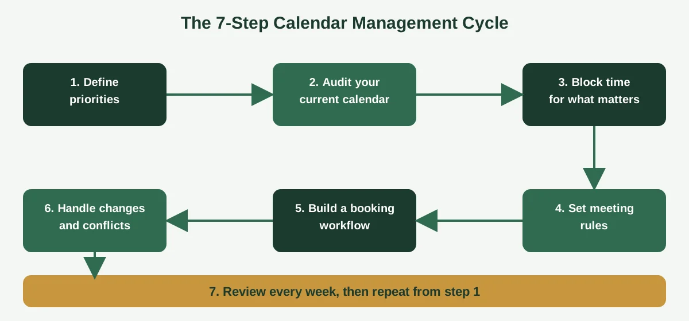
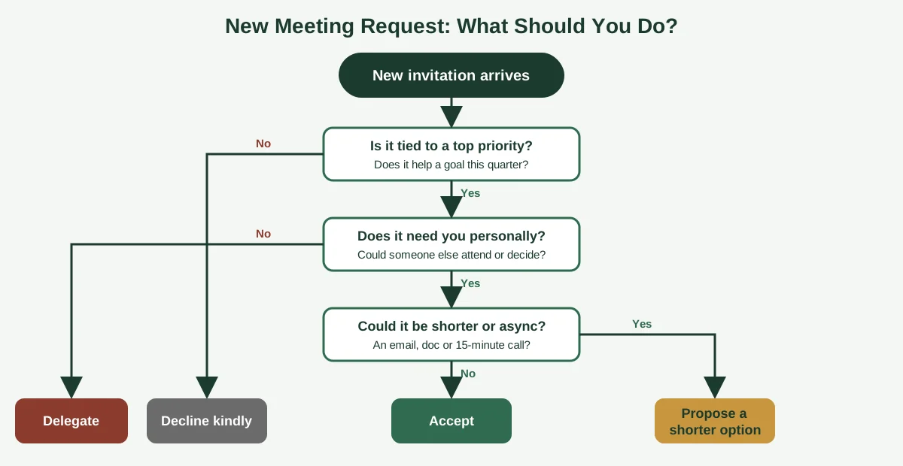

Open your calendar right now and count the meetings you actually chose. Not the ones you said yes to out of politeness, or the ones that landed with a video link and no agenda. Just the ones you would book again on purpose.

If that number is smaller than you'd like, you're in good company, and it's fixable! That's the whole point of calendar management. Done well, it turns your schedule from a pile of other people's requests into a plan that protects your best hours, your focus time and your evenings.

This guide gives you a plain-English answer to **what is calendar management**, real examples, a seven-step method, best practices, the mistakes that wreck good calendars, and a clear sign for when it's time to hand the job to someone else. If you lead a team, run a business or support a busy executive, you'll find something to use today.

## What Is Calendar Management? A Simple Definition

**Calendar management is the practice of planning, organizing and protecting your time on a calendar so your commitments, priorities and availability line up.** It includes scheduling meetings, setting boundaries, resolving conflicts and reviewing what's coming, so nothing catches you off guard.

A calendar is only a tool. Management is the decision-making around it: what earns a slot, how long it gets, what you decline, and what you move.

Think of it like a kitchen. The calendar is the counter space, and calendar management is deciding what gets cooked, in what order, and what never makes it onto the menu at all.

Good calendar management has four jobs:

* **Plan:** decide what matters most this week and put it on the calendar first.
* **Protect:** guard blocks of time for deep work, rest and the tasks only you can do.
* **Coordinate:** schedule meetings, handle time zones and keep other people's calendars in view.
* **Adjust:** reschedule, decline and re-plan when things change, which they always do.

Many people treat the calendar like a record of what already happened to them. Strong calendar management flips that. Your calendar becomes a plan you wrote on purpose, and meetings have to fit around your priorities instead of the other way around.

You'll also hear the term used in a business setting, where it often means managing someone else's calendar. That's the daily work of executive assistants and virtual assistants, who keep a leader's schedule clean, conflict-free and tied to their goals. We'll cover that in the executive calendar management section below.

Is it the same as time management? Not quite, and we'll untangle the two in a moment. For now, remember this: time management is the big skill of choosing how to spend your hours, and calendar management is the part where those choices get written down and defended.

One more thing worth saying early. Calendar management isn't about packing every hour. A calendar with no gaps has no room for surprises, thinking time or a real lunch. The best calendars have white space on purpose.

## Why Calendar Management Matters for Founders and Executives

When you're the decision-maker, your time is the scarcest thing in the business. Every hour in a low-value meeting is an hour not spent on the things only you can do, like hiring, strategy, key clients and big decisions.

Here's what changes when calendar management is working.

**You get your focus back.** Long blocks of uninterrupted time make hard work possible. If your day is cut into 30-minute fragments, you'll spend most of it switching between tasks and very little of it finishing anything.

**You stop double-booking yourself.** Conflicts, missed calls and "sorry, I thought that was next week" moments damage trust fast. A clean calendar helps you show up on time and prepared.

**You make better use of meetings.** When every meeting needs a purpose, a length and a clear next step, you'll find that a surprising number of them can be an email. Fewer, better meetings is a win for everyone involved.

**You reduce stress.** Part of the tiredness leaders feel comes from carrying the schedule in their heads. Writing it down and trusting a system frees up mental space.

**You protect the rest of your life.** Without boundaries, work slides into mornings, evenings and weekends. Calendar management is how you say "this time is taken" without having to argue about it every week.

Picture a founder whose day runs through a crowded inbox. Calls get booked by email ping-pong, time zones get mixed up, and a partner call lands on top of a client deadline. None of those problems is huge on its own. Together, they eat the first half of every day.

That's the pattern we see most often with small, growing businesses. The business works, but the calendar has become a bottleneck, and the founder is the only one who can fix it.

The good news is that you don't need a perfect system. You need a few clear rules, a weekly habit and, at some point, maybe a helping hand.

## Examples of Calendar Management in Real Life

People often ask for examples because the phrase sounds abstract. In practice, calendar management shows up in small, concrete habits. Here are six you can spot in a good schedule.

**1. Time blocking.** You reserve blocks for specific work, like "Proposal writing, 9:00 to 11:00," and treat them like meetings with yourself. Others see you as busy, because you are.

**2. Batching similar meetings.** Instead of scattering calls across the week, you put all your one-on-ones on Tuesday afternoon. That leaves Monday, Wednesday and Thursday mornings free for focused work.

**3. Adding buffer time.** You leave 10 to 15 minutes between meetings for notes, a quick break or a delay. Back-to-back calls feel efficient until the first one runs over.

**4. Handling time zones on purpose.** When you work with clients in other regions, you set your working hours in the calendar and offer windows that suit both sides. No more "wait, is that 3 p.m. mine or yours?"

**5. Color-coding.** Client calls are green, internal meetings are blue, focus time is grey. One glance tells you what kind of week you're having.

**6. Using a scheduling link.** You share a booking link with set availability, so people pick a time without a dozen emails. Meeting types can have different lengths and rules.

There's a delegated version of all this too. A virtual executive assistant might triage new invitations, hold tentative slots, send agendas the day before, and remind you of follow-ups after each call.

For a real-world sketch of that kind of support, take a look at the founder calendar and partnership example on our [case studies](https://insyncea.com/case-studies/) page. It shows how scheduling, reminders and follow-ups were handled so a founder could stay on strategic work.

Notice that none of these examples needs fancy software. A free calendar app and a few agreed habits will take you a long way. The skill is in the choices, not the tool.

If you're wondering which example to try first, start with time blocking. It's the simplest change, and it gives you protected hours right away.

## Calendar Management vs Time Management, Scheduling and Meeting Management

These four terms get tossed around as if they mean the same thing. They overlap, but each one has a different job. Here's how they fit together.

| Term                    | What it means                                                  | Main question it answers                               |
| ----------------------- | -------------------------------------------------------------- | ------------------------------------------------------ |
| **Time management**     | Choosing how to spend your time across goals and tasks         | "What should I be doing with my hours?"                |
| **Calendar management** | Planning, protecting and adjusting your schedule on a calendar | "Is my calendar a true picture of my priorities?"      |
| **Scheduling**          | Finding and booking a time for a specific event                | "When can this meeting happen?"                        |
| **Meeting management**  | Running meetings well, before, during and after                | "Is this meeting worth having, and what happens next?" |

Time management sits on top. It's the skill of deciding what matters, and you can practice it with a paper list and no calendar at all.

Calendar management is the working layer in the middle. It takes your priorities and turns them into booked time, boundaries and routines.

Scheduling is the narrow task of finding a slot. It's one piece of calendar management, and it's the piece that scheduling tools do well. Good calendar management goes further by asking whether the meeting should exist at all.

Meeting management covers what happens inside the time you booked: the agenda, who attends, how it ends and who follows up. A beautifully managed calendar can still be full of badly run meetings.

Here's a quick way to remember the difference. Time management decides, calendar management plans, scheduling books and meeting management runs.

You can see why people mix them up. In daily life they happen almost at once. You decide a project matters, block time for it, find a slot with a colleague, and run the meeting.

Where it matters is when something goes wrong. If your calendar is chaotic but your priorities are clear, you have a calendar management problem. If your calendar is neat but you're working on the wrong things, you have a time management problem.

That's a useful check when you're trying to figure out what to fix first.

## How to Manage Your Calendar in 7 Steps

There's no single official method, but this seven-step approach works for most founders, executives and small teams. It moves from deciding what matters to keeping the habit alive.

### Step 1: Define your top priorities

Write down the three to five things that matter most this quarter. If it's not on that list, it shouldn't take up much calendar space.

### Step 2: Audit your current calendar

Look at the last two to four weeks. Mark each meeting as valuable, necessary or avoidable, and note where your time really went.

Most people find a few recurring meetings that nobody remembers starting. Those are easy wins.

### Step 3: Block time for what matters

Put your priorities on the calendar first. Add focus blocks, admin time, planning time and breaks before other people's requests fill the gaps.

### Step 4: Set simple meeting rules

Decide your defaults, like 25 or 50 minutes instead of 30 or 60, no meetings before 10 a.m., and Fridays kept light. Rules make it easy to say yes, no or "how about Thursday?"

### Step 5: Build a booking workflow

Decide how requests reach you and who approves them. A short workflow, such as invitation arrives, it's checked against your rules, then accepted, declined or proposed a new time, saves endless back-and-forth. Our guide on [how to create workflows](https://insyncea.com/blog/how-to-create-workflows/) shows how to map a process like this in plain steps.

### Step 6: Handle changes and conflicts

Things will move. Decide in advance what wins in a clash, such as client commitments over internal meetings, and who is allowed to move what.

### Step 7: Review every week

Spend 15 minutes on Friday or Sunday looking at the week ahead. Check for conflicts, missing prep time and meetings with no purpose, then fix them while there's still time.

That weekly review is the habit that keeps everything else working. Skip it and the calendar slowly drifts back to chaos.

Start small. Pick one step this week, probably step 3 or step 7, and add the next one when the first feels normal.

## Calendar Management Best Practices

Once the basics are in place, these habits keep your calendar working for you. Treat them as a menu, not a rulebook, and pick what fits your work.

**Put your own priorities in first.** If you wait until the calendar fills up, you'll find no room left for the work that moves your business forward.

**Give every meeting a purpose.** An invitation should say why the meeting exists and what a good outcome looks like. If nobody can say, question it.

**Use shorter default meeting lengths.** Meetings tend to expand to fill the time you give them. Setting 25 or 50 minutes gives you a natural pause between calls.

**Protect your best hours.** Notice when you do your sharpest thinking and guard that window. Put meetings in the slots where your energy is average.

**Keep one source of truth.** If you run work and personal calendars, sync them so a free slot is truly free. Double-booking often comes from two calendars that don't talk to each other.

**Share your rules.** People respect boundaries they can see. A short note about your preferred meeting days and response times prevents most awkward requests.

**Prepare the day before.** Check tomorrow's calendar at the end of today, so you start each morning knowing what's ahead.

If you want to turn your habits into something repeatable, write them down. Our guide to [building business systems for growth](https://insyncea.com/blog/business-systems-for-growth/) walks through how to turn a loose habit into a clear, owned routine anyone can follow.

Here's a short checklist you can copy into your weekly review.

| Weekly review check                                | Done? |
| -------------------------------------------------- | ----- |
| Top three priorities have blocked time             | ✅     |
| No unexplained double-bookings                     | ✅     |
| Every meeting has a purpose or agenda              | ✅     |
| Buffer time sits between back-to-back calls        | ✅     |
| Time zones are right for all external calls        | ✅     |
| Focus blocks are protected for next week           | ✅     |
| Follow-ups from last week's meetings are scheduled | ✅     |

The decision tree below is also worth keeping close. It helps you decide quickly what to do with any new meeting request, so you aren't relying on willpower in the moment.

Run each new invitation through those questions. Over a few weeks, you'll find yourself saying a kind, clear "no" much more often.

## Executive Calendar Management: What Changes at the Top

Executive calendar management is the same craft with higher stakes. A CEO's or founder's hour is worth more, their calendar has more people trying to claim it, and a scheduling slip can cost a deal or a relationship.

Here's what's different.

**Priorities come from the top.** An executive calendar has to reflect the company's goals, not just the leader's habits. Board meetings, investor updates and key client calls outrank almost everything else.

**Gatekeeping matters.** Someone has to decide which requests get through, which get redirected and which get a polite no. That takes judgment and a clear understanding of the leader's preferences.

**There are more moving parts.** Travel, time zones, prep time, follow-ups and several calendars all have to line up. One missed detail can ripple through a whole week.

**Confidentiality is part of the job.** A calendar shows who a leader is talking to and what's coming. Anyone managing it needs to treat that information carefully.

This is why executive level calendar management is usually shared with an executive assistant. A good EA doesn't just book meetings. They know the leader's priorities, protect their focus time, prepare them for each call and make sure follow-ups happen.

Many of the same skills apply if you're a CEO managing your own calendar for now. Start with the priorities, add the rules, and decide what you would hand over first.

If you work as an executive assistant yourself, the craft is about anticipating needs. You're watching the week ahead, spotting conflicts early and keeping a leader ready without them having to ask. We'll go deeper on that in our upcoming guides for EAs.

And if you're the leader, a simple test helps. If you can't answer "what's my calendar protecting this week?" in one sentence, it's probably time to tighten the rules or bring in support.

For businesses that want that support without a full-time hire, our [executive assistant support](https://insyncea.com/services/executive-support/) covers calendar and inbox management, meeting coordination, travel and follow-ups.

## Common Calendar Management Mistakes

Most calendar problems come from a handful of repeat mistakes. Here are the ones to watch for, along with a quick fix for each.

**1. Saying yes by default.** If every invitation gets accepted, your calendar belongs to everyone but you. Pause before accepting, and use the decision tree above.

**2. Scheduling back-to-back.** Moving from call to call with no break means notes don't get written and late starts snowball. Add buffer time.

**3. Leaving no room for deep work.** When your day is all meetings, the real work gets pushed into evenings. Block focus time first.

**4. Ignoring time zones.** Mixing up a time zone is a fast way to look unprepared. Set your calendar's time zone and working hours, and double-check external invitations.

**5. Keeping several unsynced calendars.** A work calendar, a personal calendar and a team calendar that don't talk to each other lead to double-bookings. Sync or share them.

**6. Skipping the weekly review.** Without it, small problems pile up unnoticed until Monday morning hits.

**7. Treating every request as urgent.** Not every ask deserves a slot this week. Use "next week" and "async" more often.

**8. Planning for the perfect day.** Things run late. If your calendar has no slack, one delay will derail the rest of the day, so plan for reality.

Notice how many of these come back to the same root cause, which is the lack of a few simple rules. When you decide your defaults in advance, you stop making the same judgment call forty times a week.

If you catch yourself in three or more of these, don't panic. Pick one, fix it this week, and move on to the next.

## Calendar Management Tools: What You Actually Need

You don't need a stack of apps. Most people do fine with a few well-used basics.

**A main calendar.** Google Calendar and Microsoft Outlook both handle shared calendars, working hours, color-coding, reminders and multiple time zones. Pick the one your team already uses.

**A scheduling link.** Tools such as Calendly let others book time from your set availability, which cuts the email back-and-forth. Use different link types for different meetings, like a 20-minute intro and a 50-minute working session.

**A task or notes tool.** Calendar blocks tell you when to work. A task list or notes app, such as Asana, Trello or Notion, tells you what to work on inside the block.

**A video meeting tool.** Make sure invitations include the link automatically, so nobody hunts for it five minutes before a call.

A few things matter more than which brand you pick. Check that your calendar tools sync, that access is limited to the people who need it, and that you use strong passwords and sharing settings, since calendars hold sensitive information.

Before you add any tool, ask what problem it solves. A new app on top of a messy habit just gives you a messy habit with more logins.

We'll compare specific options in a future guide, but the rule is simple. Choose the simplest setup that fits how you really work, and only add something when you hit a real limit.

## When to Hand Your Calendar to a Virtual Assistant

At some point, managing your calendar is itself a time drain. That's the moment to think about handing it off.

**A calendar management virtual assistant is a remote professional who manages your schedule for you,** including booking and rescheduling meetings, protecting focus time, coordinating time zones, sending reminders and following up afterwards. They work inside your calendar and inbox with the access you give them and the rules you set.

It's a good fit when you notice signs like these:

* Your inbox and calendar eat the first half of your day
* Meetings keep getting double-booked or rescheduled at the last minute
* Follow-ups slip through the cracks
* You're the only person who knows how your schedule works
* You've started working evenings to catch up on real work

A virtual executive assistant goes beyond booking. They tend to own the follow-through, anticipate what's coming and decide within your guidelines, so you aren't the one chasing details.

What does it cost? That depends on the hours you need. At InSyncEA, support starts at $10 per hour, with part-time retainers from 20 hours a month. 

Before you hand anything over, write down your rules. The preferences, priorities, meeting lengths and who can book you are the playbook your assistant works from. If you haven't documented them yet, our [business operations support](https://insyncea.com/services/business-operations-support/) can help turn them into a simple SOP.

The best handoffs start small. Begin with scheduling and inbox triage, check in weekly, and widen the scope as trust builds.

If you'd like to talk it through, you can [book a discovery call](https://insyncea.com/contact/#book) and tell me what's taking up your time.

## FAQ

### What is calendar management?

Calendar management is the practice of planning, organizing and protecting your time on a calendar so your commitments, priorities and availability line up. It includes scheduling meetings, setting boundaries, resolving conflicts and reviewing your week.

### What are examples of calendar management?

Common examples include time blocking for focused work, batching similar meetings on one day, adding buffer time between calls, color-coding events, setting working hours across time zones, and using a scheduling link so others can book you without emails.

### What is a calendar management virtual assistant?

A calendar management virtual assistant is a remote professional who handles your schedule for you. They book and reschedule meetings, protect your focus time, coordinate time zones, send reminders and follow up after calls, working within your rules.

### What are the four types of calendars?

There's no official list of four. In history, calendars are usually grouped as solar, lunar and lunisolar. At work, people usually mean personal, shared team, project or master, and booking calendars. If you mean scheduling, those four work calendars are the ones to manage.

### What are the 7 steps of time management?

There's no single official list, and versions vary. A practical one is to set goals, rank priorities, plan your week, schedule your time, delegate, limit distractions and review. Calendar management covers the scheduling and review steps.

### How often should I review my calendar?

A short weekly review of 15 minutes is enough for most people. Add a quick look at the next day each evening, so you start the morning knowing what's ahead.

### Is calendar management the same as time management?

No. Time management is choosing how to spend your time across goals and tasks. Calendar management is the part where those choices are planned, protected and adjusted on your calendar.

## Conclusion

Calendar management isn't about cramming more into your week. It's about making sure the hours you have go to the things that matter, and that nobody else decides that for you by default.

To recap, define your priorities, audit your week, block time for what matters, set simple meeting rules, build a booking routine, plan for changes and review weekly. Add a decision tree for new requests, and you'll say yes to the right things far more often.

Make it your own. A founder with client calls in three time zones needs different rules from a team lead with a steady weekly rhythm, so adjust these steps to fit how you really work.

And remember that a calendar holds sensitive information. Whoever has access, whether that's a team member or an assistant, should have only what they need and a clear understanding that it stays confidential.

If your calendar has become a job of its own, you don't have to carry it alone. Explore our [executive assistant support](https://insyncea.com/services/executive-support/) or [book a discovery call](https://insyncea.com/contact/#book) to talk through what you'd like off your plate.

Got a calendar habit that saved your week? Share it with us. We'd love to hear what works for you.