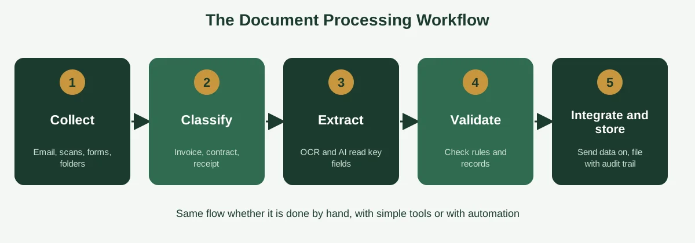
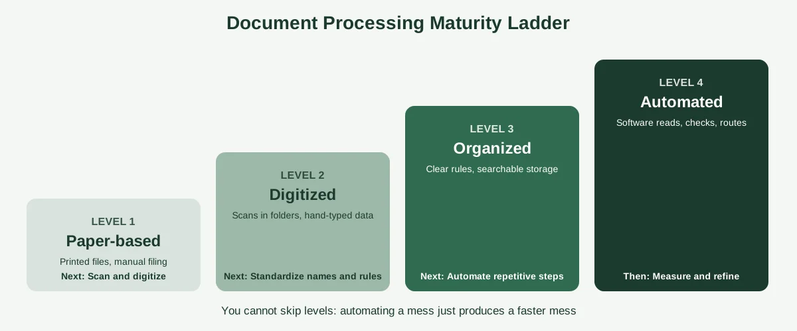

Follow a single purchase order around your business for a week, and you'll probably find it lives in six places. An email attachment. A printed copy on someone's desk. A photo on a phone. A line in a spreadsheet. A folder on the shared drive named "Orders (new)". And, eventually, the accounting system, typed in by hand.

Each of those copies is a chance for something to go missing, get mistyped or fall out of date. Fixing that is what document processing is about: getting information out of documents and into the right place, accurately and without a scavenger hunt.

This guide explains what document processing is, how the workflow runs from capture to storage and which documents it covers. You'll also see examples by department, the problems that slow most businesses down, a practical eight-step improvement plan, tool categories and even what a document processing job involves. If you're also thinking about automation, our guide to [document process automation](https://insyncea.com/blog/document-process-automation/) picks up where this one leaves off.

## What Is Document Processing?

**Document processing is the set of steps a business uses to capture, organize, read, check and store documents so the information inside them can be used in day-to-day work.** It turns paper, scans, PDFs, emails and forms into structured, searchable data that can flow into your other systems.

Wikipedia describes it as a field of research and a set of production processes aimed at making an analog document digital, which is a handy way to see the core idea. You can read that overview on [Wikipedia's page on document processing](https://en.wikipedia.org/wiki/Document_processing).

Here's the plain-language version. A customer sends an invoice. Document processing is everything that happens between "it arrived" and "the amount is in the books, and the file is stored where anyone can find it."

You'll also hear the phrase used in an older sense. In office and secretarial training, "document processing" often means creating, editing, formatting and printing documents with word processing software. Both meanings are valid, but this guide focuses on the business meaning: handling the documents that flow through your organization.

### How it differs from related terms

These terms overlap, and people mix them up constantly.

| Term                            | What it focuses on                                       | Example                                                    |
| ------------------------------- | -------------------------------------------------------- | ---------------------------------------------------------- |
| **Document processing**         | Capturing, reading, checking and storing documents       | Extracting the total from a supplier invoice and filing it |
| **Document management**         | Storing, organizing and retrieving documents             | A shared drive with folder rules and search                |
| **Document automation**         | Creating documents from templates and data               | A contract generated from a client record                  |
| **Document process automation** | Using software to run the whole document flow end to end | An invoice read, matched, approved and filed automatically |
| **Word processing**             | Writing and formatting a document                        | Writing a proposal in Word or Google Docs                  |

Document processing is the practical middle layer. It sits between receiving a document and using what's in it, and you can do it by hand, with simple digital tools or with full automation.

## Types of Documents Businesses Process

Not all documents are equally easy to handle. A useful way to sort them is by how structured they are.

| Type                | What it looks like                   | Examples                                               | How hard to process |
| ------------------- | ------------------------------------ | ------------------------------------------------------ | ------------------- |
| **Structured**      | Fixed layout, same fields every time | Online forms, spreadsheets, standard application forms | Easiest             |
| **Semi-structured** | Consistent content, varying layout   | Invoices, receipts, purchase orders, bank statements   | Moderate            |
| **Unstructured**    | Free-form text with no fixed layout  | Contracts, emails, letters, reports, meeting notes     | Hardest             |

Structured documents can often be processed with simple rules. Semi-structured ones need smarter reading, since the total might sit in a different spot on each supplier's invoice. Unstructured documents need the most judgment, whether from a person or from AI.

You'll also see documents grouped by purpose, such as financial, legal, HR, operational and customer documents. There's no single official list of document types, so use whichever grouping helps you organize your own work.

The practical lesson is simple: start with your structured and semi-structured documents. They're the most common, and the easiest to improve.

## The Document Processing Workflow: Five Steps

Whether it's done by hand or with software, document processing follows a similar flow.

### 1. Collect

Gather documents from wherever they arrive: email attachments, scanned paper, web forms, shared folders, photos and messages. The aim is to bring them into one place, instead of leaving them scattered.

A simple win here is to agree on a single "front door." For example, all supplier invoices go to one email address, and all signed forms go to one upload folder.

### 2. Classify

Sort each document by type. Is it an invoice, a contract, a receipt or an application? Classification decides what happens next, and it's often done by file name, folder or a quick check. Software can do it by recognizing the layout.

### 3. Extract

Read the information out of the document. For a typed form, that might be copying fields. For scans and images, tools use OCR (optical character recognition) to convert pictures of text into readable characters, and ICR (intelligent character recognition) to handle handwriting. Newer AI tools can also understand context, like telling a due date from an invoice date.

### 4. Validate

Check that the data is right. Does the total match the purchase order? Is the supplier in your records? Is the date in a valid format? Anything that doesn't pass gets flagged for a person to look at.

### 5. Integrate and store

Send the clean data to the system that needs it, such as accounting software, a CRM or a database, and store the document in a searchable archive with a clear name and an audit trail.

IBM describes a similar sequence in its overview of [document processing](https://www.ibm.com/blog/document-processing), including the final step of storing the document and its data so they work with your existing applications. It also notes a common challenge: many systems give little visibility into where errors occur, which makes continuous improvement hard. That's worth remembering when you design your own process, so build in a simple way to see what goes wrong.

## Manual, Digital and Automated Document Processing

Most businesses sit somewhere on a ladder, from paper-based to fully automated. Knowing where you are helps you choose your next step.

| Level              | What it looks like                                                       | Typical problems                            | Next step                             |
| ------------------ | ------------------------------------------------------------------------ | ------------------------------------------- | ------------------------------------- |
| **1. Paper-based** | Printed documents, manual filing, handwritten notes                      | Lost papers, slow retrieval, no backup      | Scan and digitize                     |
| **2. Digitized**   | Scans and PDFs saved in folders, data typed in by hand                   | Inconsistent names, duplicate entry, errors | Standardize naming, folders and rules |
| **3. Organized**   | Clear structure, shared rules, searchable storage, checklists            | Repetitive typing and slow approvals        | Automate the repetitive steps         |
| **4. Automated**   | Software captures, reads, checks and routes documents, with human review | Setup effort, tool maintenance              | Measure and refine                    |

The key point is that you can't skip levels. Automating a messy folder of badly named scans gives you messy data faster. Get level three right, and level four becomes much easier.

If you're wondering where to begin, our guide to [process documentation](https://insyncea.com/blog/process-documentation/) shows how to write down the steps, so you can see what you're improving.

## Document Processing Examples by Department

Document processing shows up everywhere in a business. Here are some of the most common examples.

| Department                    | Documents                                                    | What processing involves                                                |
| ----------------------------- | ------------------------------------------------------------ | ----------------------------------------------------------------------- |
| **Finance**                   | Supplier invoices, receipts, bank statements, expense claims | Capturing amounts, matching to orders, approving, posting to accounting |
| **HR**                        | Applications, CVs, contracts, ID documents, leave forms      | Collecting, checking, filing securely, updating records                 |
| **Sales and client services** | Quotes, proposals, signed agreements, intake forms           | Capturing client details, routing for signature, updating the CRM       |
| **Operations and logistics**  | Purchase orders, delivery notes, shipping documents          | Matching orders to deliveries, updating stock, flagging discrepancies   |
| **Legal and compliance**      | Contracts, policies, certificates, audit records             | Tracking versions, renewals and approvals, storing with access controls |
| **Customer support**          | Emails, forms, complaint letters, warranty claims            | Logging, categorizing, routing and responding                           |

Industries with heavy paperwork lean on document processing even more. IBM's examples include insurance, where forms are read to verify coverage and eligibility, and mortgage lending, where huge volumes of paper must be retrieved and filed quickly.

For small businesses, the most common starting points are invoices, expense receipts, onboarding paperwork and client intake forms. Our guide to [process documentation examples](https://insyncea.com/blog/process-documentation-examples/) includes step-by-step versions of several of them.

## Common Document Processing Problems (and How to Fix Them)

Most businesses run into the same handful of issues. Here's what they look like, and what to do about them.

| Problem                        | What it looks like                                        | Fix                                                                   |
| ------------------------------ | --------------------------------------------------------- | --------------------------------------------------------------------- |
| **Scattered documents**        | Files live in email, drives, desktops and phones          | Pick one storage location and one "front door" for each document type |
| **Inconsistent naming**        | "Invoice final," "Invoice final 2," "Invoice FINAL (new)" | Agree on a naming rule, such as date, supplier and number             |
| **Duplicate data entry**       | The same details are typed into several systems           | Enter once, and connect systems or use import tools                   |
| **Version chaos**              | Nobody knows which copy is current                        | Keep one live copy, and use version history                           |
| **Slow approvals**             | Documents wait in inboxes                                 | Define who approves what, set time limits and use reminders           |
| **Errors and rework**          | Typos, missing fields, mismatched totals                  | Add validation checks, and review exceptions                          |
| **Lost or hard-to-find files** | Searching takes minutes, or fails                         | Use clear folders, consistent names and searchable storage            |
| **Security gaps**              | Sensitive files shared too widely                         | Limit access, use permissions and keep an audit trail                 |
| **No visibility**              | You can't tell where delays or errors happen              | Track turnaround time and common errors                               |

Notice that most of these have nothing to do with fancy software. They're about clear rules and consistent habits, and that's good news, because they cost almost nothing to fix.

If you'd like to see how these small gaps add up across a growing company, our guide to [business operations challenges](https://insyncea.com/blog/business-operations-challenges/) covers the wider picture.

## How to Improve Your Document Processing in 8 Steps

You don't need a big project. This sequence works for most small businesses.

### Step 1: List your documents

Write down the main types of documents your business handles, who receives them, where they end up and roughly how many arrive each month.

### Step 2: Pick the one that hurts most

Choose a document type that's frequent, error-prone or slow. Supplier invoices are a classic choice.

### Step 3: Map the current journey

Follow one document from arrival to storage. Note every handoff, every system it touches and every time someone retypes something.

### Step 4: Create a single front door

Decide where each type of document should arrive: a shared inbox, an upload form or a scanning station. Tell suppliers and clients where to send things.

### Step 5: Standardize names, folders and rules

Agree on a simple naming pattern and folder structure, and document them. Something like "2026-03-14_SupplierName_Invoice-1042" is easy to sort and search.

### Step 6: Add checks

Decide what must be true before a document is accepted: required fields, approval limits, matching rules. Write them down as a short checklist. Our [process template](https://insyncea.com/blog/process-template/) guide has formats you can copy.

### Step 7: Digitize and reduce typing

Scan paper at the start, not the end. Use import tools, forms and integrations to cut manual entry, and let software handle the repetitive parts where it makes sense.

### Step 8: Measure and review

Track how long a document takes from arrival to storage, how many need rework and where they get stuck. Review it monthly, and adjust.

When the basics are working, it's the right time to think about automation. And if you want to see how this fits into the bigger picture of running a business smoothly, our guide to [building business systems for growth](https://insyncea.com/blog/business-systems-for-growth/) is a good next read.

## Document Processing Tools and Software

You can do document processing with almost any tool, from a folder and a spreadsheet to enterprise platforms. Here are the main categories, from simple to advanced.

| Category                                  | What it does                                                  | Examples                                          |
| ----------------------------------------- | ------------------------------------------------------------- | ------------------------------------------------- |
| **Word processors and editors**           | Create, edit and format documents                             | Microsoft Word, Google Docs                       |
| **Scanning and capture apps**             | Turn paper into digital files                                 | Phone scanning apps, desktop scanners             |
| **OCR and text extraction**               | Read text from scans and images                               | Cloud services such as Amazon Textract            |
| **Email and PDF parsers**                 | Pull data out of emails and PDFs into spreadsheets or apps    | Tools such as Parseur                             |
| **Intelligent document processing (IDP)** | Classify documents, extract fields and learn from corrections | Platforms such as IBM, ABBYY, DocuWare and Hyland |
| **Workflow and no-code automation**       | Route documents and connect apps                              | Microsoft Power Automate, Zapier, Make            |
| **Document management systems**           | Store, search and control access to files                     | SharePoint, Box, Google Drive                     |

### Which app is best for documents?

It depends on the job. For writing and editing, Microsoft Word and Google Docs are the most widely used, and the better one is usually whichever your team already shares. For capturing and extracting data, you'll want OCR or IDP tools. For storing and finding files, a document management system.

### Which software is used for document processing?

There's no single answer. Small businesses often combine a word processor, a shared drive, a scanning app and a workflow tool such as Microsoft Power Automate. Larger organizations add IDP platforms.

### What about AI?

AI has improved extraction, especially for messy layouts and handwriting, and it keeps getting better. A few honest notes:

* **Test on your own documents.** Results vary by document type, quality and language.
* **Keep a human check.** Anything involving money, contracts or personal data should be reviewed.
* **Check privacy terms.** Don't upload confidential files to any tool without understanding where the data goes.

Pricing and features change quickly, so check current details on each vendor's site, and test with real samples before committing.

## Document Processing Jobs, Duties and Skills

People also search for document processing jobs and specialists, so it's worth explaining the role. Titles vary, and you'll see document processor, data entry clerk, records clerk, document specialist or back-office administrator.

### What does a document processor do?

Typical duties include:

* Receiving, sorting and logging incoming documents
* Scanning paper and checking image quality
* Entering or verifying data in business systems
* Checking documents for completeness and accuracy
* Naming, indexing and filing documents correctly
* Flagging errors, missing information or duplicates
* Retrieving documents for colleagues and clients
* Following retention and confidentiality rules

### What skills matter most?

The most valued skills are attention to detail, accuracy, organization, reliable typing and data entry, comfort with office software and databases, clear communication and discretion with sensitive information. Increasingly, knowing how to review and correct the output of automated tools is part of the job too.

### What if you don't have someone for this?

For many small businesses, document handling is spread across several people, and it quietly eats hours. A dedicated person, even part-time, can take it over, set up the rules and keep things consistent. That's one of the most common reasons owners bring in administrative support.

## Security, Privacy and Retention

Documents often contain financial details, personal information and confidential agreements, so protect them as you improve how you process them.

* **Limit access.** Give people only the permissions they need, and review them regularly.
* **Use secure storage.** Choose tools with encryption, access controls and an audit trail.
* **Turn on two-step verification.** Do it for email, storage and any connected apps.
* **Don't share files by email when you can avoid it.** Use shared links with permissions instead.
* **Set retention rules.** Decide how long to keep each document type, and how to dispose of it safely. Some records have legal minimums, so check what applies to your business and location.
* **Handle paper carefully.** Shred what you no longer need, and keep sensitive paper locked away.

If you're unsure about legal requirements for a specific document type, it's worth checking with a qualified professional.

## Need Help With Document Processing?

If documents are eating your team's time, you don't have to fix it alone. Mapping how documents move, setting up naming and folder rules, and building a simple routine often makes a bigger difference than any new software.

Our [administrative support](https://insyncea.com/services/administrative-support/) can take on document-heavy work like data entry, filing and reporting, and our [business operations support](https://insyncea.com/services/business-operations-support/) can help you design and document the process behind it. You can also [book a discovery call](https://insyncea.com/contact/#book) and tell us where your documents are causing the most trouble.

## FAQ

### What is document processing?

Document processing is the set of steps a business uses to capture, organize, read, check and store documents so the information inside them can be used. It turns paper, scans, PDFs and emails into structured, searchable data.

### What are the steps in document processing?

The usual steps are collecting documents, classifying them, extracting the data, validating it and then integrating the data into your systems and storing the document. Some versions add pre-processing, such as cleaning up scans, at the start.

### What is the difference between document processing and document management?

Document processing focuses on capturing, reading and checking documents so their data can be used. Document management focuses on storing, organizing, securing and retrieving them. Most businesses need both.

### What is intelligent document processing (IDP)?

IDP uses AI and machine learning to classify documents, extract information and validate data, including from unstructured and semi-structured files. It goes beyond basic OCR by understanding context.

### What is OCR?

OCR, or optical character recognition, converts images of text, such as scans and photos, into machine-readable characters. It reads the letters but doesn't understand what they mean.

### What are some examples of document processing?

Examples include extracting totals from supplier invoices, capturing details from expense receipts, filing signed contracts, reading application forms, logging purchase orders and updating records from client intake forms.

### Which software is used for document processing?

It depends on the task. Word processors such as Microsoft Word and Google Docs create documents. Scanning apps and OCR services capture them. Workflow tools such as Microsoft Power Automate route them, and document management systems store them. IDP platforms combine several of these.

### Which AI is best for document processing?

There's no single best option. Accuracy depends on your documents, so test a few candidates on real samples, check privacy terms and keep a human review step for important items.

### What are the four types of documents?

There's no single official list. One common grouping, for business records, is financial, legal, HR and operational documents. Another sorts them by structure into structured, semi-structured and unstructured.

### What are the four main types of software documentation?

Lists vary by source. One common grouping is requirements, design, technical and user documentation. Some frameworks instead use tutorials, how-to guides, reference and explanation.

### What are the duties of a document processor?

They receive, sort, scan, enter, verify, index and file documents, check them for accuracy and completeness, flag errors and retrieve files when needed, while following confidentiality rules.

### What is the best way to document processes?

Choose one specific process, define where it starts and ends, involve the person who does the work, capture the real steps and write them in plain numbered language. Then test the draft with someone new, and give it an owner and a review date. Our guide to process documentation covers this in detail.

### What are the 5 principles of good documentation?

A practical set is clear, complete, consistent, correct and current. Many people also add concise and accessible.

## Conclusion

Document processing isn't glamorous, but it quietly decides how smoothly a business runs. When documents are captured in one place, read accurately, checked against clear rules and stored where anyone can find them, everything downstream gets easier.

To recap, understand the five steps of the workflow, know whether your documents are structured, semi-structured or unstructured and spot where you sit on the maturity ladder. Fix the basics first with a single front door, clear naming, simple checks and a monthly review, and only then bring in automation.

Make it your own. A two-person consultancy and a growing distribution company will process very different documents, so start with the one that causes the most pain, and build from there.

And treat documents with care. They often hold financial and personal information, so limit access, use secure storage, turn on two-step verification and set sensible retention rules.

If you'd like help getting your documents under control, [book a discovery call](https://insyncea.com/contact/#book) and we'll look at where to start. And if you've found a document habit that saved your team hours, we'd love to hear it.