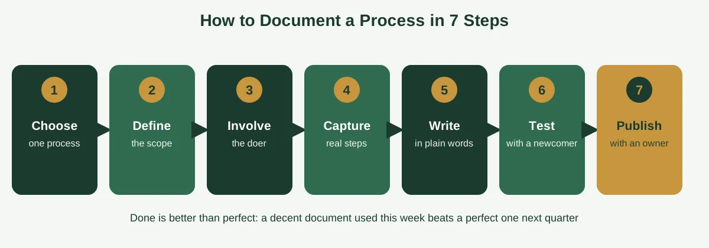
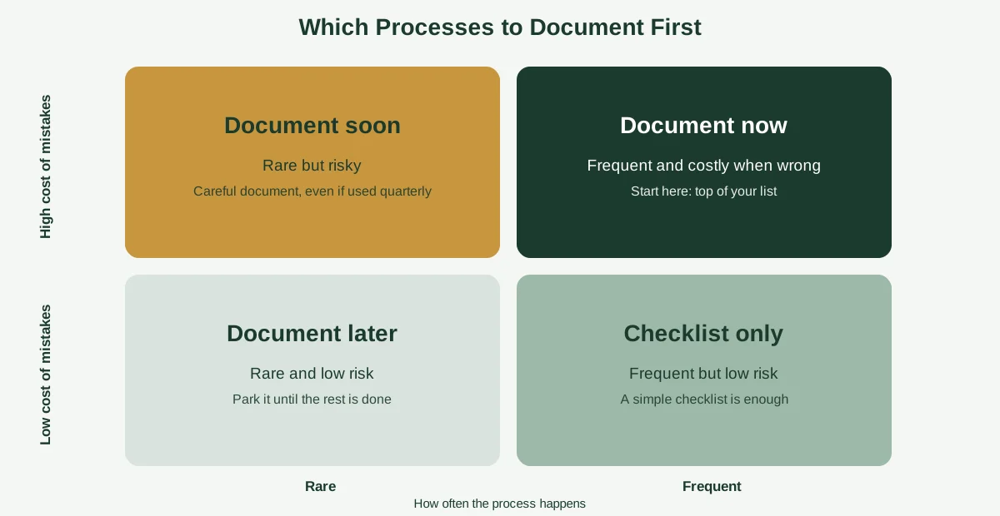

You can tell how well a business is documented by what happens when someone goes on holiday. In a documented business, the work carries on, a colleague opens a page and follows the steps, and nobody sends a panicked message to the one person who "just knows how it works." In an undocumented one, things quietly grind to a halt until that person gets back.

That gap is exactly what process documentation closes. It's not paperwork for its own sake. It's the difference between a business that runs on a few people's memories and one that runs on shared, written know-how anyone can follow.

This guide explains what process documentation is, why small businesses need it, and how it differs from SOPs and workflows. You'll also get a seven-step method, a simple way to decide what to document first, real examples, a template, tool options and the habits that keep documents from going stale. If you'd like the wider picture first, our guide to [building business systems for growth](https://insyncea.com/blog/business-systems-for-growth/) shows where documentation fits.

## What Is Process Documentation?

**Process documentation is a written (or visual) record of how a recurring piece of work gets done, including the steps, who does them, the tools used and what a good result looks like.** It turns knowledge that lives in people's heads into something the whole team can read, follow and improve.

A few common ways to say the same thing: a process document, a procedure, an SOP (standard operating procedure), a runbook, a playbook or workflow documentation. The names differ, but the purpose is the same. Someone who's never done the task should be able to do it correctly by following the page.

Atlassian describes it as detailed, step-by-step guidance that explains how to carry out a process in your organization, and it makes a helpful point for beginners: it's fine to start small and simple. You can read its approach in the [Atlassian guide to process documentation](https://www.atlassian.com/work-management/knowledge-sharing/documentation/process-documentation).

Process documentation can take many forms:

* A written document with numbered steps
* A checklist for tasks that repeat
* A flowchart that shows decisions and branches
* Screenshots with short captions
* A short screen recording with a written summary

The format matters less than the result. A good process document answers four questions: what's the task, who does it, how is it done, and how do we know it's done right?

Here's a quick example. Imagine a small agency that onboards new clients. The process document might say: when a contract is signed, the account manager creates the client folder, sends the welcome email within one business day, books the kickoff call and adds the client to the project board. Each step names who's responsible, which template to use and what "done" looks like.

It's simple, and it's powerful. The next time a new account manager joins, they don't have to guess.

## Why Small Businesses Need Documented Processes

Big organizations document processes because they have to. Small businesses often skip it because they feel too busy. But smaller teams usually have more to gain, because every person carries more knowledge and every absence hurts more.

Here are the main reasons it pays off.

**Consistency.** When everyone follows the same steps, clients get the same quality of service no matter who handles their account. Mistakes drop, because the "right way" is written down.

**Faster onboarding.** New hires and contractors get up to speed from a page, not from weeks of shadowing and repeated questions. It also takes pressure off the people who would otherwise have to train them.

**Easier delegation.** You can't hand off what only you understand. A documented process makes it possible to pass work to a team member, a contractor or a virtual assistant without losing quality.

**Business continuity.** Illness, holidays, resignations and growth all reveal who holds the knowledge. Documentation protects the business from depending on any single person.

**A foundation for improvement.** You can't improve a process you can't see. The UC Berkeley Business Process Management Office makes this case clearly, noting that documentation gives teams a picture of how work is done, which makes continuous improvement efforts much easier. See its page on the [value of process documentation](https://bpm.berkeley.edu/process-documentation).

**Readiness for automation.** Before you automate anything, you need to know exactly what happens today. Documented processes show you which steps are repetitive, and which need human judgment.

**Less stress for you.** If you're the owner and the answer to every "how do we do this?" question, documentation gives you your time and your weekends back.

There's a catch. Documentation only pays off if people actually use it. A 40-page manual nobody reads is worse than no manual at all, because it creates a false sense of security. That's why we'll focus on documents that are short, clear and kept alive.

If you're still getting a feel for the big picture, our guide on [what business operations are](https://insyncea.com/blog/what-are-business-operations/) explains how documented processes fit into the day-to-day running of a company.

## Process Documentation vs SOPs vs Workflows vs Process Maps

These terms get used almost interchangeably, which causes plenty of confusion. They overlap, but each one means something slightly different.

| Term                                   | What it is                                                 | Level of detail    | Example                                                |
| -------------------------------------- | ---------------------------------------------------------- | ------------------ | ------------------------------------------------------ |
| **Process documentation**              | The overall written record of how work gets done           | Varies             | The full set of documents for client onboarding        |
| **SOP (standard operating procedure)** | A detailed set of instructions for one task                | High, step by step | How to set up a new client folder                      |
| **Workflow**                           | The sequence of tasks and handoffs between people or tools | Medium             | Contract signed, then welcome email, then kickoff call |
| **Process map or flowchart**           | A visual diagram of steps and decisions                    | Medium, visual     | A diagram showing the approval path for an invoice     |
| **Checklist**                          | A short list of items to complete or verify                | Low                | Pre-launch website checklist                           |

Think of process documentation as the umbrella. An SOP, a workflow description, a flowchart and a checklist are all forms it can take.

If you want a deeper look at the workflow side, our guides on [how to create workflows](https://insyncea.com/blog/how-to-create-workflows/) and [workflow steps](https://insyncea.com/blog/workflow-steps/) walk through it in plain language.

### What are the four types of documentation?

There's no single universal list, because "documentation" means different things in different fields. In quality and operations work, a common hierarchy runs from top to bottom like this:

1. **Policies** state what the organization commits to and why.
2. **Processes** describe the overall flow of work to meet that goal.
3. **Procedures** (SOPs) give step-by-step instructions for specific tasks.
4. **Work instructions and checklists** provide the fine detail for a single action.

In software, you'll sometimes see a different set of four: tutorials, how-to guides, reference material and explanations. For most small businesses, the first list is the more useful one, and you'll spend most of your time on procedures and checklists.

### What are the two main types of documentation?

A simple split is process documentation, which explains how work gets done, and product or system documentation, which explains how something works, like a piece of software. Another common split is internal documentation, for your team, and external documentation, for customers.

## The Core Elements of a Process Document

A good process document doesn't need to be long. It does need to include a handful of essentials, so that nothing important is left to guesswork.

| Element                      | What to include                                      | Example                                                           |
| ---------------------------- | ---------------------------------------------------- | ----------------------------------------------------------------- |
| **Name and purpose**         | A clear title and one sentence on why it exists      | "New client onboarding: get every client set up within two days"  |
| **Scope and trigger**        | Where it starts, where it ends and what kicks it off | "Starts when the contract is signed; ends after the kickoff call" |
| **Owner**                    | The person responsible for keeping it accurate       | "Operations manager"                                              |
| **Roles**                    | Who does each step                                   | "Account manager, finance, project lead"                          |
| **Inputs and outputs**       | What you need to begin and what you produce          | "Needs: signed contract. Produces: client folder, project board"  |
| **Steps**                    | Numbered, plain-language actions                     | "1. Create the client folder using the template"                  |
| **Decisions and exceptions** | What to do if something goes wrong                   | "If payment isn't received in 5 days, escalate to finance"        |
| **Tools and links**          | Software, templates and shortcuts                    | "Link to the welcome email template"                              |
| **Quality check**            | How to confirm it's done correctly                   | "Client has received the welcome email and booked a call"         |
| **Review date and version**  | When it was last updated                             | "Reviewed 1 March; version 2"                                     |

If you only add two things beyond the steps, make them the owner and the review date. Those two keep a document from quietly rotting.

### What principles make documentation good?

There's no official standard, but you'll often see lists like the "5 C's" or "7 C's" of documentation. They vary by source, so treat them as helpful guidelines. A practical set for process documents looks like this:

* **Clear:** plain language anyone can understand
* **Concise:** as short as it can be while still complete
* **Complete:** nothing important missing
* **Consistent:** the same format and terms across documents
* **Correct:** accurate to how the work is really done
* **Current:** reviewed and updated regularly
* **Accessible:** easy to find when someone needs it

If you remember just one, make it "accessible." A perfect document in a folder nobody can find helps nobody.

## How to Document a Process in 7 Steps

You don't need special software or a big project to start. Here's a straightforward method that works for most small businesses.

### Step 1: Choose one process

Pick something specific and repeatable, not a vague area like "marketing." "Publishing a weekly blog post" is a process. "Marketing" isn't. Start with one, and finish it before starting another.

### Step 2: Define the scope

Decide where the process starts, where it ends and what triggers it. This keeps the document focused, and it stops it from sprawling into neighboring processes.

### Step 3: Involve the person who does the work

The people who do the task every day know what really happens, including the workarounds that never made it into any manual. Ask them to walk you through it, or watch them do it.

### Step 4: Capture the real steps first

Write down what actually happens today, even if it's messy. This is called the "as-is" process. You can improve it later, but you need an honest starting point.

For digital tasks, a short screen recording while the person talks through it can save a lot of time. You can then turn it into written steps.

### Step 5: Write it in plain language

Use short, numbered steps that start with a verb: "Create the client folder," "Send the welcome email," "Book the kickoff call." Add screenshots or a flowchart where they help. Include the exceptions, such as what to do if something goes wrong.

### Step 6: Test it with someone new

Hand the draft to a person who's never done the task, and watch them follow it. Where they hesitate, ask questions or make mistakes, the document needs work. Atlassian recommends getting feedback for the same reason.

### Step 7: Publish it and assign an owner

Store it somewhere easy to find, and give it a named owner and a review date. Then tell the team it exists. A document nobody knows about might as well not exist.

A few notes on timing. A simple process might take an hour to document, and a complex one might take a day. Don't wait for perfection, because a decent document used this week beats a perfect one next quarter.

## Which Processes Should You Document First?

If you try to document everything at once, you'll burn out and give up. A better approach is to rank your processes, and start with the ones that matter most.

Score each candidate on three questions:

1. **How often does it happen?** Tasks that repeat weekly or daily give you the biggest payoff.
2. **How risky is a mistake?** Anything involving money, clients, compliance or security should move up the list.
3. **How much does it hurt today?** If a process causes frequent errors, delays or questions, document it first.

Processes that are frequent and costly when wrong go to the top. Processes that are frequent but low risk can often be a simple checklist. Processes that are rare but risky deserve a careful document, even if you only use them once a quarter. And processes that are rare and low risk can wait.

A quick scoring table helps you compare.

| Process               | Frequency (1 to 5) | Risk (1 to 5) | Pain (1 to 5) | Total |
| --------------------- | ------------------ | ------------- | ------------- | ----- |
| Client onboarding     | 4                  | 4             | 4             | 12    |
| Invoice approval      | 5                  | 5             | 3             | 13    |
| Weekly newsletter     | 3                  | 2             | 2             | 7     |
| Office supplies order | 2                  | 1             | 1             | 4     |

The numbers above are only an example. Use your own, and start with the top two or three.

Another good trigger is the "bus factor" question: if one person disappeared tomorrow, which tasks would be stuck? Those are prime candidates.

## Process Documentation Examples

Abstract advice only goes so far. Here are four short examples showing what documented processes can look like in practice.

### Example 1: Client onboarding

**Purpose:** Get every new client set up within two business days.
**Trigger:** Signed contract.
**Owner:** Account manager.

1. Save the signed contract in the client folder.
2. Create the project on the board using the onboarding template.
3. Send the welcome email within one business day.
4. Book the kickoff call.
5. Add the client to the invoicing system.
6. Confirm everything is complete on the onboarding checklist.

### Example 2: Handling a meeting request

This one comes from calendar work, and it's a great example of a small process with big payoff.

**Purpose:** Decide quickly and consistently which meetings get booked.
**Trigger:** A new meeting invitation arrives.
**Owner:** Executive assistant.

1. Check the request against the priorities and rules.
2. If the person is on the "always book" list, offer two or three times with the time zone.
3. If they're a new contact or vendor, send a short summary to the executive for a yes or no.
4. If it doesn't fit, send a polite decline or suggest another contact.
5. Add prep time and a buffer to anything booked.

Our guide on [how to effectively manage an executive calendar](https://insyncea.com/blog/how-to-manage-an-executive-calendar/) includes a preferences brief that works as a mini process document.

### Example 3: Website maintenance

Recurring maintenance is a classic candidate for a checklist: back up the site, update plugins and themes, check forms and links, review security and test key pages. Our [WordPress website management case study](https://insyncea.com/case-studies/wordpress-website-management/) shows what ongoing site care looks like in practice.

### Example 4: Invoice approval

**Purpose:** Pay suppliers accurately and on time.
**Trigger:** Invoice received.
**Owner:** Finance lead.

1. Log the invoice in the tracker on the day it arrives.
2. Match it to the purchase order.
3. Route it to the budget holder for approval.
4. If it's over the approval limit, escalate to the owner.
5. Schedule payment, and record the date.

Notice that none of these are long. Each fits on a page, names an owner and tells you exactly what to do. That's the standard to aim for.

## Types and Formats of Process Documentation

Different processes suit different formats. Here's how to choose.

| Format                        | Best for                                   | Watch out for                               |
| ----------------------------- | ------------------------------------------ | ------------------------------------------- |
| **Numbered steps**            | Most procedures                            | Becoming too long and wordy                 |
| **Checklist**                 | Tasks that repeat and need a quality check | Skipping the reasons behind steps           |
| **Flowchart**                 | Processes with decisions and branches      | Getting too complicated                     |
| **Screenshots with captions** | Software-based tasks                       | Going out of date when the software changes |
| **Short video**               | Fast-moving digital tasks                  | Hard to search and update                   |
| **Template**                  | Documents you produce repeatedly           | Not explaining when to use it               |

For many small businesses, a mix works best: numbered steps for the core, a flowchart for decisions and a short video for anything fiddly.

What's the main purpose of all this? The three biggest purposes are consistency, training and continuity. Compliance and improvement follow close behind.

## Process Documentation Tools

You can start documenting with the tools you already use. A shared document is enough to begin. When you outgrow it, there are several categories of tools worth knowing.

**Documents and knowledge bases.** Google Docs, Notion, Confluence and internal wikis give you a central place to store and search documents.

**Screen capture and video.** Tools like Loom let you record a task and talk through it, which is fast for capturing fiddly digital steps.

**Diagramming.** Draw.io, Miro and similar tools help you map flowcharts and decision trees.

**Process management platforms.** Dedicated tools such as SweetProcess and Process Street are built for SOPs, checklists and approvals, with ownership and review features built in.

**Project and task tools.** Asana, Trello and ClickUp can turn a documented process into a repeatable checklist or template.

How do you pick? Start with the simplest option your team will actually use. Look for easy search, easy editing, version history and the ability to assign owners and review dates. A tool that's slightly less powerful but gets used beats a fancy one that doesn't.

We'll compare specific tools in more detail in a dedicated guide. For now, remember that the tool is the container. The value is in the clarity of what you write.

## How to Keep Process Documentation Up to Date

Documentation has a nasty habit of decaying. The process changes, the document doesn't, and soon nobody trusts either one. A few habits prevent that.

**Name an owner for every document.** If everyone owns it, no one does.

**Set a review date.** Quarterly or twice a year works for most documents. Put it on the calendar, so it actually happens.

**Make updating easy.** If changing a document feels like a project, nobody will do it. Let anyone suggest edits, and have the owner approve them.

**Keep a short change log.** A line at the bottom saying what changed and when helps people trust the current version.

**Use one home.** Duplicate copies in different places are how outdated versions survive.

**Update after real problems.** When something goes wrong, ask whether the document was missing a step. Fix it right away.

**Retire what you don't use.** Archive documents that no longer apply, rather than letting them clutter the search results.

If you're ever unsure whether a document is useful, ask the team to try following it for real. You'll learn more in ten minutes than in a month of reviews.

## Common Process Documentation Mistakes

Most failed documentation projects fail in the same few ways.

**1. Trying to document everything at once.** Start with two or three processes, and finish them.

**2. Writing for yourself, not the reader.** Skipped steps and insider shorthand leave newcomers lost.

**3. Documenting how it should work, not how it does.** Capture reality first, then improve it.

**4. Making it too long.** If a document is hard to scan, people won't use it. Use numbered steps, short sentences and clear headings.

**5. Burying it somewhere nobody can find.** Keep everything in one searchable place.

**6. Having no owner or review date.** This is the quickest route to out-of-date documents.

**7. Never testing it.** A draft isn't finished until someone new has followed it.

**8. Treating it as a one-off.** Documentation is a habit, not a project.

If these sound familiar, you're not alone. Many operational headaches in a growing company start with gaps like these. Our guide to [business operations challenges](https://insyncea.com/blog/business-operations-challenges/) covers the wider picture, and [how to improve business operations](https://insyncea.com/blog/how-to-improve-business-operations/) shows where to go next.

## When to Get Help With Process Documentation

Documenting processes takes time, and for busy owners it's usually the first thing to slip. That's a good moment to bring in help.

A support partner can interview your team, map the real steps, draft clear documents, build templates and set up a simple review routine. That frees you to focus on running the business, while the knowledge gets captured properly.

Our [business operations support](https://insyncea.com/services/business-operations-support/) helps small businesses document processes, build SOPs, organize workflows and improve how work gets done. If you'd like to talk through where to start, you can [book a discovery call](https://insyncea.com/contact/#book).

## FAQ

### What is process documentation?

Process documentation is a written or visual record of how a recurring piece of work gets done, including the steps, who does them, the tools used and what a good result looks like. It turns knowledge from people's heads into something the whole team can follow.

### What is an example of a process document?

A client onboarding document is a common example. It lists the trigger (a signed contract), the steps (create the folder, send the welcome email, book the kickoff call), who does each one and how to confirm it's done.

### What is the best way to document a process?

Choose one specific process, define where it starts and ends, involve the person who does the work, capture the real steps, write them in plain numbered language, test the draft with someone new and then publish it with an owner and a review date.

### What are the best tools for process documentation?

Start with what you already have, such as Google Docs or Notion. Add a screen recording tool like Loom for digital tasks, a diagramming tool such as Draw.io or Miro for flowcharts, and a process platform like SweetProcess or Process Street if you need ownership and review features.

### What is another word for process document?

Common alternatives include SOP (standard operating procedure), procedure, runbook, playbook, work instruction and workflow documentation.

### What are the 5 C's or 7 C's of documentation?

There's no single official list, and different sources use different words. Commonly cited qualities include clear, concise, complete, consistent, correct, current and accessible. Use them as a quality checklist for your documents.

### What are the principles of documentation?

Good documentation is accurate, clear, complete, consistent, up to date and easy to find. It's written for the person who'll use it, and it has an owner who keeps it current.

### What are the four types of documentation?

In operations and quality work, a common hierarchy is policies, processes, procedures (SOPs) and work instructions or checklists. In software, you may also see tutorials, how-to guides, reference material and explanations.

### What are the three main purposes of documentation?

The main purposes are consistency, so work is done the same way each time; training, so new people can learn quickly; and continuity, so the business keeps running when people are away. Compliance and improvement are also common goals.

### What is the difference between process documentation and an SOP?

Process documentation is the umbrella term for any record of how work gets done. An SOP is one specific form of it, giving detailed step-by-step instructions for a single task.

### How long should a process document be?

As short as it can be while staying complete. Most small-business processes fit on one or two pages. If it's longer, consider splitting it into smaller documents.

### How often should process documentation be reviewed?

Review important documents at least twice a year, and update them whenever the process, the tools or the team changes.

## Conclusion

Process documentation isn't about creating a mountain of manuals. It's about capturing how work gets done in a form that people can actually use, so your business stops depending on a few people's memories.

To recap, start with one important process. Define its scope, involve the person who does the work, capture the real steps, write them plainly and test the draft with someone new. Prioritize by frequency, risk and pain, and give every document an owner and a review date.

Make it your own. A two-person service business and a twenty-person agency will document different things in different ways, so start where the pain is greatest, and grow from there.

And keep one eye on sensitivity. Process documents can contain customer details, access information and internal workflows, so store them carefully, limit access to the people who need it and keep passwords out of the document itself.

If you'd like help getting started, [book a discovery call](https://insyncea.com/contact/#book) and we'll look at which processes to document first. And if you've documented a process that changed how your team works, we'd love to hear about it.